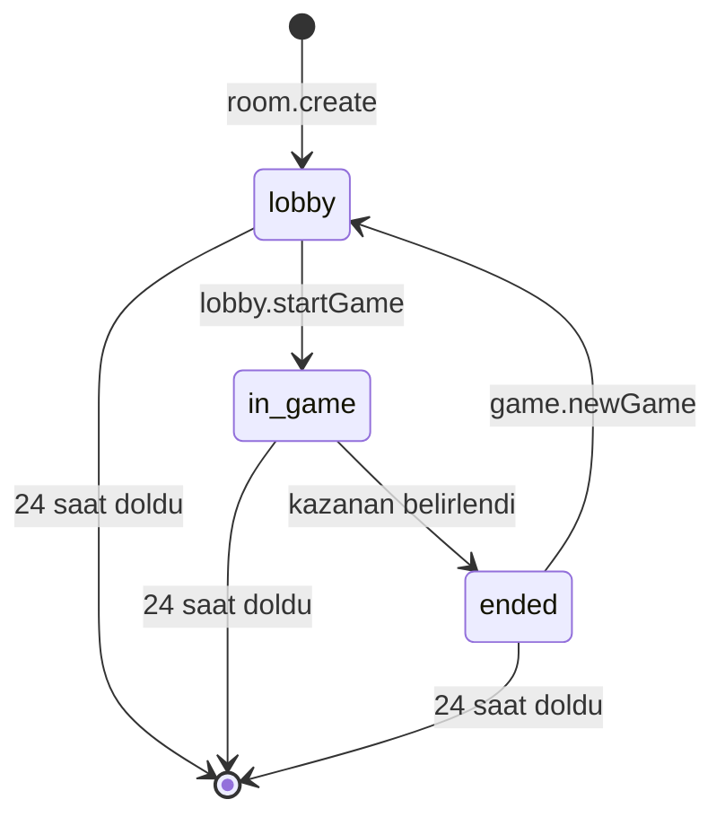
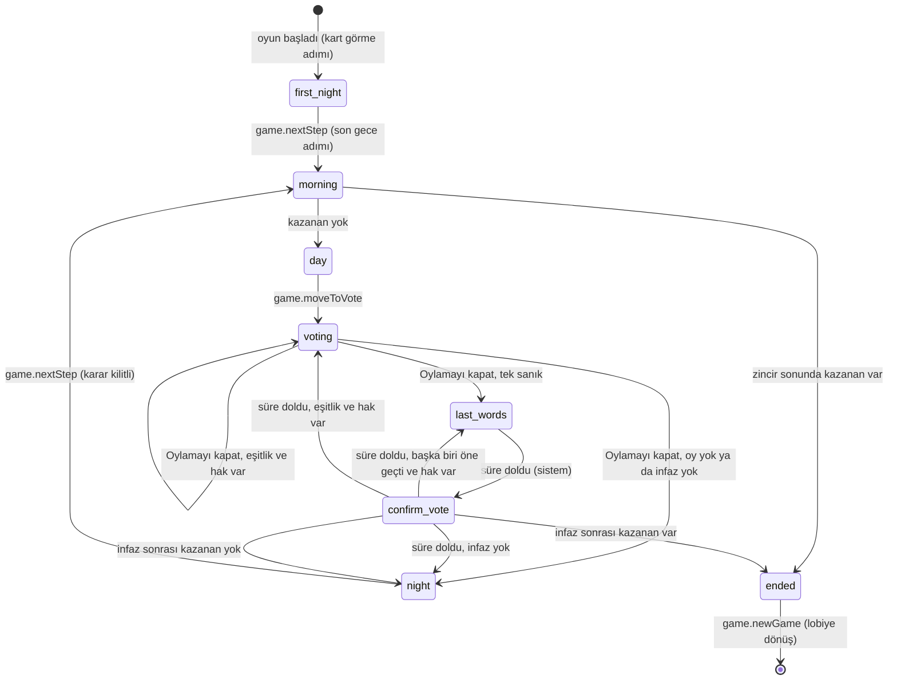
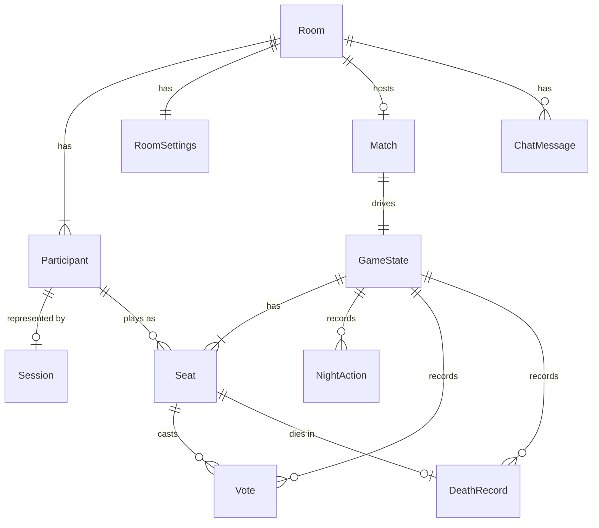

# Fonksiyonel Tanım — U1 Yürüyen İskelet

Bu belge, yürüyen iskeletin (yalnızca Gulyabani ve Köylü ile baştan sona oynanabilen en küçük tam oyun) davranışını tanımlar: kullanım akışlarının adım sırası ve durum geçişleri burada tek doğru kaynaktır. Veri biçimi `entities.md`'de, karar mantığı `rules.md`'de yaml bloklarıyla tanımlıdır; aşağıdaki ilişki diyagramı ve kural özeti onlardan türetilmiştir. Teknolojiden bağımsızdır.

## Sources

- Parça tanımı: `inception/units-generation/unit-of-work.md` (unit-of-work; U1 sınırları, sorumluluklar ve uygulama notları).
- Hikâye eşlemesi ve parça içi sıra: `inception/units-generation/unit-of-work-story-map.md` (unit-of-work-story-map).
- Kullanıcı hikâyeleri: `inception/user-stories/stories.md` (stories) — bu parçanın yazdığı hikâyeler: US1.1, US1.2, US1.4, US2.2, US3.1, US3.2, US3.3, US4.1, US4.2 (U1 payı), US5.1, US5.2, US5.3, US5.4 (U1 payı), US7.1 (U1 payı), US7.2 (U1 payı), US9.1, US13.1, US13.3, US13.4, US13.5 (U1 payları).
- Gereksinimler: `inception/requirements-analysis/requirements.md` (requirements).
- Yapı taşları: `inception/domain-design/components.md` (components; yürüyen iskelette kullanılan yapı taşları).
- Sözleşmeler: `inception/contract-design/contract-summary.md` (contract-summary; C1 canlı bağlantı, C2 sağlık kontrolü, C3 kural arayüzü, C5 görünüm, C6 olaylar, C8 silme, C9 depo).
- Teslim Planlaması: `inception/delivery-planning/bolt-plan.md` (B1 kapsamı, korumalar ve bitti tanımı).
- Özet onayı: `functional-design-questions.md` (Looks correct; iskelet varsayılanları).

## Kapsam

**İskelette var:** oda kurma ve katılma, lobi ve başlatma (3–26 oyuncu), lobide çıkarma, rol dağıtımı (Gulyabani ve Köylü), kart görme, gece (gulyabani tanışma ve ortak kurban kararı, gulyabani sohbeti), sabah, gündüz ve gündüz sohbeti, oylama, yeniden oylama, son söz, onay oylaması, infaz, kazanma kontrolü, oyun sonu, yeni oyun, moderatör ekranı, yeniden bağlanma, moderatör kopunca bekleme, sağlık kontrolü, basit hız sınırı, 24 saatte silme, bot oyunculu uçtan uca test.

**İskelette yok (sonraki parçalar):** ayar ekranı, rol havuzu ve 7 özel rol, bekleme ekranı ve 22 saat kuralı, moderatörlük devri ve 30 dakika yasağı, köyün en genci (U2, U3); mezarlık sohbeti, hayalet modu, kelime filtresi, şikayet (U4); moderatör devralma, ikinci sekme uyarısı, sunucu yeniden başlatmanın bot senaryosu, yeniden katılma isteği (U5); Rehber ve kart çizimleri (U6); kayıtlar, geri bildirim, "Sorun bildir", rapor (U7); tam gizli bilgi testi, yük testi, erişilebilirlik taraması, tarayıcı uyarısı (U8).

## Komut Yönlendirme Tablosu

Sözleşmedeki (C1) her komutun hangi yapı taşına gittiği. ConnectionGateway komutu alır, oturumu doğrular, hız sınırını uygular ve komutu odanın tek sırasına koyar; tekrar denetimi sırada yapılır (BR10.2); asıl işi aşağıdaki yapı taşı yapar.

| Komut | İşleyen yapı taşı | Kural motoruna (GameRules) gider mi | Komut numarasının saklandığı yer |
|---|---|---|---|
| `hello`, `ping` | ConnectionGateway | Hayır | — |
| `room.create`, `room.join` | RoomManager (oturum başına bir kez, BR10.5) | Hayır | Room |
| `lobby.kick` | RoomManager | Hayır | Room |
| `lobby.startGame` | RoomManager → MatchFlow | Evet (dağıtım ve başlangıç durumu) | Room (kesinleşme noktası) |
| `game.cardSeen`, `game.ghulMark`, `game.ghulConfirm`, `game.vote` | MatchFlow | Evet | Match |
| `game.nightSelect` | MatchFlow | Evet; U1'de her zaman `not_your_turn` (BR4.9) | — (reddedilen komut kaydedilmez) |
| `game.nextStep`, `game.revealResult`, `game.moveToVote` (`stepVersion` taşır, BR10.7) | MatchFlow | Evet | Match |
| `game.timerExtend`, `game.pause`, `game.resume` | MatchFlow | Hayır (yalnızca sayaçlar) | Match |
| `game.newGame` | MatchFlow → RoomManager | Hayır | Room |
| `chat.send` | ChatService (MatchFlow'dan faz ve yaşam bilgisini okur) | Hayır | ChatMessage |
| `system.deadlineReached` (yalnızca sunucu içi; C1'de yok, BR10.6) | MatchFlow zamanlayıcısı → odanın sırası | Evet (`actor = system`) | Match |

Sonraki parçaların eklediği komutlar bu tabloya aynı biçimde eklenir (`lobby.*` → RoomManager, `game.*` → MatchFlow, `chat.*` → ChatService, `moderator.*` ve `rejoin.*` → MatchFlow/RoomManager, `feedback.*` → FeedbackService).

**Sözleşmeye eklemeler (yalnızca ekleme):** C1 ReasonCode'a U1 kodları `step_waiting` (adım henüz tamamlanmadı) ve `game_paused` (oyun duraklatılmış); C1 `game.nextStep`/`game.revealResult`/`game.moveToVote` args'ına `stepVersion`; C3 RuleCommand'ın aktörüne `system` ve sunucu içi `system.deadlineReached` komutu; C5 `moderator` bloğuna `stepVersion`, `game.myAction.deadline` isteğe bağlı. `rate_limited` ve `pauseReason` U1'den itibaren kullanılır (Teslim Planlaması B1).

## Faz Bitirme Tablosu

Her faz ve adımın kimin tarafından, hangi koşulla bitirildiği. Süre dolması kural motoruna `system.deadlineReached` ile girer (BR10.6); moderatörün ilerletme komutu `stepVersion` taşır, tutmazsa `phase_closed` (BR10.7). Duraklatılmışken hiçbir faz bitmez (BR10.8).

| Faz / adım | Süre | Kim bitirir, nasıl | `game.nextStep` bu adımda | Sonraki |
|---|---|---|---|---|
| `first_night` / `card_reveal` | yok | Moderatör, `game.nextStep` | Her zaman kabul | `ghul_meet` |
| `first_night` / `ghul_meet` | yok | Moderatör, `game.nextStep` | Her zaman kabul | `ghul_kill`; "ilk gece kimse kaçırılmaz" açıksa `morning` |
| `first_night` ya da `night` / `ghul_kill` | 90 sn | Karar: gulyabanilerin `game.ghulConfirm`'i ya da süre dolunca sistem (BR4.6). Geçiş: moderatör, `game.nextStep` | Yalnızca karar kilitliyken (`done` ya da `timed_out`); aksi hâlde `step_waiting` | `morning` |
| `morning` | yok | Moderatör, `game.revealResult` | `phase_closed` | `day` ya da `ended` |
| `day` | 4 dk | Moderatör, `game.moveToVote` (süre dolunca yalnızca hatırlatma, BR6.2) | `phase_closed` | `voting` |
| `voting` (ilk tur ya da eşitlik yeniden oylaması) | yok | Moderatör, `game.nextStep` = "Oylamayı kapat" (BR6.11) | Kabul; turu kapatır | `voting` (yeniden oylama), `last_words` ya da `night` |
| `last_words` | 30 sn | Sistem, süre dolunca | `step_waiting` | `confirm_vote` |
| `confirm_vote` | 20 sn | Sistem, süre dolunca (BR6.8) | `step_waiting` | `last_words`, `voting`, `night` ya da `ended` |
| `ended` | yok | Moderatör, `game.newGame` | `phase_closed` | Lobi (yeni oyun) |

## Akışlar

### A1 — Oda kurma (US1.1)

1. Kişi ana sayfayı açar; tanıtım, KVKK bilgilendirmesi, "Oda Kur", kodla "Katıl" ve Rehber bağlantısını görür (BR1.5).
2. "Oda Kur"a basar, nick girer (BR1.3).
3. Sunucu benzersiz 6 haneli kod üretir, odayı `lobby` durumunda ve 24 saatlik ömürle kurar, kurucuyu moderatör yapar (BR1.1, BR1.2), oturum belirteci verir (BR9.1).
4. Moderatör lobiye geçer; kod ve paylaşılabilir link görünür.

### A2 — Odaya katılma (US1.2)

1. Kişi linkle ya da kodla gelir; giriş ekranında KVKK bilgilendirmesini görür (BR1.5).
2. Nick girer. Sunucu sırayla denetler: deneme sınırı (BR10.3) → oda var ve süresi dolmamış mı (BR1.4) → oda dolu mu (BR1.4) → oyun sürüyor mu (BR1.6) → nick geçerli ve benzersiz mi (BR1.3).
3. Hata varsa neden alanın altında Türkçe yazılır, yazılan metin korunur.
4. Başarılıysa oturum belirteci verilir ve kişi lobiye girer; herkesin lobi listesi güncellenir.

### A3 — Lobi ve oyunu başlatma (US1.4)

1. Lobide herkes katılımcıları ve açık rolleri (Gulyabani, Köylü) görür (BR2.4).
2. "Oyunu Başlat" oyuncu sayısına göre pasif ya da etkindir; 3–5 oyuncuda öneri uyarısı görünür (BR2.1).
3. Moderatör isterse bir oyuncuyu onay sorusundan sonra çıkarır (BR2.3).
4. Moderatör başlatır (BR2.2). Sunucu gulyabani sayısını hesaplar (BR3.1), rolleri güvenli rastgele dağıtır (BR3.2), ayarları oyuna kopyalar ve ilk gecenin kart görme adımına geçer (`first_night` / `card_reveal`, BR4.1). Önce oyun kaydı, sonra oda kaydı yazılır; ancak ondan sonra kabul döner (BR10.2).

### A4 — Kart görme (US2.2)

1. Her oyuncu kendi kartını kapalı görür; dokununca açılır, tekrar dokununca kapanır (BR3.3, BR11.1).
2. "Gördüm" deyince moderatörde işaret çıkar.
3. Moderatör herkes basmadan da "Sonraki Adım" ile gulyabani tanışma adımına geçebilir (BR10.7).

### A5 — Gece (US3.1, US3.2, US3.3)

1. Gece başlar; sırası gelmeyen herkes aynı Uyku ekranını görür (BR4.7).
2. **İlk gece, kart görmeden sonraki adım — tanışma:** yaşayan gulyabaniler birbirini ve gulyabani sohbetini görür (BR11.2, BR4.8). Moderatör anonsu (ilk gece hatırlatma cümlesiyle) okur ve "Sonraki Adım" der (BR4.3).
3. **Kurban seçimi** (ilk gecenin son adımı; standart gecede tek adım) (BR4.1, BR4.2):
   1. Yaşayan gulyabanilerin ekranında hedef listesi (yaşayan, gulyabani olmayan, moderatör olmayan) ve sohbet açılır (BR4.4).
   2. Her gulyabani hedef işaretler; ötekiler işaretleri canlı görür (BR4.5).
   3. Hepsi aynı hedefteyse "Kararı Onayla" etkinleşir; onaylanınca karar kilitlenir, moderatörde "yapıldı" görünür.
   4. Süre (90 sn) dolarsa sistem kararı verir: çoğunluk, eşitlikte ayara göre rastgele ya da kimse; hiç işaret yoksa kimse; moderatörde "süre doldu" görünür (BR4.6, BR10.6).
4. Karar kilitlenince moderatör "Sonraki Adım" ile sabaha geçer; karar kilitlenmeden basılırsa `step_waiting` döner (BR10.7).

### A6 — Sabah (US4.1, US4.2)

1. Moderatör gecenin sonucunu ve anons metnini görür (BR5.1).
2. "Sonucu Açıkla" der: ölen varsa kartı herkese açılır ve ölüm zinciri işler (BR5.2); kimse ölmediyse kart açılmaz.
3. Kazanan varsa A9'a; yoksa gündüze geçilir (BR5.3).

### A7 — Gündüz ve oylama (US5.1, US5.2, US5.3)

1. Gündüz başlar; herkeste aynı geri sayım (BR6.1). Yaşayanlar ve moderatör gündüz sohbetine yazar, ölüler okur (BR6.4).
2. Moderatör süreyi uzatabilir ya da duraklatabilir (BR6.3). Süre dolunca moderatöre "Oylamaya geç" hatırlatması çıkar (BR6.2).
3. Moderatör oylamaya geçirir. Yaşayanlar oy verir (BR6.5); oylar ayara göre canlı görünür (BR11.3).
4. Oylamanın süresi yoktur; moderatör "Oylamayı kapat" ile (oylama fazındaki `game.nextStep`) kapatır (BR6.11):
   - Hiç oy yoksa o gün infaz yok → gece (BR6.6).
   - Tek en çok oy alan varsa sanık olur → son söz (BR6.6).
   - Eşitlik varsa eşitler arasında yeniden oylama; yine eşitse ya da 2 yeniden oylama dolduysa infaz yok → gece (BR6.7).
5. **Son söz** (30 sn): yalnızca sanık ve moderatör yazar (BR6.4). Süre dolunca sistem onay oylamasını açar (BR10.6).
6. **Onay oylaması** (20 sn, oylar korunur, değiştirilebilir; sohbet kapalı): süre dolunca sistem kapatır. Sanık hâlâ tek başına en çok oydaysa infaz; başka biri tek başına öne geçtiyse yeni sanıkla son söze dönülür; eşitlik çıktıysa eşitler arasında yeniden oylama; günün yeniden oylama hakkı (2) dolduysa infaz yok. Yeniden oylama sayacı her yeni turda yalnızca bir kez artar (BR6.7, BR6.8).
7. **İnfaz:** kart herkese açılır, ölüm zinciri işler (BR6.9). Kazanan varsa A9; yoksa gece (A5).

### A8 — Moderatör ekranı (US5.4)

Moderatör oyun boyunca fazı/adımı, anons metnini, beklenen işlemi ve durumunu, kalan süreyi, "Sonraki Adım"ı, tüm oyuncuları rolleri, yaşam durumları ve "kopuk" bilgileriyle, oy ayrıntısını, gece olay günlüğünü ve gulyabani sohbetini görür (BR8.1, BR6.10, BR11.5). Telefonda dört sekme (Akış / Oyuncular / Günlük / Sohbet), bilgisayarda sütunlar.

### A9 — Oyun sonu ve yeni oyun (US7.1, US7.2)

1. Zincir sonunda kazanma kontrolü yapılır (BR7.1).
2. Kazanan belirlenince herkese kazanan taraf, bütün roller ve gece olay günlüğü gösterilir (BR7.2, BR11.4).
3. Moderatör "Yeni oyun" derse aynı oda, aynı oyuncular ve aynı ayarlarla lobiye dönülür; odanın ömrü sıfırlanmaz (BR7.3).

### A10 — Yeniden bağlanma (US9.1)

1. Bağlantı koparsa istemci "Yeniden bağlanılıyor" şeridini gösterir ve artan aralıklarla yeniden dener (BR9.2).
2. Sunucu 45 saniye ses alamazsa kişiyi kopuk sayar; moderatörde "kopuk" görünür (BR9.3).
3. Bağlantı gelince istemci saklı belirteçle `hello` gönderir; sunucu oturumu doğrular, son bağlantıyı geçerli yapar ve tam görünümü gönderir (BR9.1, BR9.4). Ekranda "Tekrar oyundasın" görünür.
4. Onayı gelmemiş komutlar aynı numarayla yeniden gönderilir; sunucu bunları bir kez işler (BR10.2). Oda kurma ve katılma da oturum başına bir kez işlenir: yeniden gönderilen `room.create` ikinci oda, `room.join` ikinci katılımcı oluşturmaz, kişi kendi nickiyle `nick_taken` almaz (BR10.5).
5. 60 saniyede bağlanılamazsa uyarı metni çıkar, deneme sürer (BR9.2).

### A11 — Moderatörün kopması

1. Moderatör kopuk sayılınca oyun ve bütün sayaçlar duraklar; herkes "Moderatör bekleniyor. Oyun duraklatıldı." görür. Kalan süre, moderatörden son ses alınan andan (ya da o andan sonra adım değiştiyse adım değişiminden) hesaplanır; böylece fark edilene kadar geçen süre oyunculardan yenmez (BR8.2).
2. Moderatör aynı linkle dönünce sayaçlar kalan süreden sürer. Oyun moderatör kopmadan önce elle duraklatılmışsa dönüşte duraklatılmış kalır; devam ettirmeyi moderatör seçer (BR8.3). İskelette başka biri moderatörlüğü devralmaz.
3. Duraklatılmışken yalnızca devam ettirme, süre uzatma, kart görme işareti ve izinli sohbet kabul edilir; diğer oyun komutları `game_paused` alır (BR10.8).

### A12 — Komut işleme (US13.5)

1. Komut gelir; oturum ve deneme sınırı denetlenir (BR10.3). Süresi dolmuş odanın komutu `room_not_found` alır (BR1.4).
2. Komut odanın tek sırasına girer — oyun yokken gelen oda ve lobi komutları da, sistemin süre komutu da aynı sıradandır (BR10.2, BR10.6).
3. Tekrar denetimi: numara odanın kaydında (oda düzeyi komutlar), oyun kayıtlarında (biten oyunlar dahil) ya da sohbet mesajlarında bulunursa yeniden işlenmez, `duplicate` ve güncel tam görünüm döner (BR10.2, BR10.5).
4. Yapı taşı komutu doğrular (BR10.1, BR2.2, BR10.7, BR10.8); geçersizse neden koduyla reddedilir, durum değişmez.
5. Yeni durum hesaplanır; komut numarasıyla birlikte, değiştirdiği kaydın sürüm numarası bir artırılarak kalıcı depoya yazılır; ancak sonra `accepted` döner.
6. Görünüm süzgeci her alıcı için ayrı görünüm üretir (BR11.1–BR11.5) ve odadaki herkese aynı anda gönderilir (BR4.7).

### A13 — 24 saatte silme ve sağlık kontrolü

1. Süresi dolan oda, silinmesi beklenmeden hemen "oda bulunamadı" sayılır (BR1.4).
2. U1'in küçük temizlik zamanlayıcısı (ExpirySweep) program açılışında ve sonra 10 dakikada bir çalışır; süresi dolan her oda için sırayla oyun, sohbet, oturum ve oda verisini sahipleri siler; açık bağlantılar "oda bulunamadı" ile kapanır. Açılıştaki çalıştırma kapalıyken kaçırılan silmeleri yapar (BR12.1, BR12.3). U7'de bu işi Housekeeping devralır.
3. Sağlık kontrolü dışarıya yalnızca `status: ok` ve sürümü verir; etkin oda ve etkin oyun sayısını yalnızca sunucunun kendi içinden gelen isteğe verir; depoya ulaşılamıyorsa ya da açılış bitmediyse 503 döner (BR12.2). Yeni sürüm yalnızca etkin oyun sayısı 0 iken yüklenir.

### A14 — Bot oyunculu uçtan uca test

1. Test, gerçek şifreli bağlantı üzerinden bir bot moderatör sürücüsü ve en az 3 bot oyuncuyla oda kurar, katılır ve başlatır.
2. Botlar kartlarını görür, gulyabaniler ortak karar verir, gündüz oy verir; moderatör sürücüsü adımları ilerletir.
3. Test oyun bir tarafın zaferiyle bitene kadar sürer ve şunları denetler: kazanan doğru, hiçbir köylü botuna başka oyuncunun açılmamış rolü gitmedi (BR11.1), sayaçlar sunucu saatine uydu (BR9.6).
4. Construction doğrulama komutu bu testi ve kapsam ölçümünü çalıştırır.

## Durum Makineleri

### Room.status

<!-- Text fallback: Oda kurulunca lobby. Oyun başlayınca in_game. Kazanan belirlenince ended. Yeni oyunla tekrar lobby. Herhangi bir durumdayken 24 saat dolunca oda silinir. Durum kalıcı yazılmaz; odanın etkin oyunundan türetilir. -->

### GameState.phase

<!-- Text fallback: Oyun ilk geceyle (first_night) başlar; ilk adımı kart görmedir. Gece adımları bitip moderatör ilerletince sabah; sabah zincirinde kazanan çıkarsa oyun biter, çıkmazsa gündüz (day). Moderatör oylamaya geçirir. Moderatör oylamayı kapatınca: eşitlik ve hak varsa yeniden oylama; tek sanık varsa son söz; oy yoksa ya da infaz yoksa gece. Son söz süresi dolunca sistem onay oylamasını açar. Onay oylamasının süresi dolunca: başka biri öne geçtiyse ve hak varsa son söze; eşitlik ve hak varsa yeniden oylamaya; infaz yoksa geceye; infaz sonrası kazanan varsa oyun biter, yoksa gece. Bitmiş oyundan yeni oyunla lobiye dönülür. -->

### Gece adımı (stepCursor) ve adım durumu

| Gece | Adımlar | Adım durumu |
|---|---|---|
| 1 (`first_night`) | card_reveal → ghul_meet → ghul_kill (noKillFirstNight açıksa ghul_kill yok) | ghul_kill: `waiting` → `done` / `timed_out`; oyuncu kopuksa `player_disconnected` |
| ≥ 2 (`night`) | ghul_kill | aynı |

Her faz ya da adım değişiminde `stepVersion` bir artar (BR10.7).

### Match.paused

| Durum | Giriş | Çıkış |
|---|---|---|
| çalışıyor | — | game.pause → duraklatıldı (`moderator`); moderatör kopuk → duraklatıldı (`moderator_lost`, kalan süre son sesten hesaplanır) |
| duraklatıldı (`moderator`) | kalan süre saklanır | Yalnızca game.resume → çalışıyor; bu sırada moderatör kopup dönse de duraklatılmış kalır (BR8.3) |
| duraklatıldı (`moderator_lost`) | kalan süre saklanır | Moderatörün dönmesi → çalışıyor; bitiş = şimdi + kalan süre |

## Varlık İlişkileri (türetilmiş görünüm)

Tek doğru kaynak `entities.md`'deki yaml bloğudur.

<!-- Text fallback: Bir odanın katılımcıları, ayarları, en fazla bir etkin oyunu ve sohbet mesajları vardır. Katılımcının bir oturumu ve her oyunda bir koltuğu olur. Oyun akışı bir kural durumunu yürütür; kural durumunun koltukları, gece işaretleri, oyları ve ölüm kayıtları vardır. -->

## Kural Özeti (türetilmiş görünüm)

Tek doğru kaynak `rules.md`'deki yaml bloğudur.

| Grup | Ne söyler |
|---|---|
| BR1 Oda ve giriş | 6 haneli benzersiz kod; kurucu moderatör; nick 2–16 karakter ve benzersiz; yok/dolu oda mesajları; KVKK bilgilendirmesi; oyun sürerken giriş yok |
| BR2 Lobi | 3–26 oyuncu ve öneri uyarısı; moderatör komutları; lobide çıkarma; rol eşleşmesi gizli; ayrılma komutu yok |
| BR3 Dağıtım | Oyuncu sayısına göre gulyabani; güvenli rastgele dağıtım; kart kapalı gelir, "Gördüm" |
| BR4 Gece | Kart görme, tanışma ve kurban adımları; yalnızca yaşayan hedefler; ortak karar ve süre dolunca çoğunluk; aynı Uyku ekranı; gulyabani sohbeti; nightSelect U1'de beklenmez |
| BR5 Sabah | Anons ve kart açma; ölüm zinciri; gündüze geçiş |
| BR6 Gündüz | Sunucu saatine göre geri sayım; "Oylamaya geç"; uzat/duraklat; açık listeyle sohbet izinleri; oy kuralları (çekimser yok); eşitlik ve en fazla 2 yeniden oylama (sayaç tek artar); son söz ve onay oylaması; infaz; oylamayı moderatör kapatır |
| BR7 Oyun sonu | Kazanma sırası; herkese roller ve günlük; yeni oyun |
| BR8 Moderatör | Ekran içeriği ve düzeni; kopunca bekleme (süre son sesten); elle duraklatmanın önceliği |
| BR9 Bağlantı | Belirteç; yeniden bağlanma şeridi; kopuk bilgisi; son bağlantı; şifreli bağlantı ve sürüm; sunucu saati |
| BR10 Güvenlik | Komut doğrulama; odanın tek sırası, önce kayıt sonra kabul, üç yerde tekrar denetimi; hız sınırı; IP yok; oda kurma/katılma oturum başına bir kez; süre dolması sistem komutu; adım sürümü ile çift dokunuş koruması; duraklatmada izinli komutlar |
| BR11 Görünürlük | Yalnızca kendi rolü; gulyabanilerin birbirini görmesi; oyların gösterimi; açılan kartlar; moderatörün tam görünümü |
| BR12 Saklama | 24 saatte silme; sağlık kontrolü (dışarıya yalnızca durum ve sürüm); açılışta ve 10 dakikada bir çalışan temizlik zamanlayıcısı |
| BR13 Arayüz | Türkçe metin dosyası; 320 px; WCAG 2.1 AA |

## Hata ve Kenar Durumları

| Durum | Davranış |
|---|---|
| İki gulyabani aynı anda farklı hedef işaretler | Komutlar sırayla işlenir; her biri kendi işaretini günceller; onay pasif kalır (BR4.5, BR10.2) |
| Oylama kapanırken son anda oy gelir | Tur kapandıktan sonra gelen oy `phase_closed` ile reddedilir (BR6.5) |
| Sanık son söz sırasında kopar | Son söz süresi işler; onay oylaması onsuz yapılır (kopan için 5 dakika uzatma U5'te) |
| Moderatör "Sonraki Adım"a iki kez basar (çift dokunuş) | İkinci komut aynı numarayla gelirse `duplicate`; yeni numarayla gelirse eski `stepVersion`'ı taşıdığı için `phase_closed`; adım atlanmaz (BR10.7) |
| Moderatör gulyabani kararı verilmeden "Sonraki Adım"a basar | `step_waiting`; karar kilitlenince ya da süre dolunca kabul edilir (BR10.7, BR4.6) |
| Oda kurulurken bağlantı kopar, istemci `room.create`'i yeniden gönderir | İkinci oda kurulmaz; aynı oda ve aynı moderatör döner (BR10.5) |
| Katılırken bağlantı kopar, istemci `room.join`'i yeniden gönderir | İkinci katılımcı oluşmaz, `nick_taken` verilmez; aynı katılımcı döner (BR10.5) |
| `lobby.startGame` yazılırken sunucu kapanır | Oda kaydı yazılmadıysa oyun başlamamış sayılır; açılışta yarım oyun kaydı silinir, aynı komut yeniden gelince yeniden işlenir (BR10.2) |
| Yeni oyundan sonra eski oyuna ait geç komut gelir | Biten oyunun komutu `phase_closed`; numarası biliniyorsa `duplicate` (BR7.3, BR10.2) |
| Sunucu bir sürenin dolduğu sırada yeniden başlar | Açılışta süresi geçmiş adımın sistem komutu hemen sıraya girer; komut numarası sabit olduğu için bir kez işlenir (BR10.6) |
| Oyun duraklatılmışken oy ya da işaret gelir | `game_paused`; duraklatılmışken süre işlemez (BR10.8) |
| Çekimser oy ayarı kapalıyken boş oy gelir | `invalid_target` (BR6.5) |
| Kalıcı depoya yazılamaz | Komut `internal_error` ile reddedilir, durum değişmez, hata sayılır (BR10.2) |
| Bütün gulyabaniler kopuk ve gece süresi dolar | Hiç işaret yoksa kimse kaçırılmaz (BR4.6) |
| Oyuncu sayısı oyun sırasında 3'ün altına düşer (lobide çıkarma yok, ölümle) | Kazanma kontrolü erken bitiş kuralıyla oyunu bitirir (BR7.1) |
| Oda oyun sürerken 24 saati doldurur | Temizlik odayı siler; açık bağlantılar "oda bulunamadı" ile kapanır (BR12.1) |

## Assumptions & Open Questions

- [assumption] İskelet ayarları sabit varsayılanlardır; ayar ekranı U2'de gelir (özet onayı).
- [assumption] İskelette oyun sürerken yeni giriş reddedilir; U2 bunu bekleme ekranıyla değiştirir (BR1.6).
- [assumption] Moderatörün yanlışlıkla "Sonraki Adım"a basmasına karşı onay sorusu yalnızca kalıcı işlemlerde (çıkarma) vardır; adım ilerletme onaysızdır ama adım sürüm numarası çift dokunuşun adım atlatmasını engeller (FR5.4, BR10.7).
- [assumption] Oylama turunun süresi yoktur; moderatör "Oylamayı kapat" ile kapatır (BR6.11). Oylama süresi ayarı gerekirse U2'deki ayar ekranına yalnızca ekleme olarak gelir.
- [assumption] Sözleşmeye yapılan U1 eklemeleri (iki yeni neden kodu, `stepVersion`, sistem süre komutu, isteğe bağlı `myAction.deadline`) Komut Yönlendirme Tablosu'nun altında listelidir; hepsi "yalnızca ekleme" kuralına uyar ve var olan alanların anlamını değiştirmez.
- Açık soru: kalıcı depo ürünü ve oyun kaydının biçimi NFR ve altyapı aşamalarında, kod yazılmadan önce seçilir (contract-summary C9, ISS-02).
