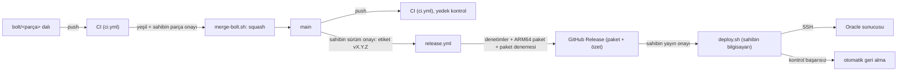

# Teslim Hattı (CI/CD) — U1 Yürüyen İskelet

Bu belge, kodun bir parçanın geçici dalından Oracle sunucusuna kadar izlediği yolu tasarlar: her değişiklikte çalışan otomatik denetimler (CI), `main`'e birleştirme kapısı, sürüm etiketi ve sürüm paketi, sunucuya yayın, yayın sonrası kontrol ve geri alma. Ekip kuralları sabittir (team.md): tek ana dal `main`, parça başına geçici dal ve tek commit'lik squash birleştirme, PR yok, birleştirmeden önce CI ve kapsam sınırları, canlıya çıkış yalnızca sahibin açık onayıyla ve sürüm etiketiyle, otomatik yayın yok, her yayının geri dönüş yolu. Sahip teknik değildir: dal, etiket ve yayın komutlarını sahibin onayından sonra Claude, sahibin bilgisayarında çalıştırır; sahip komut yazmaz. Kesin iş akışı dosyaları ve betikler Kod Üretimi'nde yazılır.

## Sources

- Özet onayı: `infrastructure-design-questions.md` (Looks correct; yayın yalnızca sahibin onayıyla ve oyun yokken, başarısızsa önceki sürüme otomatik dönüş).
- Altyapı: `infrastructure-specification.md` (Oracle ARM64 makinesi, Ubuntu 24.04, Node.js sürümü `.nvmrc`'den, dosya yerleri, `gulyabani.service`, `--check-config`).
- Hız tasarımı: `nfr-design/performance-design.md` (performance-design; paket boyutu 150 KB CI denetimi, önceden sıkıştırılmış dosyalar, yazım ölçüm testi).
- Güvenlik tasarımı: `nfr-design/security-design.md` (security-design; ESLint IP ve `dangerouslySetInnerHTML` kuralları, satır içi stil denetimi, gitleaks, `npm audit --audit-level=high`, bot testinin kendi `PUBLIC_ORIGIN`'ı, Güvenlik Doğrulama Tablosu).
- Ölçek tasarımı: `nfr-design/scalability-design.md` (scalability-design; Maliyet: GitHub Actions ücretsiz).
- Dayanıklılık tasarımı: `nfr-design/reliability-design.md` (reliability-design; Açılış ≤ 60 sn, Planlı Kapanış ≤ 5 sn, Yayın ve Geri Alma, depo biçiminin yalnızca eklemeyle değişmesi NFR5.10).
- İzleme tasarımı: `nfr-design/observability-design.md` (observability-design; Bot Testi Raporu `npm run verify` ve `reports/e2e-summary.json`).
- Mantıksal parçalar: `nfr-design/logical-components.md` (logical-components; sunucuya yalnızca derlenmiş program, web paketi ve içerik kataloğu yüklenir).
- Yapı taşları: `inception/domain-design/components.md` (components; BotPlayer'ın uçtan uca test olarak doğrulama komutunda çalışması).
- Fonksiyonel tasarım: `functional-design/functional-spec.md` (functional-spec; A13 "yeni sürüm yalnızca etkin oyun sayısı 0 iken yüklenir", A14 bot oyunculu test).
- Sözleşmeler: `inception/contract-design/contract-summary.md` (contract-summary; C2 yayın denetimi `activeMatches`, tarayıcı ile sunucunun aynı sürümde çalışması ve `reload`).
- Teknoloji kararları: `nfr-requirements/tech-stack-decisions.md` (tech-stack-decisions; CI satırı, NFR9.1, NFR11.1, NFR12.1–NFR12.3).
- Ekip kuralları: `memory/team.md` (Way of Working, Testing Posture, Deployment, Code Style).

## Akışın Genel Görünümü

<!-- Text fallback: Her parça bolt/<parça> adlı geçici dalda yazılır; dala her gönderimde CI çalışır. CI yeşilse ve sahip parçayı onayladıysa merge-bolt.sh parçayı main'e tek commit olarak squash ile ekler; main'de CI yedek kontrol olarak yeniden çalışır. Sahip bir sürümü onaylayınca main'deki commit vX.Y.Z etiketiyle işaretlenir; release.yml denetimleri yeniden çalıştırır, ARM64 sürüm paketini üretip dener ve GitHub Release olarak yayımlar. Sahip yayını onaylayınca deploy.sh sahibin bilgisayarından SSH ile paketi sunucuya yükler; yayın sonrası kontrol başarısız olursa kendiliğinden önceki sürüme döner. -->

## Dallar ve Tetikleyiciler

| Olay | Çalışan | Not |
|---|---|---|
| `bolt/**` dalına gönderim | `ci.yml` (tam) | Parçanın birleştirme kapısı bu çalıştırmanın sonucuna bakar |
| `main`'e gönderim | `ci.yml` (tam) | Yedek kontrol. Yalnızca `aidlc/**` ve `.claude/**` altını değiştiren belge commit'lerinde atlanır (`paths-ignore`) |
| `v*` etiketi gönderimi | `release.yml` | Denetimleri etiketli commit'te yeniden çalıştırır; atlanmış belge commit'i etiketlense de güvenlidir |
| Elle başlatma (`workflow_dispatch`) | `ci.yml` | Yeniden deneme ve inceleme için |

- Dal adı `bolt/<bolt-slug>`'dır (delivery-planning'in parça adı); `main`'den açılır ve birleştirmeden sonra silinir (team.md Way of Working).
- Eşzamanlılık: `ci.yml` aynı dal için yeni gönderimde eskisini iptal eder; `main` ve etiket çalıştırmaları iptal edilmez. `release.yml` tek sıradır (iptal yok).

## CI İş Akışı (`ci.yml`)

Bütün denetimler engelleyicidir; biri başarısızsa iş akışının sonucu başarısızdır ve parça `main`'e eklenmez (team.md Testing Posture). Otomatik yeniden deneme yoktur: kararsız (flaky) test hata sayılır ve düzeltilir, sınırlar bir adımı geçirmek için gevşetilmez.

| İş | Çalıştığı makine | Adımlar |
|---|---|---|
| `checks` | `ubuntu-24.04` | `npm ci` → biçim → denetim → tür denetimi → depo biçimi denetimi |
| `verify` | Matris: `ubuntu-24.04` (x64) ve `ubuntu-24.04-arm` (ARM64) | `npm ci` → `npm run verify` → raporları yükle |
| `web` | `ubuntu-24.04` | `npm ci` → web derlemesi → paket boyutu → satır içi stil denetimi → erişilebilirlik taraması |
| `security` | `ubuntu-24.04` | `npm ci` → `npm audit --audit-level=high` → `npm audit signatures` → gitleaks |

ARM64 makinesi açık depolarda ücretsizdir ve sunucuyla aynı işlemci mimarisidir: derlenmiş `better-sqlite3` paketi ve depo testleri sunucudaki mimaride de sınanır. Bütün işlerde Node.js sürümü `.nvmrc`'den okunur (sunucuyla aynı).

### Aşama → kapı eşlemesi

| Aşama | Komut / araç | Ölçüt (geçmezse kırmızı) | Kaynak |
|---|---|---|---|
| Biçim | `prettier --check .` | Biçimsiz dosya yok | team.md Code Style |
| Denetim | `eslint .` | Hata yok; `socket.remoteAddress`, `X-Forwarded-For`/`Forwarded` okuma ve `dangerouslySetInnerHTML` yasak | NFR7.9, NFR7.11 |
| Tür denetimi | `tsc --noEmit` (sıkı mod) | Hata yok | tech-stack-decisions |
| Depo biçimi | Göç (migration) dosyalarında `DROP`, `RENAME`, sütun silme ya da tür değiştirme yok | Yalnızca ekleme | NFR5.10 (geri almanın önkoşulu) |
| Birim + entegrasyon + kapsam | `npm run verify` içinde Vitest + v8 kapsam | Tüm kodda satır kapsamı ≥ %80, `src/rules/` ≥ %90; `tr.json` anahtar testi; günlük ve depo IP/metin taramaları | NFR12.1, NFR11.1, NFR7.11, NFR7.14, NFR8.4 |
| Bot oyunculu uçtan uca test | `npm run verify` içinde: gerçek sunucu süreci, test başında üretilen kendinden imzalı sertifikayla gerçek şifreli bağlantı, bot moderatör + ≥ 3 bot | Oyun kazananla biter; köylü botlarına giden mesajlarda yasak alan 0; gece görünümleri aynı | NFR12.2, NFR8.2, NFR8.3, A14 |
| Web derlemesi | `vite build` | Derleme başarılı; Brotli ve gzip kopyaları üretildi | NFR1.6 |
| Paket boyutu | Derlenmiş betik ve stillerin gzip toplamı | ≤ 150 KB | NFR1.6, performance-design |
| Satır içi stil | Derlenmiş HTML'de `style` özniteliği ve `<style>` yok | 0 bulgu | NFR7.9 (CSP `unsafe-inline` yok) |
| Erişilebilirlik | Playwright (Chromium) + axe-core, iskelet ekranları 320 px'te, iki temada | Ciddi ya da kritik bulgu 0 | NFR9.1, NFR10.1 |
| Bağımlılık güvenliği | `npm audit --audit-level=high`; `npm audit signatures` | Yüksek ya da kritik bulgu yok; imza doğrulaması geçer | NFR7.10 |
| Sır taraması | gitleaks (gönderilen commit'ler) | Bulgu yok | NFR7.8 |

- Testler ağ dışında hiçbir hizmet istemez: bot testi kendi sunucusunu, kendi geçici veri klasörünü, kendi sertifikasını ve kendi `PUBLIC_ORIGIN`'ını (`https://localhost:<kapı>`) kurar; `Origin` denetimi testte gevşetilmez (security-design Canlı Bağlantıya Geçiş, NFR12.3).
- Yüklenen raporlar (7 gün saklanır): `reports/e2e-summary.json` (observability-design Bot Testi Raporu), kapsam özeti, erişilebilirlik raporu. Raporlar yalnızca bot nickleri ve sayılar içerir.
- Süre bütçesi: işler paralel çalışır; toplam ≈ 10 dakika (en uzunu `verify`).

### Construction doğrulama komutu

`npm run verify` yerelde ve CI'da aynı komuttur: Vitest testleri (kapsam sınırlarıyla), bot oyunculu uçtan uca test ve kısa rapor. İskelet denetim noktasında sahibin onayına sunulacak doğrulama komutu budur (tech-stack-decisions NFR12.2). Ön koşul yalnızca `npm ci`'dir (NFR12.3).

## Birleştirme Kapısı (`scripts/merge-bolt.sh <bolt-slug>`)

PR olmadığı için GitHub'ın "PR'da durum denetimi" kuralları kullanılamaz; kapı bir betiktir ve `main` CI'si yedek kontroldür. Betik şu sırayla denetler; ilk başarısız denetimde hiçbir şey değiştirmeden çıkar ve nedeni yazar:

1. Çalışma ağacı temiz; `bolt/<bolt-slug>` dalı yerelde ve uzakta aynı commit'te.
2. `origin/main`, dalın başının atasıdır (dal güncel). Değilse dal `main` üzerine yeniden kurulur, gönderilir ve CI'nin yeniden yeşil olması beklenir; böylece birleştirilen içerik tam olarak denetlenen içeriktir.
3. GitHub'da `ci.yml`'nin, dalın baş commit'i için tamamlanmış ve başarılı bir çalıştırması vardır (`gh run list` ile commit numarası eşlenir). Yoksa ya da başarısızsa birleştirme yapılmaz.
4. `git merge --squash` → tek commit, mesajı parçanın adı (team.md) → `main`'e gönderim.
5. Geçici dal yerelde ve uzakta silinir.

- Betik yalnızca sahibin o parçayı AI-DLC onay noktasında onaylamasından sonra çalıştırılır; betiğin kendisi onayı denetleyemez, bu sıra Claude'un çalışma kuralıdır.
- `main` CI'si kırmızı olursa aynı oturumda düzeltilir; düzeltme hemen mümkün değilse squash commit'i `git revert` ile geri alınır. `main` kırmızıyken sürüm etiketi konmaz.
- AI-DLC belge commit'leri (onaylardan sonra, team.md) bu betikten geçmez; doğrudan `main`'e gider ve uygulama kodunu değiştirmez.

## Sürüm Etiketi ve Sürüm Paketi (`release.yml`)

- **Sürüm numarası:** semver; `package.json`'daki sürüm etiketle aynıdır. v1'e kadar `v0.x.y` (iskeletin ilk sürümü `v0.1.0`) ve GitHub'da "ön sürüm" işaretlidir.
- **Etiket:** yalnızca sahibin sürümü onaylamasından sonra, CI'si yeşil olan bir `main` commit'ine konur ve gönderilir (team.md Deployment).

| İş | Makine | Ne yapar | Başarısızsa |
|---|---|---|---|
| `guard` | `ubuntu-24.04` | Etiket `^v\d+\.\d+\.\d+$` biçiminde; etiketli commit `origin/main`'in atası; `package.json` sürümü etiketle aynı | Sürüm yayımlanmaz |
| `verify` | `ci.yml` yeniden kullanılır | Bütün CI kapıları etiketli commit'te | Sürüm yayımlanmaz |
| `bundle` | `ubuntu-24.04-arm` | `npm ci` → `npm run build` → `npm prune --omit=dev` → paket → SHA-256 özeti → paket denemesi | Sürüm yayımlanmaz |
| `publish` | `ubuntu-24.04` | GitHub Release: paket, özet dosyası, otomatik sürüm notları; yalnızca bu iş `contents: write` yetkisi alır | — |

**Paket içeriği** (`gulyabani-vX.Y.Z-linux-arm64.tar.gz`): `dist/server/` (derlenmiş program), `dist/web/` (içerik özetli, önceden sıkıştırılmış dosyalar), `content/` (rol kataloğu, `tr.json`), `node_modules/` (yalnızca çalışma zamanı paketleri, ARM64 için derlenmiş), `package.json`, `package-lock.json`, `infra/` (`gulyabani.service`, `Caddyfile`, kurulum ve ölçüm betikleri), `VERSION`. Paket, sunucuyla aynı Ubuntu sürümü ve aynı Node.js sürümüyle ARM64 makinede üretildiği için sunucuda derleme ya da `npm` çalışmaz; sunucuya giden dosyalar, denenen dosyalarla bayt bayt aynıdır.

**Paket denemesi** (`bundle` işinin sonu, sunucuya gitmeden önce): paket boş bir klasöre açılır; `node dist/server/main.js --check-config` geçer; program geçici bir veri klasörü ve deneme ortam değişkenleriyle başlatılır; iki `/healthz` 200 ve doğru sürümü döner; `GET /` 200 ve `Content-Security-Policy` başlığı taşır; depodaki duman testi betiği (`scripts/smoke.ts`) bir botla oda kurar, ikinci botla katılır ve ikisi de `ack accepted` alır; program `SIGTERM` ile 10 saniye içinde 0 koduyla kapanır.

## Yayın (`scripts/deploy.sh vX.Y.Z`)

Yayın CI'da yapılmaz; sahibin bilgisayarından, sahibin SSH anahtarıyla yapılır (aşağıda Sırlar). Claude betiği yalnızca sahip sohbette o sürümün yayınlanmasını açıkça onayladıktan sonra çalıştırır. Sunucu adresi depoya girmeyen yerel `.deploy.env` dosyasındadır (sır değildir). Sunucuda aynı anda tek yayın çalışır (`flock` kilidi).

1. **İndirme ve doğrulama:** `gh release download` ile paket ve özet indirilir; SHA-256 denetlenir. Uymazsa durur, hiçbir şey değişmez.
2. **Oyun denetimi:** sunucuda iç `/healthz` okunur (C2). `activeMatches` 0 değilse beklenir: dakikada bir, en fazla 30 dakika; süre dolarsa hiçbir şey değiştirmeden durur ve "oyun sürüyor, yayın yapılmadı" der. Program yanıt vermiyorsa (ilk kurulum ya da çökmüş hizmet) korunacak oyun olmadığı için devam edilir.
3. **Yükleme:** paket sunucuya kopyalanır, özet orada yeniden denetlenir, geçici klasöre açılır ve tek adımda `/opt/gulyabani/releases/vX.Y.Z/` adına taşınır (`root:root`, salt okunur). Aynı sürüm klasörü varsa yeniden yükleme yapılmaz (bilerek istenmedikçe).
4. **Ayar denetimi:** yeni sürüm `--check-config` ile, oyun kullanıcısıyla ve hizmetin ortam dosyalarıyla (`systemd-run`) çalıştırılır; başarısızsa durur, çalışan sürüme dokunulmaz.
5. **Önceki sürümün kaydı:** `current` bağının gösterdiği sürüm `PREV` olarak saklanır (ilk kurulumda boş).
6. **Son oyun denetimi:** bağ değiştirilmeden hemen önce `activeMatches` yeniden okunur; 0 değilse 2. adıma dönülür.
7. **Geçiş:** `version.env` geçici dosya + yeniden adlandırmayla, `current` bağı `ln -sfn` + `mv -T` ile tek adımda değiştirilir; `systemctl restart gulyabani`. Planlı kapanış ≤ 5 sn, açılış hedefi ≤ 10 sn: kesinti genellikle ≤ 15 sn, en fazla ~30 sn (reliability-design).
8. **Sağlık bekleme:** iç `/healthz` en fazla 60 saniye içinde 200 ve `vX.Y.Z` döndürmelidir (açılış üst sınırı, NFR5.2).
9. **Yayın sonrası kontrol** (sahibin bilgisayarından, internet üzerinden; team.md Deployment): `https://<alt adres>/healthz` 200 ve `vX.Y.Z`; ana sayfa 200 ve CSP başlığı; `http://<alt adres>/` → 308; duman testi: bir bot oda kurar, ikinci bot katılır, ikisi de `ack accepted` alır. Deneme odası boş kalınca 15 dakikada süresi dolar ve silinir (security-design NFR7.7 e).
10. **Sonuç:** 8. ya da 9. adım başarısızsa Otomatik Geri Alma çalışır. Başarılıysa sunucuda çalışan sürüm + önceki 2 sürüm klasörü tutulur, eskileri silinir; özet yazdırılır (sürüm, kesinti süresi, kontrol sonuçları) ve Claude sonucu sahibe bildirir.

- **Kalan küçük pencere:** 6. adımla yeniden başlatma arasında (birkaç saniye) yeni bir oyun başlarsa o oyun ≤ 30 saniye duraklar ve depodan kaldığı yerden sürer (FR14.6, reliability-design Açılış); oyuncular yeniden bağlanır. Bu pencere kabul edilmiştir.
- **Eski sayfalar:** yeni sürümde eski bir sayfa bağlanırsa `reload` alır ve kendiliğinden yenilenir (contract-summary C2 kuralları); sunucu eski istemci sürümünü desteklemez.

### Yayın stratejisi kararı

- *Bağlam:* tek makine, tek süreç, tek yazarlı SQLite (`game.db`); yeni sürüm yalnızca oyun yokken yüklenir (C2 [Q1]).
- *Karar:* yeniden oluşturma (recreate): eski süreç durur, yeni süreç aynı depoyla açılır; sürüm klasörü ve tek adımlı bağ değişimiyle.
- *Sonuçlar:* (+) En sade yol; iki sürüm aynı anda çalışmaz, depoya hep tek yazar dokunur. (+) Geri alma bağı geri çevirmektir. (−) Her yayında ≤ ~30 sn kesinti; oyun yokken yapıldığı için oyuncuyu etkilemez ve %99 hedefinin aylık payında küçük kalır.
- *Reddedilen seçenekler:* (1) Mavi-yeşil (iki süreç, trafik geçişi): aynı `game.db`'ye iki yazar olurdu (tek yazar kuralını bozar) ve bellek iki katına çıkar (512 MB bütçe). (2) Kanarya (trafiğin bir kısmı yeni sürüme): tek sunucu ve oda başına durum olduğundan bölünecek trafik yok; tarayıcı ile sunucu aynı sürümde çalışmalıdır. (3) Kademeli (rolling): tek makine vardır.

## Geri Alma

| Durum | Ne yapılır |
|---|---|
| Yayın sonrası kontrol başarısız (otomatik) | `current` bağı `PREV`'e, `version.env` önceki sürüme çevrilir; hizmet yeniden başlatılır; 8. ve 9. adımlar önceki sürümle yeniden çalışır; sonuç "vX.Y.Z başarısız, vPREV'e dönüldü" olarak bildirilir |
| Geri dönülen sürüm de kontrolü geçemiyor | P1: betik durur, son 100 günlük satırının özetini yazdırır; Claude sahibe bildirir ve elle inceleme yapılır (`monitoring-design.md` İlk müdahale) |
| İlk kurulumda kontrol başarısız (`PREV` yok) | Dönülecek sürüm yoktur; hizmet olduğu gibi bırakılır, sorun bildirilir ve düzeltme sürümü hazırlanır (iskelet öncesinde canlı oyuncu yoktur) |
| Yayından sonra fark edilen sorun (elle) | Sahibin onayıyla `scripts/rollback.sh`: sunucudaki önceki sürüm klasörüne aynı adımlarla (2, 5–10) dönülür; indirme gerekmez. Daha eski bir sürüm gerekirse `deploy.sh v<eski>` |

- **Depo uyumu:** depo biçimi yalnızca eklemeyle değişir (NFR5.10) ve CI'daki depo biçimi denetimi bunu zorlar; bu yüzden önceki sürüm, yeni sürümün açtığı depoyu okur. Yeni sürümün eklediği tablo ve alanlar eski sürümce görmezden gelinir.
- **Sürüm etiketleri silinmez:** başarısız sürümün etiketi ve Release'i kalır; düzeltme yeni bir sürüm numarasıyla çıkar.

## Ortamlar Arası İlerleme

| Ortam | Ne zaman | Ne çalışır | Sonraki adıma kim geçirir |
|---|---|---|---|
| Geliştirme (sahibin bilgisayarı) | Her parça | `npm run dev`, `npm run verify` | Claude, dal gönderimiyle |
| CI, `bolt/**` | Her gönderim | `ci.yml` tam | Sahibin parça onayı + birleştirme kapısı |
| CI, `main` | Her birleştirme | `ci.yml` tam (yedek) | Sahibin sürüm onayı (etiket) |
| Sürüm paketi | Her etiket | `release.yml`: denetimler + ARM64 paket denemesi | Sahibin yayın onayı |
| Oracle sunucusu — v1'e kadar | İskelet ve erken sürümler | Deneme ve iskelet denetimi; telefonlarla Wi-Fi ve mobil veri denemesi | — |
| Oracle sunucusu — v1'den sonra | Yalnızca canlı oyun | Yeni parçalar önce yerelde, CI'da ve paket denemesinde kanıtlanır; sunucu deneme için kullanılmaz | — |

Ayrı deneme (staging) ortamı yoktur (team.md Deployment, bilinçli sapma). Özellik bayrakları (feature flags) v1'de yoktur: bir sürüm ya bütünüyle çıkar ya hiç çıkmaz.

## Sırlar

| Sır / erişim | Nerede durur | Kim kullanır | Depoda ya da CI'da var mı |
|---|---|---|---|
| `GITHUB_TOKEN` | GitHub her çalıştırmada verir, çalıştırma bitince geçersiz | İş akışları; `ci.yml` yalnızca `contents: read`, `release.yml`'de yalnızca `publish` işi `contents: write` | Yalnızca CI'da, kendiliğinden |
| SSH özel anahtarı (ed25519, parolalı) | Yalnızca sahibin bilgisayarı (`~/.ssh`, macOS anahtar zinciri); sunucuda yalnızca açık anahtar | `deploy.sh`, `rollback.sh`, kurulum betiği | Hayır. Yayın CI'da yapılmadığı için anahtar GitHub Secrets'a da konmaz: depoya ya da CI'ya erişen biri sunucuya ulaşamaz |
| `gh` oturumu | Sahibin bilgisayarı | Sürüm indirme, CI sonucu sorgusu | Hayır |
| Oracle konsol girişi | Sahibin hesabı (çok adımlı doğrulama açık) | Sahip (kılavuzla) | Hayır |
| DuckDNS hesabı | Sahibin GitHub ya da Google girişi | Sahip (adres kaydı) | Hayır; DuckDNS belirteci hiçbir yerde kullanılmaz |
| Sunucudaki sırlar | İskelette yok; ileride `/etc/gulyabani/secrets.env` (`root:root` 600) | Oyun programı (ortam değişkeni) | Hayır (NFR7.8, project.md Mandated) |

## Tedarik Zinciri Güvenliği

- İş akışlarındaki her eylem (action) tam commit numarasıyla sabitlenir; yanına sürüm yorumu yazılır. Yalnızca GitHub'ın kendi eylemleri (`actions/checkout`, `actions/setup-node`, `actions/upload-artifact`) ve gitleaks eylemi kullanılır.
- İş akışlarının varsayılan yetkisi `contents: read`'dir; `pull_request_target` kullanılmaz.
- `npm ci` kilit dosyasındaki bütünlük özetleriyle kurar; `npm audit signatures` paket imzalarını doğrular.
- GitHub'ın açık depolarda ücretsiz olan gizli bilgi taraması ve gönderim koruması (push protection) ile Dependabot güvenlik uyarıları açılır. Dependabot'un kendiliğinden PR açan sürüm güncellemeleri kapalıdır (ekip PR açmaz); güncellemeler bir parçanın içinde yapılır ve aynı kapılardan geçer.

## Başarısızlık Durumları

| Nerede | Başarısız olursa | Sonuç |
|---|---|---|
| `bolt/**` CI | Parça dalda düzeltilir | `main` değişmez |
| Birleştirme kapısı denetimi | Betik nedenini yazar, çıkar | `main` değişmez |
| `main` CI (yedek) | Aynı oturumda düzeltme ya da `git revert` | Kırmızıyken etiket konmaz |
| `release.yml` `guard` / `verify` / `bundle` | Release oluşmaz | Sorun düzeltilir; Release oluşmadığı için etiket sahibin onayıyla silinip düzeltilmiş commit'e yeniden konur ya da yeni sürüm numarası kullanılır |
| `deploy.sh` 1–4. adımlar | Durur | Sunucuda çalışan sürüm değişmez |
| `deploy.sh` 8–9. adımlar | Otomatik geri alma | Önceki sürüm çalışır |
| Geri alma da başarısız | P1, elle inceleme | `monitoring-design.md` İlk müdahale |

## Assumptions & Open Questions

- [assumption] GitHub'ın ARM64 makineleri (`ubuntu-24.04-arm`) açık depolarda ücretsiz kalır. Depo kapalı yapılırsa ya da bu makineler ücretli olursa `bundle` işi x64'te `node_modules`'süz paket üretir ve sunucu yayın sırasında `npm ci --omit=dev` çalıştırır (sunucuya `build-essential` eklenir); `verify` matrisi x64'e iner ve ARM64 denemesi yayın sonrası kontrole kalır.
- [assumption] Squash commit mesajının parçanın adı olması ve geçici dal adının `bolt/<bolt-slug>` olması benim seçtiğim biçimdir (team.md "parçanın adını taşıyan tek commit").
- [assumption] Oyun sürerken bekleme süresinin 30 dakikayla sınırlanması benim seçtiğim varsayılandır; süre dolunca yayın yapılmaz, sahip daha sonra yeniden onaylar.
- [assumption] Sürüm sonrası kontroldeki duman testi botları dış adrese gerçek şifreli bağlantıyla bağlanır ve `Origin` olarak sitenin adresini gönderir; denetim gevşetilmez.
- Açık soru: oyun sürerken acil düzeltme gerekirse yayının yine de yapılıp yapılmayacağı (contract-summary C2 Açık Sorular) Ortam ve Dağıtım aşamalarında kararlaştırılır; o zamana kadar betik oyun sürerken yüklemez.
