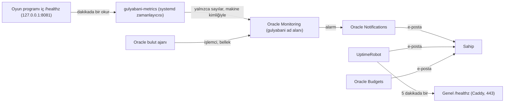

# İzleme Tasarımı (Platform) — U1 Yürüyen İskelet

Bu belge, `observability-design`'daki izleme stratejisinin Oracle sunucusunda hangi ücretsiz araçlarla uygulanacağını tasarlar: hangi ölçüm nereden okunur, hangi eşikte kime uyarı gider, hizmet hedefleri (SLO) nasıl ölçülür, günlükler nerede durur. İskelette yalnızca program içindeki hazırlık (günlük, iki sağlık ucu, ölçümler) ve sistem günlüğü ayarı vardır; dış denetim, ölçümlerin Oracle'a gönderilmesi ve uyarı kanalı izleme aşamasında kurulur (ISS-03, team.md Deployment notu). Kişisel veri sunucudan dışarı çıkmaz: dışarı giden yalnızca sayılardır.

## Sources

- İzleme tasarımı: `nfr-design/observability-design.md` (observability-design; Günlük Kaydı, Bellek İçi Ölçümler, Sağlık Uçları, Hizmet Hedefleri, Uyarı Eşikleri, Bileşen Başına Sağlık ve Hata Ölçümü).
- Hız tasarımı: `nfr-design/performance-design.md` (performance-design; ölçüm noktası, kesinleştirme %95 ≤ 20 ms varsayımı, olay döngüsü gecikmesi).
- Güvenlik tasarımı: `nfr-design/security-design.md` (security-design; iç kapı 8081, günlükte yasak alanlar, IP okunmaz).
- Ölçek tasarımı: `nfr-design/scalability-design.md` (scalability-design; büyüme tetikleri, bellek 400 MB uyarısı, yazım bekleyen istek sınırı 2.000, Maliyet).
- Dayanıklılık tasarımı: `nfr-design/reliability-design.md` (reliability-design; Hizmet Yöneticisi, ardışık çökmeler, Erişilebilirlik Hedefi %99, Temizlik ve Saklama).
- Mantıksal parçalar: `nfr-design/logical-components.md` (logical-components; Arıza Alanları, InternalHealthListener).
- Yapı taşları: `inception/domain-design/components.md` (components; Housekeeping'in silmeleri ölçmesi, EventRecorder hata sayısı).
- Fonksiyonel tasarım: `functional-design/functional-spec.md` (functional-spec; A13 sağlık kontrolü ve 24 saatte silme, A14 bot testi).
- Sözleşmeler: `inception/contract-design/contract-summary.md` (contract-summary; C2 `/healthz` ve "dışarıdan izleyecek ücretsiz araç" açık sorusu).
- Altyapı: `infrastructure-specification.md` (Oracle Monitoring, Notifications, Budgets, UptimeRobot satırları; sistem günlüğü ayarı).
- Proje ve aşama kuralları: `memory/project.md` (IP saklama yasağı, sıfır maliyet, 24 saatte silme), `memory/phases/operation.md` (SLO yüzde ve pencereyle, uyarı SLO ihlalinden önce, her bileşenin sağlık ve hata ölçümü).

## Ölçümlerin Yolu

<!-- Text fallback: Sunucudaki küçük bir zamanlayıcı (gulyabani-metrics) dakikada bir oyun programının iç sağlık ucunu okur ve yalnızca sayıları makinenin kendi kimliğiyle Oracle Monitoring'e gönderir. Oracle'ın bulut ajanı da işlemci ve bellek ölçümlerini aynı yere gönderir. Monitoring'deki alarmlar Oracle Notifications üzerinden sahibe e-posta gönderir. UptimeRobot dışarıdan 5 dakikada bir genel sağlık ucunu dener ve sorun olursa sahibe e-posta gönderir. Oracle Budgets harcama olursa sahibe e-posta gönderir. -->

- **Makine kimliği, sır yok:** ölçüm gönderen betik Oracle'a "instance principal" ile bağlanır: makine kendi kimliğiyle yetkilendirilir, sunucuda anahtar ya da şifre durmaz (NFR7.8). Oracle'da bir dinamik grup (yalnızca bu makine) ve tek bir izin kuralı tanımlanır: bu grup yalnızca `gulyabani` ad alanına ölçüm yazabilir.
- **Betik:** `infra/metrics-push.sh`, ayrı ayrıcalıksız kullanıcıyla (`gulyabani-metrics`) `systemd` zamanlayıcısıyla dakikada bir çalışır; iç ucu okur, disk doluluğunu ve hizmetin yeniden başlatılma sayısını (`systemctl show -p NRestarts gulyabani`) ekler ve Oracle CLI ile gönderir. Gönderim başarısızsa bir sonraki dakika yeniden dener; hata yalnızca betiğin kendi günlüğüne yazılır, oyunu etkilemez.
- **Ne gider, ne gitmez:** yalnızca aşağıdaki tablodaki sayılar ve sürüm. Oda kodu, oyun numarası, nick, IP ya da günlük satırı Oracle'a gitmez.

## Metrics & KPIs

| Metric | Source | Threshold | Why it matters |
|---|---|---|---|
| Dış erişilebilirlik (`/healthz` 200 ve `"status":"ok"`) | UptimeRobot, 5 dakikada bir, `https://<alt adres>/healthz` | 2 art arda başarısız denetim (10 dk) | Erişilebilirlik SLO'su %99 (NFR6.1, NFR13.5); yazım iş parçacığı yanıt vermezse `/healthz` 503 döndüğü için "süreç ayakta ama yazamıyor" da yakalanır |
| `commandLatencyP95Ms` (son 5 dk) | İç uç → `gulyabani` ad alanı | > 300 ms | Hız SLO'su ve büyüme tetiği (NFR13.6, NFR2.6) |
| `errorCount` artışı | İç uç (sayaç) → dakikalık fark | 10 dakikada > 10 | Hata SLO'su (NFR13.6) |
| `memoryRssMb` | İç uç | > 400 MB | 512 MB kesin sınıra çarpmadan önce (NFR2.4, NFR13.6) |
| `CpuUtilization` | Oracle bulut ajanı (`oci_computeagent`) | 5 dk ortalama > %70 | Büyüme tetiği (NFR2.1, NFR2.6) |
| `commitP95Ms` | İç uç | > 20 ms (15 dk boyunca) | Hız bütçesinin dayandığı disk varsayımı (NFR1.3, performance-design) |
| `eventLoopDelayP95Ms` | İç uç | > 20 ms (15 dk boyunca) | Hız bütçesinin bozulduğunun erken işareti (performance-design) |
| `writeQueueDepth` | İç uç | > 1.600 (2.000 sınırının %80'i) | Disk yavaşlıyor; `server_busy` yaklaşıyor (scalability-design Aşırı Yükte Davranış) |
| `connections`, `activeRooms` | İç uç | ≥ 1.600 bağlantı ya da ≥ 240 oda (sınırların %80'i) | Koruma sınırı yaklaşıyor (NFR2.5); program ayrıca `limit.near` günlüğü yazar |
| `sweepFailed` | İç uç (son tarama) | Art arda 2 taramada > 0 | 24 saatte silme yükümlülüğü (BR12.1, project.md Mandated, C-15) |
| Hizmet yeniden başlatma sayısı (`NRestarts` farkı) | Betik (`systemctl show`) | 10 dakikada > 3 | Çökme döngüsü (reliability-design Hizmet Yöneticisi) |
| Disk doluluğu (`/`) | Betik (`df`) | > %80 | Depo + sistem günlüğü + sürüm klasörleri (infrastructure-specification Depolama) |
| Aylık harcama | Oracle Budgets | Gerçek harcama 1 USD'nin %100'ü | Sıfır maliyet (NFR3.1); "kullandıkça öde"ye geçişten sonra önemlidir |
| `activeMatches` | İç uç | Eşik yok (bilgi) | Yayın betiği yüklemeden önce okur (C2); panoda gösterilir |

## Alerts

| Alert | Condition | Severity | Routes to |
|---|---|---|---|
| Hizmet yok | UptimeRobot: genel `/healthz` 2 art arda denetimde başarısız (makine durdurulmuş, Caddy ya da program kapalı, sertifika geçersiz) | P1 | Sahibin e-postası (UptimeRobot) |
| Hata artışı | `errorCount` 10 dakikada 10'dan fazla arttı | P2 | Sahibin e-postası (Oracle Notifications, `gulyabani-alerts` konusu) |
| Yavaşlama | `commandLatencyP95Ms` > 300 ms, 5 dakika boyunca | P2 | Sahibin e-postası (Notifications) |
| Bellek | `memoryRssMb` > 400 MB, 5 dakika boyunca | P2 | Sahibin e-postası (Notifications) |
| Silme başarısız | `sweepFailed` > 0, art arda 2 taramada (20 dk) | P2 | Sahibin e-postası (Notifications) |
| Çökme döngüsü | Hizmet 10 dakikada 3'ten fazla yeniden başladı | P2 | Sahibin e-postası (Notifications) |
| İşlemci | `CpuUtilization` 5 dk ortalama > %70, 15 dakika boyunca | P3 | Sahibin e-postası (Notifications) |
| Disk / kesinleştirme / olay döngüsü / yazım sırası / koruma sınırı | Metrics & KPIs tablosundaki eşikler | P3 | Sahibin e-postası (Notifications) |
| Harcama | Oracle Budgets: gerçek harcama 1 USD | P2 | Sahibin e-postası (Budgets) |
| Ölçüm gelmiyor | `gulyabani` ad alanına 10 dakikadır veri gelmedi (alarmın "veri yok" durumu) | P3 | Sahibin e-postası (Notifications) |

Önem düzeyleri: P1 hizmet tamamen yok, hemen bakılır; P2 oyuncular etkileniyor ya da yasal yükümlülük (silme) tehlikede, aynı gün bakılır; P3 eğilim, haftalık bakılır. Tek kişilik hobi oyunudur: nöbet ve telefonla arama yoktur; uyarı yalnızca e-postadır. Her uyarı ilgili SLO ihlal edilmeden önce tetiklenir (operation.md): 10 dakikalık kesinti uyarısı %99 SLO'sunun aylık ~7 saatlik payının çok altındadır; 300 ms ve 10 hata eşikleri 150 ms / %0,1 hedeflerinin 7 günlük penceresi dolmadan gelir.

### İlk müdahale

| Uyarı | İlk bakılacak yer | İlk adım |
|---|---|---|
| Hizmet yok | Oracle konsolunda makine durumu; `systemctl status gulyabani caddy`; `journalctl -u gulyabani -n 100` | Makine durdurulmuşsa başlatılır (ücretsiz hesapta ikinci kez olursa [Q1] C gereği "kullandıkça öde"ye geçilir); program çöküyorsa son yayın geri alınır (`cicd-pipeline.md` Geri Alma) |
| Hata artışı / çökme döngüsü | `journalctl -u gulyabani -p err` (`event`, `err`, `commandId` alanları) | Son yayınla başladıysa geri alma; değilse hata kaydıyla düzeltme parçası |
| Yavaşlama / işlemci / bellek | İç uç ve Oracle ölçümleri | scalability-design Büyüme Yolu: önce ucuz ayarlar, sonra ücretsiz hak içinde makineyi büyütme |
| Silme başarısız | `journalctl -u gulyabani` içinde `sweep.done` ve `error` satırları | Düzeltme parçası; silinemeyen odalar sonraki taramada yeniden denenir (C8) |
| Harcama | Oracle konsolunda maliyet çözümlemesi | Ücret doğuran kaynak kapatılır |

Ayrıntılı müdahale kitapçıkları (iletişim ve yükseltme yolları dahil) Olay Müdahalesi aşamasında yazılır (operation.md).

## SLIs / SLOs

| SLI | SLO target | Measurement window |
|---|---|---|
| Erişilebilirlik: başarılı dış `/healthz` denetimi / bütün denetimler (UptimeRobot, 5 dakikada bir) | ≥ %99 | 30 gün kayan |
| Hız: sunucu işleme süresi 150 ms'nin altında kalan komutlar / bütün komutlar (`commandsUnder150Ms` / `commandsTotal` farkları) | ≥ %95 | 7 gün kayan |
| Hata: `internal_error` ile biten komutlar / bütün komutlar (`commandInternalErrors` / `commandsTotal` farkları) | ≤ %0,1 | 7 gün kayan |

- SLI ve SLO değerleri observability-design Hizmet Hedefleri'yle aynıdır; burada yalnızca nasıl ölçüldükleri eklenir.
- 7 günlük oranlar için iç uç açılıştan beri sayaçlar verir: `commandsTotal`, `commandsUnder150Ms`, `commandInternalErrors` (infrastructure-specification Hizalamalar; observability-design ölçümlerine yalnızca ekleme). Betik dakikalık farkları gönderir; program yeniden başlayınca sayaçlar sıfırlanır, fark negatifse o dakika sıfırdan başlamış sayılır. Oracle Monitoring ölçümleri 90 gün saklar; 7 günlük oran Monitoring sorgusuyla (`sum` üzerinden) hesaplanır.
- Erişilebilirlik oranı UptimeRobot'un kendi aylık raporundan okunur.
- İskelette yalnızca program içi sayaçlar ve iç uç vardır; SLO ölçümü izleme aşamasında başlar.

## Logs & Tracing

| Konu | Karar |
|---|---|
| Program günlüğü | Satır başına bir JSON, standart çıktı → `systemd` sistem günlüğü (observability-design Günlük Kaydı); alan beyaz listesi, mesaj metni yok |
| Caddy günlüğü | Yalnızca `ERROR` düzeyi, erişim ve `http.stdlib` günlükçüleri dışlanmış (infrastructure-specification Caddy ayarı) |
| Saklama | Sistem günlüğü 7 gün ya da 200 MB (hangisi önce dolarsa) |
| Toplama | Günlükler sunucudan dışarı gönderilmez (Oracle Logging ajanı kurulmaz): kişisel veri yüzeyi en küçük kalır ve tek sunucuda gerek yoktur. Okuma: SSH ile `journalctl -u gulyabani -o cat` |
| Arama anahtarları | `event`, `commandId`, `connId`, `roomCode` (observability-design İz Sürme) |
| Dağıtık izleme | Yok (tek süreç; observability-design NFR13.7) |
| IP denetimi | İskelet denetiminde ve her büyük yayından sonra `journalctl -u caddy -u gulyabani` IPv4/IPv6 desenleriyle taranır (security-design NFR7.11) |

## Pano (Dashboard)

İskelette pano yoktur (observability-design). İzleme aşamasında Oracle konsolunda tek bir ücretsiz pano kurulur:

| Bölme | Gösterilen |
|---|---|
| Trafik | `activeRooms`, `activeMatches`, `connections` |
| Hız | `commandLatencyP95Ms`, `commitP95Ms`, `eventLoopDelayP95Ms` |
| Hata | `errorCount` farkı, `sweepFailed`, yeniden başlatma sayısı |
| Kaynak | `CpuUtilization`, `memoryRssMb`, disk doluluğu |
| SLO | 7 günlük hız ve hata oranları |

## Ne Zaman Kurulur

| Parça | İskelet (U1 Kod Üretimi) | İzleme aşaması (ISS-03) |
|---|---|---|
| JSON günlük, alan beyaz listesi, iki sağlık ucu, iç ölçümler ve SLO sayaçları | Evet | — |
| Sistem günlüğü sınırları, Caddy günlük ayarı | Evet (kurulum betiği) | — |
| Oracle Budgets 1 USD uyarısı | Evet (hesap açılınca) | — |
| UptimeRobot dış denetimi | — | Evet |
| `gulyabani-metrics` betiği, dinamik grup ve izin, alarmlar, `gulyabani-alerts` konusu ve e-posta aboneliği | — | Evet |
| Pano | — | Evet |

İskelet denetim noktasında uyarılar henüz e-postaya gelmez; sahip dış adresi ve telefon denemelerini kendisi görür, hatalar sistem günlüğünde durur. Bu, izleme aşaması çalışma planına eklenene kadar kabul edilen boşluktur.

## Assumptions & Open Questions

- [assumption] UptimeRobot'un ücretsiz planı (5 dakikalık denetim, e-posta uyarısı) kişisel ve ticari olmayan bu oyun için uygundur; ücretsiz planda uyarı ilk başarısız denetimde geliyorsa bu, 10 dakikalık eşikten daha erken uyarıdır ve SLO'yu bozmaz.
- [assumption] Oracle Monitoring ve Notifications'ın ücretsiz hakları (ayda 500 milyon ölçüm noktası, 1.000 e-posta) bu kullanım için yeterlidir; dakikada ~12 ölçüm ayda ~520 bin noktadır.
- [assumption] Oracle CLI ARM64 Ubuntu'ya Python sanal ortamıyla kurulur; kurulamazsa betik aynı imzalı isteği Oracle'ın Python SDK'sıyla yapar. Sunucuda yine sır durmaz.
- Açık soru: uyarıların sahibin e-postasından başka bir kanala (ör. telefon bildirimi) gidip gitmeyeceği izleme aşamasında sahibe sorulur (ISS-03).
