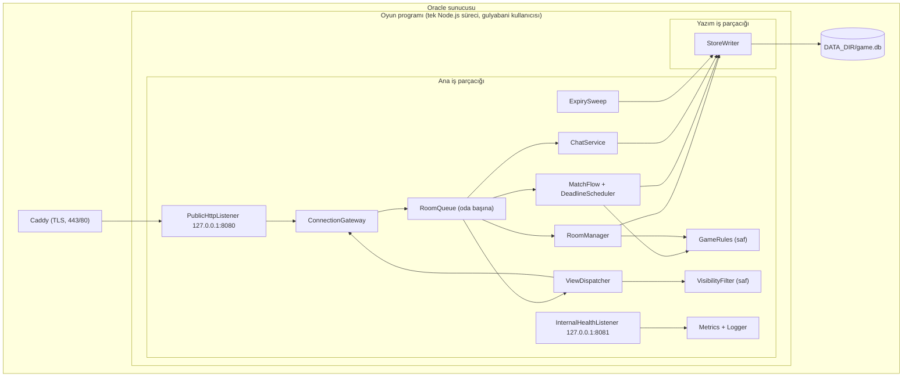

# Mantıksal Parçalar — U1 Yürüyen İskelet

Bu belge, NFR tasarım kararlarının programın hangi parçasında uygulandığını gösterir: parça listesi, her parçanın nerede çalıştığı, arıza alanları ve etki yarıçapı, yalıtım yöntemi ve paylaşılan kaynaklar. Altyapı Tasarımı'na köprüdür: sunucuda neyin çalışacağını (tek süreç, iki dinleyici, bir yazım iş parçacığı, Caddy) ve neyin nerede saklanacağını buradan alır. Alan Tasarımı'nın yapı taşları (components) burada koddaki mantıksal parçalara iner; yeni yapı taşı eklenmez, yalnızca yapı taşlarının içindeki teknik parçalar (sıra, yazım iş parçacığı, gönderim) adlandırılır.

## Sources

- Yapı taşları: `inception/domain-design/components.md` (components; Bileşen Özeti, Varlık Sahipliği, Yürüyen iskelette kullanılan yapı taşları).
- Sözleşmeler: `inception/contract-design/contract-summary.md` (contract-summary; C1–C9; C8 silme sırası, C9 depo bölümleri).
- Teknoloji kararları: `nfr-requirements/tech-stack-decisions.md` (tech-stack-decisions; Karar Tablosu, TD-01–TD-04).
- Hız, güvenlik, ölçek, dayanıklılık ve izleme gereksinimleri: `nfr-requirements/performance-requirements.md` (performance-requirements), `nfr-requirements/security-requirements.md` (security-requirements), `nfr-requirements/scalability-requirements.md` (scalability-requirements), `nfr-requirements/reliability-requirements.md` (reliability-requirements), `nfr-requirements/observability-requirements.md` (observability-requirements).
- Fonksiyonel tasarım: `functional-design/functional-spec.md` (functional-spec; Komut Yönlendirme Tablosu, A12, A13) ve `functional-design/rules.md` (rules).
- Bu aşamanın öteki belgeleri: `performance-design.md`, `security-design.md`, `scalability-design.md`, `reliability-design.md`, `observability-design.md`.
- NFR Gereksinimleri incelemesinden devreden iki küçük not (TD-02 ifadesi, NFR7.13/NFR7.14 sırası) ve Kod Üretimi'ne bırakılan kural hizalamaları.
- Özet onayı: `nfr-design-questions.md` (Looks correct).

## Çalışma Yerleri

<!-- Text fallback: Oracle sunucusunda Caddy TLS'i yapar ve istekleri oyun programının 127.0.0.1:8080'deki genel dinleyicisine iletir. Oyun programı tek Node.js sürecidir ve gulyabani kullanıcısıyla çalışır. Ana iş parçacığında genel dinleyici, 127.0.0.1:8081'deki iç sağlık dinleyicisi, ConnectionGateway, oda başına sıra, RoomManager, MatchFlow ve süre zamanlayıcısı, saf kural modülü GameRules, ChatService, saf görünüm süzgeci VisibilityFilter, ViewDispatcher, ExpirySweep ve ölçüm/günlük modülü vardır. Yazım iş parçacığında yalnızca StoreWriter çalışır ve game.db dosyasına tek o yazar. Komutlar ConnectionGateway'den oda sırasına, oradan RoomManager, MatchFlow ya da ChatService'e gider; bunlar yazım isteklerini StoreWriter'a verir. Oda sırası değişince ViewDispatcher görünümleri VisibilityFilter'la üretip ConnectionGateway üzerinden gönderir. İç dinleyici ölçümleri okur. -->

Tarayıcıda WebClient (Preact paketi) çalışır; CI'da ve geliştirme makinesinde BotPlayer (bot testi) ve test araçları çalışır. Sunucuya yalnızca derlenmiş program, derlenmiş web paketi ve içerik kataloğu yüklenir.

## Parça Envanteri

| Parça | Yapı taşı (components) | Çalıştığı yer | Sorumluluk | Uygulanan NFR desenleri |
|---|---|---|---|---|
| PublicHttpListener | ConnectionGateway | Ana | `/`, `/oda/{kod}`, `/static`, `/ws` geçişi, genel `/healthz`; güvenlik başlıkları | Başlıklar ve CSP (NFR7.9), statik izin listesi, önbellek başlıkları (NFR1.6), geçiş denetimi (NFR7.3) |
| InternalHealthListener | ConnectionGateway | Ana | İç `/healthz` | Ayrı kapı (NFR7.12), ölçümler (NFR13.1, NFR13.4) |
| ConnectionGateway | ConnectionGateway | Ana | Bağlantı, `hello`/oturum, mesaj doğrulama, hız sınırları, bağlantı izleyicisi, yönlendirme | Doğrulama hattı (NFR7.5), oturum (NFR7.4), sınırlar (NFR7.7), kopma kararı (NFR5.5) |
| RateLimiter | ConnectionGateway | Ana | Bellek içi sayaçlar (a)–(g) | Kayan pencere, kova, genel sayaçlar (NFR7.7, NFR2.5) |
| RoomQueue | MatchFlow (yürütme) | Ana | Odanın tek sırası, tekrar denetimi, oda içi boru hattı, sıra üst sınırı | Tek sıra (BR10.2, NFR2.2), boru hattı (NFR1.1), yük atma |
| RoomManager | RoomManager | Ana | Oda, katılımcı, lobi; oda kodu üretimi; boş lobi denetimi | Rastgelelik (NFR15.1), BR10.5, NFR7.7 e |
| MatchFlow + DeadlineScheduler | MatchFlow | Ana | Fazlar, moderatör adımları, oyun başına tek zamanlayıcı, duraklatma | Sistem komutları ve tekrar anahtarları (NFR5.5, NFR5.6), açılışta geciken süreler (NFR5.2) |
| GameRules | GameRules | Ana (saf) | `dealRoles`, `decide`, `legalActions`; `enterNight` | Saf modül, dışarıdan saat ve rastgelelik (C3, NFR5.7, NFR15.1) |
| ChatService | ChatService | Ana | Kanallar, yazma izinleri, kanal başına sınırlar | 300 karakter ve düz metin (BR6.4), bellekte 100 / depoda 2.000 mesaj (NFR1.5, NFR3.2) |
| VisibilityFilter | VisibilityFilter | Ana (saf) | Alıcıya özel `FilteredView` | Tek süzgeç ve işaretli tür (NFR8.1), izin listesiyle alan ekleme |
| ViewDispatcher | ConnectionGateway | Ana | Oda başına gönderim turu, aynı görünüm atlama, gece eşit gönderim, tampon denetimi | Birleştirme (NFR1.4, NFR2.3), NFR8.3 |
| StoreWriter | MatchFlow, RoomManager, ChatService, ConnectionGateway'in depo bölümleri (C9) | Yazım iş parçacığı | Tek depo bağlantısı, toplu işlem + geri alma noktaları, açılış yüklemesi, bütünlük denetimi, WAL kısaltma | Grup kaydı (NFR1.3, NFR5.1), tek yazar (NFR2.2), bozuk depo (NFR5.9), `secure_delete` (NFR7.14) |
| Repositories | Her yapı taşının kendi bölümü | Yazım iş parçacığı | `room_`, `match_`, `chat_`, `session_` tablolarına yalnızca sahibinin ifadeleri | Bölüm kuralı (C9), yalnızca ekleme (NFR5.10) |
| ExpirySweep | U1'in küçük temizlik zamanlayıcısı (U7'de Housekeeping devralır) | Ana (sorgular yazım iş parçacığında) | 10 dakikada bir ve açılışta silme; boş oturum; bozuk dosya; WAL kısaltma | C8 sırası, BR12.1, BR12.3 |
| Metrics + Logger | — (ortak teknik parça) | Ana | Bellek içi ölçümler, JSON günlük, alan beyaz listesi | NFR13.2–NFR13.4, NFR8.4, NFR7.11 |
| ContentCatalog | ContentCatalog | Ana (açılışta yüklenir) | 2 rol, `tr.json` | C4 biçim denetimi |
| Shared schemas (`src/shared/`) | — | Sunucu, tarayıcı, botlar | C1 mesajları, C5 görünüm, neden kodları (`zod`) | Tek doğrulama kaynağı (NFR7.5) |
| WebClient | WebClient | Tarayıcı | Ekranlar, yeniden bağlanma, onay bekleyen komutlar, saat farkı | NFR4.2, NFR14.1, NFR1.6, NFR9.1 |
| BotPlayer | BotPlayer | CI / geliştirme | Bot moderatör sürücüsü ve botlar; rapor | NFR12.2, NFR8.2, NFR13.8 |
| Caddy | — (altyapı) | Sunucu, ayrı süreç | TLS, yönlendirme, iletme | NFR7.1, NFR7.2, NFR7.11 |

## Arıza Alanları ve Etki Yarıçapı

| Arıza alanı | İçindekiler | Bozulursa etkilenen | Yalıtım |
|---|---|---|---|
| Tek komut | Bir komutun kural hesabı ve yazım isteği | Yalnızca o komut (`internal_error`) | `try/catch`, geri alma noktası |
| Tek oda | Odanın sırası, durumu, zamanlayıcısı | O oda (ör. moderatör kopunca yalnızca o oda duraklar) | Oda başına sıra; odalar arası paylaşılan durum yok |
| Tek alıcı | Bir bağlantı ve tamponu | O kişi | Tampon sınırı, atlama, kapatma |
| Toplu işlem | Bir kesinleştirmedeki komutlar | ≤ 512 komut, birden çok oda | Komutlar yeniden gönderilir; durum değişmez |
| Yazım iş parçacığı | Depo bağlantısı | Bütün odaların yazımı, birkaç saniye | Bir kez yeniden başlatma, sonra süreç çıkışı |
| Ana iş parçacığı / süreç | Her şey | Bütün oyuncular, ≤ 15 sn | Hizmet yöneticisi + depodan yükleme |
| Oyun deposu dosyası | `game.db` | Süren odalar | Bozuksa kenara alma; kayıt deposu (U7) ayrı dosya |
| Caddy | TLS ve iletme | Bütün dış erişim | Ayrı süreç ve hizmet; oyun programı ayakta kalır |
| Sunucu | Hepsi | Hepsi | v1'de yedek sunucu yok (kabul edilen risk, NFR2.6) |

## Paylaşılan Kaynaklar

| Kaynak | Paylaşanlar | Koruma |
|---|---|---|
| Ana iş parçacığının işlemci zamanı | Bütün odalar ve bağlantılar | Disk beklemesi yazım iş parçacığında; ağır hesap yok; olay döngüsü gecikmesi ölçülür |
| `game.db` | MatchFlow, RoomManager, ChatService, ConnectionGateway (bölümleri ayrı) | Tek yazar (StoreWriter); bölüm öneki kuralı (C9) |
| Bellek | Hepsi | 512 MB bütçe, yığın sınırı, silinen odanın bellekten atılması |
| Bağlantı ve oda sayıları | Bütün kullanıcılar | Genel koruma sınırları |
| Disk | Depo, sistem günlüğü | Depo ≤ ~300 MB (24 saatte silme), günlük ≤ 200 MB |

## Depo Dosyaları

Bu tasarım iki SQLite dosyasını esas alır (tech-stack-decisions TD-04, reliability-requirements NFR5.9):

| Dosya | İçerik | Ne zaman | Sahibi |
|---|---|---|---|
| `DATA_DIR/game.db` (+ `-wal`, `-shm`) | Oda verisi: `room_`, `match_`, `chat_`, `session_` | U1'den itibaren | StoreWriter |
| `DATA_DIR/records.db` | U7'nin 1 yıl saklanan kayıtları ve geri bildirimleri: `log_`, `feedback_` | U7'de eklenir | U7'nin kayıt yazarı |

## Kod Üretimi'ne Devreden Hizalamalar

NFR Gereksinimleri'nin incelemesi tamamlanmış belgeleri değiştirilmez; aşağıdakiler bu tasarımda kayda geçer ve Kod Üretimi'nde (kod, şemalar ve kural metinleri) uygulanır.

| Nerede | Hizalama |
|---|---|
| tech-stack-decisions TD-02 | "Sunucunun diskinde tek SQLite dosyası" ifadesi TD-04 ve NFR5.9 ile hizalanır: oda verisi `game.db`'de, U7 kayıtları ayrı `records.db`'de (yukarıdaki Depo Dosyaları). Bu tasarım iki dosyayı esas alır. |
| security-requirements | NFR7.14 satırı tabloda NFR7.13'ten önce duruyor; yalnızca sıra farkıdır, anlam etkilenmez. Bu tasarımın belgeleri numara sırasını izler. |
| rules.md BR12.2 | "IF isteğin kaynağı 127.0.0.1" → "IF istek iç kapıdan geldiyse" (security-design Sağlık Kontrolünün İç Kapısı) |
| rules.md BR9.2 | Yeniden bağlanma aralıkları: 1, 2, 4 saniye, sonra her 4 saniye, 0–500 ms sapma; "ağ geldi" ve "sayfa görünür" olaylarında hemen (reliability-design) |
| rules.md yeni BR12.4 | Lobide 15 dakika bağlı kimse yoksa oda süresi dolmuş sayılır; odaya bağlanmayan oturum 10 dakikada silinir (NFR7.7 d, e) |
| C1 ReasonCode | `server_busy` eklenir; `closed` mesajında `server_busy` ve `rate_limited` kullanımları (security-design) |
| C1 sistem komutları | `system.connectionLost`, `system.connectionRestored` (yalnızca sunucu içi; C3 RuleCommand aktörü `system`) |
| C2 `/ws` | 403 ve 503 yanıtları eklenir |
| C2 `/healthz` | İç kapı kuralı; `connections` ve `errorCount` U1'de; iç uçta ek ölçüm alanları (observability-design) |

## Assumptions & Open Questions

- [assumption] Parça adları (RoomQueue, ViewDispatcher, StoreWriter, ExpirySweep, RateLimiter, PublicHttpListener, InternalHealthListener) kod içi adlardır ve Alan Tasarımı'nın yapı taşlarının içinde kalır; yeni yapı taşı değildir.
- [assumption] `records.db` adı benim seçtiğim varsayılandır; U7 kendi tasarımında kesinleştirir.
- Açık soru: Caddy, `systemd` hizmet dosyası, ağ kuralları, makine türü ve ücretsiz alt adres Altyapı Tasarımı'nda yazılır.
