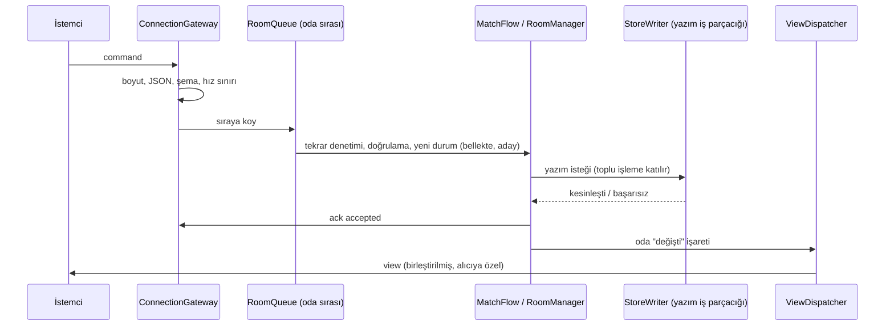

# Hız Tasarımı — U1 Yürüyen İskelet

Bu belge, hız gereksinimlerinin (NFR1.1–NFR1.6, NFR10.1, NFR14.1) nasıl karşılanacağını tasarlar: komutun sunucudaki yolu, disk yazımının grup kaydıyla toplanması, görünümlerin birleştirilmesi, tarayıcı paketinin boyutu ve saat eşitlemesi. Bütün parçalar tek sunucu programının içindedir (unit-of-work); parçaların listesi ve hangi iş parçacığında çalıştıkları `logical-components.md`'dedir. Kod örnekleri yalnızca kararı açıklamak içindir; asıl kod Kod Üretimi'nde yazılır.

## Sources

- Hız gereksinimleri: `nfr-requirements/performance-requirements.md` (performance-requirements; NFR1.1–NFR1.6, NFR10.1, NFR14.1, Kaynak Kullanımı Bütçesi).
- Ölçek gereksinimleri: `nfr-requirements/scalability-requirements.md` (scalability-requirements; Yük Tahmini — saniyede yaklaşık 130 komutluk zirve; NFR2.2 grup kaydı, NFR2.3 alıcı başına görünüm).
- Dayanıklılık gereksinimleri: `nfr-requirements/reliability-requirements.md` (reliability-requirements; NFR5.1 önce kayıt sonra kabul, tam eşitleme, geri alma noktaları).
- Güvenlik gereksinimleri: `nfr-requirements/security-requirements.md` (security-requirements; NFR7.5 mesaj sınırları, NFR8.3 gece görünümlerinin aynılığı).
- İzleme gereksinimleri: `nfr-requirements/observability-requirements.md` (observability-requirements; NFR13.4 son 5 dakikanın işleme süresi ölçümü).
- Teknoloji kararları: `nfr-requirements/tech-stack-decisions.md` (tech-stack-decisions; TD-01 Node.js, TD-03 tam durum kaydı, TD-04 tam eşitleme + grup kaydı; Preact + Vite).
- Fonksiyonel tasarım: `functional-design/functional-spec.md` (functional-spec; A12 komut işleme sırası, Komut Yönlendirme Tablosu) ve `functional-design/rules.md` (rules; BR4.7, BR9.6, BR10.2).
- Sözleşmeler: `inception/contract-design/contract-summary.md` (contract-summary; C1 tam görünüm, `serverTime`, `ping` 20 sn; C2 `/static`; C5 görünüm biçimi).
- Özet onayı: `nfr-design-questions.md` (Looks correct).

## Komutun Sunucudaki Yolu

Her komut aşağıdaki yolu izler. Bütün adımlar ana iş parçacığında çalışır; yalnızca disk yazımı ayrı yazım iş parçacığındadır (StoreWriter, `logical-components.md`).



<!-- Text fallback: İstemci komut gönderir. ConnectionGateway boyutu, JSON'u, şemayı ve hız sınırını denetler, komutu odanın sırasına koyar. Oda sırası tekrar denetimini ve doğrulamayı yapar, yeni durumu bellekte aday olarak hesaplar ve yazım isteğini StoreWriter'a verir. StoreWriter toplu işlemi kesinleştirince sonuç döner; komut kabul edilir, onay gider, oda değişti olarak işaretlenir ve ViewDispatcher birleştirilmiş, alıcıya özel görünümleri gönderir. -->

### Oda sırası ve oda içi boru hattı

- Her odanın tek bir bellek içi sırası vardır (RoomQueue, BR10.2). Odalar birbirini beklemez (NFR2.2).
- Bir odanın aynı anda **en fazla bir toplu yazımı** yoldadır. O yazım beklerken gelen komutlar sırada birikir.
- Yazım yolda değilken oda, sıradaki **bütün** komutları sırayla işler: her komut bir öncekinin aday durumu üzerine hesaplanır ve hepsinin yazım istekleri aynı toplu işleme girer. Böylece 26 kişinin aynı anda verdiği oylar bir ya da iki diske kesinleştirmede biter; oda içinde de yazım hızı komut sayısıyla değil kesinleştirme sayısıyla sınırlanır.
- Aday durum yalnızca kesinleştirme başarılı olunca odanın gerçek durumu olur. Görünümler ve onaylar hep kesinleşmiş durumdan üretilir (önce kayıt sonra kabul, NFR5.1).
- Toplu işlemde bir odanın k. komutu başarısız olursa o komut `internal_error` alır; aynı odanın aynı toplu işlemdeki sonraki komutları da geri alınır ve kesinleşmiş durumun üzerine yeniden hesaplanmak üzere sıranın başına geri konur (ayrıntı `reliability-design.md`).

### Grup kaydı (StoreWriter)

- Ana iş parçacığı, aynı olay döngüsü turunda hazır olan bütün yazım isteklerini toplar ve yazım iş parçacığında başka toplu işlem yoksa hemen (bir sonraki turda) gönderir. Bir toplu işlem yoldayken gelenler bir sonrakine birikir. Bir toplu işlem en fazla 512 istek taşır.
- Yazım iş parçacığı her toplu işlemi tek bir SQLite işleminde yapar: işlem açılır, her istek kendi geri alma noktasında (`SAVEPOINT`) çalışır, en sonda tek kesinleştirme yapılır. Depo WAL günlük modunda ve tam eşitlemeyle (`synchronous=FULL`) çalışır (TD-04).
- Sonuç ana iş parçacığına istek başına döner: kesinleşti, başarısız (neden), ya da bağımlılığı başarısız olduğu için geri alındı.

```text
batch = collect(readyWriteRequests, max = 512)
BEGIN IMMEDIATE
for req in batch:
    if req.dependsOn failed: mark(req, "aborted_dependency"); continue
    SAVEPOINT r; run(req.statements); check(req.expectedVersion)
    on error: ROLLBACK TO r; mark(req, "failed")
    RELEASE r
COMMIT            -- tek fsync; COMMIT başarısızsa toplu işlemin hepsi "failed"
post(results)
```

**Karar — yazımın ayrı iş parçacığında yapılması**

- *Bağlam:* `better-sqlite3` eşzamanlı çalışır; tam eşitlemeli bir kesinleştirme diskte %95'te 20 ms'ye kadar sürebilir (NFR1.3). Ana iş parçacığında yapılırsa bu süre boyunca hiçbir mesaj okunamaz, hiçbir görünüm gönderilemez.
- *Karar:* Oyun deposunu yalnızca bir yazım iş parçacığı (`node:worker_threads`) açar ve bütün okuma ve yazımları o yapar; ana iş parçacığının depo bağlantısı yoktur. Açılıştaki yükleme ve temizlik taramasının sorguları da aynı iş parçacığından geçer.
- *Sonuçlar:* (+) Disk beklerken ana iş parçacığı mesaj okumaya ve görünüm göndermeye devam eder; bir toplu işlem kesinleşirken sonraki birikir. (+) Depoya tek yazar yazar (C9 kuralı kendiliğinden sağlanır). (−) İstekler iş parçacıkları arasında kopyalanır; istek başına birkaç kilobayttır, maliyeti küçüktür. (−) Yazım iş parçacığının çökmesi ayrı bir hata yoludur (`reliability-design.md`).
- *Reddedilen seçenekler:* (1) Ana iş parçacığında eşzamanlı yazım: zirvede olay döngüsü neredeyse sürekli disk bekler; görünüm gönderimi ve hız hedefi bozulur. (2) Eşzamansız bir SQLite sürücüsü (geri çağırmalı): geri alma noktalı toplu işlem eşzamansız çağrılar arasında bölünür, hata durumunda yarım işlem riski artar; seçilen paketle (TD-02) de uyumsuzdur.

### Görünüm birleştirme (ViewDispatcher)

- Bir toplu işlem kesinleşince, değişen her oda "değişti" olarak işaretlenir. Görünümler komut başına değil, **oda başına gönderim turu** olarak üretilir (NFR2.3).
- Gönderim turu kuralı: odanın son turu 50 ms'den daha önce yapıldıysa yeni tur hemen (bir sonraki olay döngüsü turunda) yapılır; değilse son turdan 50 ms sonraya kurulur. Böylece bir alıcıya 50 ms'de en fazla bir görünüm gider ve son değişiklik en geç 50 ms içinde gider (NFR1.4).
- Bir gönderim turunda odadaki her bağlı alıcı için VisibilityFilter tek görünüm üretir, JSON'a çevrilir ve gönderilir.
- **Ortak blokların bir kez üretilmesi:** bir odadaki alıcılar en fazla beş görünürlük sınıfına ayrılır (moderatör, yaşayan gulyabani, yaşayan köylü, ölü oyuncu, lobideki kişi). VisibilityFilter her gönderim turunda `room`, `game` ve `chat` bloklarını sınıf başına **bir kez** üretir ve JSON metnine çevirir; alıcı başına yalnızca küçük `me` ve `myAction` blokları üretilip hazır metin parçalarıyla birleştirilir. Böylece bir gönderim turunun maliyeti alıcı sayısıyla değil sınıf sayısıyla büyür: sınıf başına ≤ 0,5 ms + alıcı başına ≤ 0,02 ms, 27 alıcılı odada tur başına **≤ 3 ms**. Sınıf ayrımı yalnızca bir hız yoludur; hangi alanın hangi alıcıya gideceği yine yalnızca süzgecin kurallarıyla belirlenir ve gizli bilgi testleri her alıcının son metnini sınar (security-design Gizli Bilgi). Alıcının bir önceki görünümüyle bayt bayt aynıysa o alıcıya gönderilmez; **ancak bu turda faz ya da adım değiştiyse (`stepVersion` arttıysa) bu atlama yapılmaz ve görünüm herkese aynı turda gider** (BR4.7, NFR8.3; gerekçesi `security-design.md` Gizli Bilgi).
- Bir alıcının gönderim tamponu 1 MB'ı aşarsa (yavaş bağlantı) o alıcıya bu tur görünüm gönderilmez; tampon boşalınca sonraki turda güncel tam görünümü alır (C6: kaçan görünüm sorun değildir). 4 MB'ı aşarsa bağlantı kapatılır ve istemci yeniden bağlanır.
- Onay (`ack`) birleştirilmez: komutun toplu işlemi kesinleşir kesinleşmez gönderilir.

### Görünüm boyutu

- Görünüm her zaman tamdır (C1). 26 oyunculu odada boyutu 32 KB'ın altında tutmak için her sohbet kanalı görünümde son 100 mesajla sınırlanır (NFR1.5); bellekte de kanal başına yalnızca son 100 mesaj tutulur, eskiler yalnızca depodadır.
- Görünümler sıkıştırılmadan gönderilir (`perMessageDeflate` kapalı): sıkıştırma her alıcı için ayrı işlemci ve bellek ister ve tek iş parçacıklı sunucuda gecikme ekler. U8 yük testi bant genişliğini sorun gösterirse açılır (performance-requirements varsayımı).

## Gecikme Bütçesi

Sunucu işleme süresi (NFR1.1), komutun okunmasından o komutun değişikliğini içeren gönderim turunun başlamasına kadar ölçülür.

| Adım | Simge | Bütçe (%95) | Not |
|---|---|---|---|
| Okuma, boyut, JSON, şema, hız sınırı | a | ≤ 1 ms | 16 KB üst sınırı |
| Oda sırasında bekleme | w | ≤ 20 ms | Odanın yoldaki toplu işlemi bitene kadar (en fazla bir kesinleştirme) |
| Tekrar denetimi, doğrulama, kural hesabı | k | ≤ 2 ms | Saf kural kodu; 26 koltuk |
| Toplu işlemin kesinleşmesi | c | ≤ 20 ms | NFR1.3 |
| Gönderim turunu bekleme | f | ≤ 50 ms − (k + c) | Yalnızca son 50 ms içinde tur yapıldıysa; aşağıya bakın |
| Görünüm üretimi (27 alıcı) | r | ≤ 3 ms | Ortak bloklar sınıf başına bir kez |

Satırlar düz toplanmaz, çünkü gönderim turu beklemesi kesinleştirmeyle örtüşür:

- **Son 50 ms içinde odada tur yoksa** (normal akıştaki tek komut): f = 0 ve toplam = a + w + k + c + r ≤ 1 + 20 + 2 + 20 + 3 = **46 ms**.
- **Son 50 ms içinde tur varsa** (yoğunluk): bu tur ancak odanın yoldaki toplu işlemi kesinleşince yapılmış olabilir; o an komutumuzun beklemesi (w) biter ve hesaplanmaya başlar. Turun aralık sayacı o andan başladığı için f ≤ 50 − (k + c) olur ve toplam = a + w + k + c + f + r ≤ a + w + 50 + r ≤ 1 + 20 + 50 + 3 = **74 ms**.

En kötü durum (74 ms) bile 100 ms'nin altında kaldığı için iskeletin tek odada 26 botla %95'te 100 ms hedefi (NFR1.1) Oracle sunucusunda bu bütçeyle karşılanır; CI'daki 300 ms sınırına da geniş pay kalır. Bütçe c ≤ 20 ms varsayımına dayanır (Assumptions); bot testi raporu (NFR13.8) gerçek %95 değerini gösterir.

## Disk Yazımı Kapasitesi

- Zirve: saniyede yaklaşık 130 komut (scalability-requirements Yük Tahmini); hedef en az 300 komut/saniye (NFR1.3).
- Kesinleştirme 20 ms sürerse saniyede en az 50 toplu işlem yapılır; 300 komut/saniyede toplu işlem başına ortalama 6 komut düşer, 512'lik üst sınırın çok altındadır.
- Her kabul edilen komut, değiştirdiği kayıtları yeniden yazar: oyun başına tek satırlık tam durum kaydı (TD-03; birkaç kilobayt) ya da oda/katılımcı/sohbet satırı. WAL dosyası kendiliğinden (1.000 sayfada bir) diske aktarılır; temizlik taramasından sonra ayrıca kısaltılır (security-design, NFR7.14).
- Ölçüm testi (NFR1.3): yazım iş parçacığına saniyede 300 komutluk yapay yük verilir; toplu kesinleştirme süresi ve komut işleme süresi ölçülür. Oracle sunucusundaki iskelet denemesinde engelleyicidir.

## Bellek ve İşlemci

- Oyun sırasında depodan okuma yoktur: etkin odaların, oyunların, oturumların ve son sohbet mesajlarının hepsi bellekte tutulur; depo yalnızca kalıcılık içindir. Bellek bütçesinin dağılımı `scalability-design.md`'dedir (toplam 512 MB, NFR2.4).
- Kural hesabı ve görünüm üretimi küçüktür; ağır hesap yoktur. Olay döngüsü gecikmesi ölçülür ve iç sağlık ucunda verilir (`observability-design.md`); %95'te 20 ms'yi geçmesi hız bütçesinin bozulduğunun erken işaretidir.

## Tarayıcı Tarafı

- **Paket boyutu (NFR1.6):** Preact + kendi parçalarımız + düz CSS. Vite derlemesi dosya adlarına içerik özeti koyar; betik ve stillerin sıkıştırılmış toplamı CI'da ölçülür ve 150 KB'ı aşarsa CI başarısız olur. Kod bölme yoktur (tek küçük paket; ilk açılışta her şey gerekir).
- **Sıkıştırma ve önbellek:** derleme her dosyanın Brotli ve gzip sıkıştırılmış kopyasını önceden üretir; sunucu tarayıcının kabul ettiği kopyayı verir. İçerik özetli dosyalar `Cache-Control: public, max-age=31536000, immutable` ile, HTML ise `Cache-Control: no-cache` ile verilir (yeni sürüm hemen görülsün, C2).
- **Yazı tipi:** sistem yazı tipleri kullanılır; indirilen yazı tipi yoktur (paket bütçesi).
- **Açılış ölçümü:** iskelet denetiminde tarayıcının mobil ölçüm aracıyla (orta sınıf Android, 4G benzetimi) sayfanın kullanılabilir olduğu süre ölçülür; hedef en fazla 3 saniye.
- **320 piksel ve tarayıcılar (NFR10.1):** düzen tek sütunlu ve akışkandır; derleme hedefi `es2020` (Android Chrome, iOS 16+ Safari ve masaüstü tarayıcıların son iki sürümü bunu destekler). Erişilebilirlik taraması 320 px genişlikte çalışır (tech-stack-decisions NFR9.1).

## Saat Eşitlemesi (NFR14.1)

- Her `view` ve `pong` mesajı `serverTime` taşır. İstemci `pong` geldiğinde gidiş-dönüş süresini ölçer ve farkı `offset = serverTime + rtt/2 − yerel saat` olarak hesaplar; son 5 ölçümün en kısa gidiş-dönüşlüsünü kullanır (ağ dalgalanmasına karşı).
- `view` mesajındaki `serverTime` gidiş-dönüş bilgisi taşımadığı için yalnızca hiç `pong` gelmemişken (bağlantının ilk anı) kaba fark olarak kullanılır.
- Geri sayım `deadline − (yerel saat + offset)` ile, ekran yenileme döngüsünde çizilir. Telefonun saati yanlış olsa da sapma gidiş-dönüş yarısının hatasıyla sınırlıdır (normal mobil ağda 1 saniyenin çok altında).
- Birim testi: istemci saati 5 dakika kaydırılmış bot, kalan süreyi sunucuyla 1 saniye içinde hesaplar.

## Uçtan Uca Yansıma (NFR1.2)

Uçtan uca yansımanın bütçesi: sunucu işleme (%95'te ≤ 150 ms, NFR2 yükünde) + mobil ağın iki yönü + tarayıcıda çizim (≤ 50 ms). 1 saniyelik hedefin büyük kısmı mobil ağa kalır. İskelette gerçek telefon denemesinde gözle, U8'de yük testiyle ölçülür.

## Assumptions & Open Questions

- [assumption] Oracle blok diskinde tam eşitlemeli kesinleştirmenin %95'te 20 ms'nin altında kaldığı varsayılır (NFR1.3'ün dayanağı); Altyapı Tasarımı'nda makine seçilince ve iskelet denemesinde ölçülür. Aşarsa önce toplu işlem boyutu ve gönderim turu aralığı ayarlanır, hız hedefi gevşetilmez.
- [assumption] Görünüm boyutu ve üretim süreleri (sınıf başına ≤ 0,5 ms, alıcı başına ≤ 0,02 ms, tur başına ≤ 3 ms) tahmindir; bot testinin raporu (NFR13.8) iskelette gerçek değeri gösterir.
- [assumption] Son 5 `pong` ölçümünün en kısa gidiş-dönüşlüsünü kullanmak benim seçtiğim varsayılandır; NFR14.1'in 1 saniyelik sınırını rahatça karşılar.
- Açık soru: Oracle makine türü (Ampere A1 ya da küçük AMD) Altyapı Tasarımı'nda seçilir; buradaki bütçeler en az bir tam işlemci çekirdeği varsayar.
