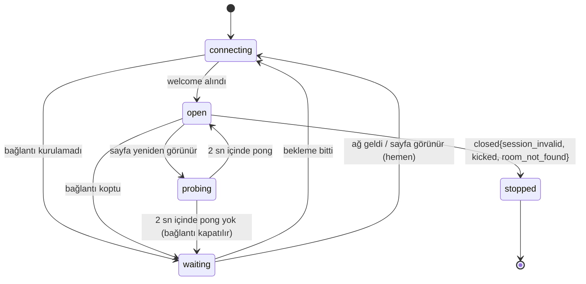

# Dayanıklılık Tasarımı — U1 Yürüyen İskelet

Bu belge, dayanıklılık gereksinimlerinin (NFR4.1–NFR4.5, NFR5.1–NFR5.10, NFR6.1, NFR6.2) nasıl karşılanacağını tasarlar: önce kayıt sonra kabul, tekrar denetimi, bağlantı olaylarının ve sürelerin odanın sırasından geçmesi, istemcinin yeniden bağlanması, açılış ve kapanış, hata ayrımı, yazım iş parçacığının arızası, bozuk depo ve yayın. Hız tarafındaki toplu yazım ayrıntısı `performance-design.md`'dedir.

## Sources

- Dayanıklılık gereksinimleri: `nfr-requirements/reliability-requirements.md` (reliability-requirements; NFR4.1–NFR4.5, NFR5.1–NFR5.10, NFR6.1, NFR6.2, Bozulma Öncelikleri).
- Hız gereksinimleri: `nfr-requirements/performance-requirements.md` (performance-requirements; NFR1.3 grup kaydı, NFR14.1 saat eşitlemesi).
- Güvenlik gereksinimleri: `nfr-requirements/security-requirements.md` (security-requirements; NFR7.4 oturum, NFR7.7 d–e boşta oturum ve lobi, NFR7.14 fiziksel silme).
- Ölçek gereksinimleri: `nfr-requirements/scalability-requirements.md` (scalability-requirements; NFR2.2 tek yazar, NFR3.2 sohbet sınırı).
- İzleme gereksinimleri: `nfr-requirements/observability-requirements.md` (observability-requirements; NFR13.1 açılışta 503, NFR13.3 hata günlüğü).
- Teknoloji kararları: `nfr-requirements/tech-stack-decisions.md` (tech-stack-decisions; TD-03 tam durum kaydı, TD-04 tam eşitleme + grup kaydı + iki depo dosyası).
- Fonksiyonel tasarım: `functional-design/functional-spec.md` (functional-spec; A10 yeniden bağlanma, A11 moderatörün kopması, A12 komut işleme, A13 silme, Hata ve Kenar Durumları) ve `functional-design/rules.md` (rules; BR8.2, BR8.3, BR9.2–BR9.4, BR10.2, BR10.5–BR10.8, BR12.1, BR12.3).
- Sözleşmeler: `inception/contract-design/contract-summary.md` (contract-summary; C1 aynı `commandId` ile yeniden gönderme ve 45 saniye eşiği, C2 `activeMatches` ile yayın, C6 olaylar yazımdan sonra, C8 silme sırası, C9 sürüm numaralı yazım).
- Hız ve güvenlik tasarımı: `performance-design.md` (StoreWriter, oda içi boru hattı), `security-design.md` (oturum, kapanış).
- Ekip kuralları: `memory/team.md` (Walking Skeleton — gerçek telefon denemesi; Deployment — geri alma ve yayın sonrası sağlık kontrolü).
- Özet onayı: `nfr-design-questions.md` (Looks correct).

## Bozulma Durumları ve Tepkiler

| Ne bozulur | Fark edilme | Tepki | Kurtarma | Etki alanı |
|---|---|---|---|---|
| Bir komutun kural hesabında beklenmeyen hata | `try/catch` | `internal_error`, durum değişmez, hata sayılır | Yok; oyun sürer | Tek komut |
| Bir komutun depo yazımı (geri alma noktasında) | StoreWriter sonucu | `internal_error`; aynı odanın sonraki komutları yeniden hesaplanır | Yok | Tek komut |
| Toplu işlemin kesinleştirmesi | StoreWriter sonucu | Toplu işlemdeki bütün komutlar `internal_error` | İstemciler yeniden gönderir | Bir toplu işlem (≤ 512 komut) |
| SQLite "meşgul" | Hata kodu | 10 ms arayla en fazla 3 kez yeniden dene, sonra başarısız | — | Bir toplu işlem |
| Yazım iş parçacığı çöker ya da 5 sn yanıt vermez | `exit` olayı / zaman aşımı | Yoldaki istekler `internal_error`; iş parçacığı bir kez yeniden başlatılır | 60 sn içinde ikinci kez olursa program çıkar (hizmet yöneticisi başlatır) | Bütün odalar, birkaç saniye |
| Ana iş parçacığında yakalanmamış hata | `uncaughtException` | `error` günlüğü, program sıfır olmayan kodla çıkar | Hizmet yöneticisi ≤ 5 sn'de başlatır; durum depodan yüklenir | Bütün odalar, ≤ 15 sn |
| Bellek sınırı | Node.js yığın sınırı | Süreç çöker | Aynı | Aynı |
| Depo dosyası açılamıyor | Açılış | Hata günlüğü, çıkış (hızlı başarısızlık, NFR5.4) | Hizmet yöneticisi yeniden dener | Hizmet yok |
| Depo bütünlük denetimi geçmiyor | Açılış | Dosya kenara alınır, boş depoyla açılır (NFR5.9) | Süren odalar kaybolur (kabul edilen risk) | Süren odalar |
| Bir olay dinleyicisinin hatası | `try/catch` | Hata sayılır, öteki dinleyiciler sürer | — | Tek dinleyici |
| Görünüm gönderilemiyor | `send` hatası / tampon | Atlanır | Sonraki tam görünüm | Tek alıcı |
| İstemcinin bağlantısı kopar | `close` / 45 sn ses yok | Kopuk sistem komutu | İstemci yeniden bağlanır | Tek kişi (moderatörse oda duraklar) |

Devre kesici (circuit breaker) ve dış servis yeniden denemesi yoktur: iskelet çalışırken hiçbir dış servise çağrı yapmaz (depo aynı makinede, rastgelelik işletim sisteminden). Dış servis eklenirse (ör. U7'de) bu tablo genişletilir.

## Önce Kayıt, Sonra Kabul (NFR5.1)

- Bir komutun değiştirdiği bütün kayıtlar tek yazım isteğidir (ör. `room.create`: oda + katılımcı + oturumun odaya bağlanması; `lobby.startGame`: oyun kaydı + oda kaydı). İstek toplu işlemin içinde kendi geri alma noktasındadır: ya hepsi yazılır ya hiçbiri.
- Bellekteki gerçek durum, onay (`ack accepted`), olaylar (C6) ve görünümler yalnızca toplu işlem kesinleşince ilerler. Kesinleşmeyen komutun hiçbir izi kalmaz.
- Depo `journal_mode=WAL`, `synchronous=FULL` ile çalışır: kesinleşen işlem işletim sistemi çökse ya da elektrik gitse de kaybolmaz (TD-04).
- Sürüm denetimi: oyun kaydı `UPDATE … WHERE match_id = ? AND version = ?` ile yazılır; etkilenen satır 1 değilse istek başarısız sayılır (C9 yazım kuralı). Tek yazar olduğu için bu yalnızca bir programlama hatasını yakalar; olursa `internal_error` ve `error` günlüğü.
- Oda içi boru hattında k. komut başarısız olursa, aynı toplu işlemdeki aynı odanın sonraki komutları StoreWriter'da "bağımlılık başarısız" olarak atlanır; ana iş parçacığı bunları kesinleşmiş durumun üzerine yeniden hesaplamak için sıranın başına koyar. Sonsuz döngüye karşı bir komut en fazla 2 kez yeniden hesaplanır, sonra `internal_error` alır.

## Tekrar Denetimi (NFR4.4, BR10.2, BR10.5)

| Komut türü | Numaranın saklandığı yer | Denetim |
|---|---|---|
| Oda ve lobi komutları | `room_processed_commands` (oda kodu + `commandId`); oda silinince silinir | Varsa `duplicate` + güncel görünüm |
| Oyun komutları | Oyun kaydındaki son 500 `commandId` (TD-03); biten oyunlar odanın ömrü boyunca bellekte ve depoda kalır | Aynı |
| `chat.send` | Mesajın kimliği `commandId`'dir (benzersiz anahtar) | Aynı |
| `room.create`, `room.join` | Oturumun bağlı olduğu oda (oturum başına bir kez, BR10.5) | Oturum zaten bir odaya bağlıysa aynı oda ve katılımcı döner; ikinci oda / ikinci katılımcı oluşmaz |
| Sistem komutları | Tekrar anahtarı (aşağıda) aynı yerlerde | Aynı |

İstemci tarafı: onayı 5 saniyede gelmeyen komut aynı `commandId` ile yeniden gönderilir; yeniden bağlanınca `welcome`'dan sonra onaysız bütün komutlar sırayla yeniden gönderilir. Onay bekleyen komutlar sayfa yenilenmesine karşı oturum deposunda (`sessionStorage`) tutulur.

## Bağlantı Olayları Odanın Sırasından (NFR5.5)

- Her bağlantının son ses zamanı tutulur (herhangi bir mesaj, `ping` dahil). Bağlantı izleyicisi 5 saniyede bir tarar; 45 saniyedir ses gelmeyen bağlantıyı kapatır (BR9.3).
- Kopma kararı (soket kapandı ya da 45 sn ses yok) ve dönüş kararı (aynı oturumla `hello`) odanın sırasına sistem komutu olarak girer: `system.connectionLost` / `system.connectionRestored`, tekrar anahtarı `conn:<sessionId>:<connectionId>:lost` / `…:restored`. Komut oturumun bağlantı durumunu ve moderatörse oyunun duraklatma alanlarını (BR8.2, BR8.3) aynı yazım isteğinde yazar; oyunu değiştirirse oyunun sürüm numarası bir artar.
- `connectionId` her bağlantı için yeni üretilen rastgele bir kimliktir (IP değil); aynı bağlantının kayıp kararı iki kez işlenmez, yeniden başlatmada da (anahtar depodadır).
- Kopukluk yalnızca oyuncu ve moderatör için anlamlıdır; lobideki kopukluk oyun durumunu değiştirmez, yalnızca katılımcının `connected` alanını ve boş lobi sayacını (NFR7.7 e) etkiler.

## Süreler ve Zamanlayıcılar (NFR5.6, NFR5.7, BR10.6)

- Her etkin oyunun tek zamanlayıcısı vardır: en yakın bitiş zamanına kurulur. Süre dolunca odanın sırasına `system.deadlineReached` girer; tekrar anahtarı `deadline:<matchId>:<stepVersion>:<endsAt>`'tir. Süre uzatılınca bitiş zamanı değiştiği için yeni anahtar oluşur; eski zamanlayıcıdan gelen komut kural motorunda bitiş zamanı tutmadığı için durum değiştirmez (NFR5.6).
- Bitiş zamanları mutlak sunucu zamanıdır (epoch ms) ve oyun kaydında saklanır. Duraklatmada kalan süre saklanır, zamanlayıcı kaldırılır; devam edince bitiş = şimdi + kalan süre (BR8.2, BR8.3).
- Geceye giriş tek bir kural fonksiyonudur (`enterNight(state, now, settings)`): gece numarası +1, adım `ghul_kill`, adım durumu `waiting`, bitiş = şimdi + gulyabani karar süresi, adım sürümü +1. Gündüzden geceye giden dört yolun hepsi bu fonksiyonu çağırır; kural testleri dört yolun başlangıç durumunun aynı olduğunu sınar (NFR5.7).
- Zamanlayıcı gecikmeleri 24 saatle sınırlıdır (Node.js zamanlayıcı üst sınırının çok altında).

## İstemcinin Yeniden Bağlanması (NFR4.1–NFR4.3)

<!-- Text fallback: İstemci bağlanmaya çalışır; welcome gelince bağlantı açıktır. Kurulamaz ya da koparsa bekleme durumuna geçer; bekleme bitince ya da tarayıcı ağın geldiğini veya sayfanın yeniden görünür olduğunu söyleyince hemen yeniden bağlanmaya çalışır. Açık bağlantıda sayfa yeniden görünür olursa ping gönderilir; 2 saniyede pong gelmezse bağlantı kapatılıp bekleme durumuna geçilir. Sunucu oturum geçersiz, çıkarıldın ya da oda bulunamadı diye kapatırsa istemci durur, yeniden denemez ve ilgili ekranı gösterir. -->

- Bekleme süreleri: 1, 2, 4 saniye, sonra her 4 saniye; her beklemeye 0–500 ms rastgele sapma eklenir. Ağ geldikten sonraki ilk deneme en geç 4,5 saniyededir (NFR4.2). `online` ve `visibilitychange` (görünür) olaylarında bekleme iptal edilir, hemen denenir ve sayaç başa döner.
- 60 saniye bağlanılamazsa uyarı metni gösterilir, deneme sürer (BR9.2).
- Sunucu tarafında geçerli belirteçli `hello`'ya `welcome` ve tam görünüm 500 ms içinde gider (NFR4.3): oturum belleğinde olduğu için depo okuması yoktur; dönüş sistem komutu kesinleşmeden önce `welcome` ve son kesinleşmiş durumun görünümü gönderilir, dönüşün etkisi (moderatörün dönmesiyle devam gibi) sonraki görünümle gelir.
- Program kapanışında sunucu bağlantıları 1012 koduyla kapatır; istemci bunu normal kopma sayar ve beklemeyle yeniden bağlanır.
- Gerçek telefon denemesi (NFR4.5): Android Chrome ve iPhone Safari'de başka uygulamaya geçip dönme, ekran kilidi sonrası dönme, Wi-Fi'den mobil veriye geçiş; dış adres üzerinden elle yapılır, sonuç sahibin iskelet onayıyla kaydedilir.

## Açılış (NFR5.2, NFR5.4, NFR5.9)

1. Ortam değişkenleri ve içerik kataloğu okunur; biçim denetiminden geçmezse program çıkar (C4). Genel ve iç dinleyiciler hemen açılır ama "hazır değil" kipindedir: iki `/healthz` de 503 döner, `/ws` geçiş isteği 503 alır (security-design Canlı Bağlantıya Geçiş, 3. denetim), sayfa ve statik dosyalar verilir.
2. Yazım iş parçacığı başlar, `game.db`'yi açar. Açamıyorsa çıkar (NFR5.4).
3. `PRAGMA quick_check` çalışır. Sonuç `ok` değilse: bağlantı kapatılır, `game.db`, `game.db-wal` ve `game.db-shm` `game.db.corrupt-<ISO zaman>` önekiyle yeniden adlandırılır, `error` günlüğü yazılır, yeni boş depo oluşturulur (NFR5.9).
4. Depo biçimi eksikse yalnızca eklemeyle tamamlanır (yeni tablo/alan; NFR5.10).
5. Etkin odalar, oyunlar (son tam durum kaydı), oturumlar ve kanal başına son 100 mesaj belleğe yüklenir; yarım kalmış `lobby.startGame` (oyun kaydı var, oda kaydı yok) oyun kaydı silinerek temizlenir.
6. Temizlik taraması çalışır (aşağıda).
7. Bitiş zamanı geçmiş adımların `system.deadlineReached` komutları sıraya konur; diğer zamanlayıcılar kurulur.
8. Program "hazır" kipine geçer: `/healthz` 200 dönmeye başlar ve `/ws` bağlantıları kabul edilir. Bu ana kadar iki `/healthz` de 503 döner; dinleyiciler 1. adımdan beri açık olduğu için Caddy bu sürede 502 değil, programın 503'ünü görür.

Hedef: 50 etkin odada açılış ≤ 10 sn, üst sınır 60 sn. Entegrasyon testi oyun ortasında süreci öldürür, yeniden açar; botlar aynı belirteçle döner, oyun kalan süreyle sürer.

## Planlı Kapanış (NFR5.3)

`SIGTERM` gelince: dinleyiciler yeni bağlantı almayı bırakır, okunan yeni komutlar sıraya alınmaz (yanıtsız kalır, istemci yeniden bağlanınca yeniden gönderir), sıradaki ve yoldaki komutlar en fazla 5 saniye içinde bitirilir, bağlantılar 1012 ile kapatılır, yazım iş parçacığı WAL'ı diske aktarıp depoyu kapatır, program 0 koduyla çıkar. Hizmet yöneticisinin durdurma süresi 10 saniyedir.

## Hizmet Yöneticisi (NFR5.4, NFR6.1)

`systemd` hizmeti `Restart=always`, `RestartSec=2` ile çalışır: çökmeden sonra ilk yeniden başlatma 2 saniyede gelir (NFR5.4'ün 5 saniye sınırı), açılışla birlikte hizmet 15 saniye içinde yeniden verilir.

- **Hizmet hiçbir zaman kalıcı "başarısız" durumuna düşmez:** `StartLimitIntervalSec=0` ile başlatma sınırı kapatılır. Böylece depo açılamadığı için hızlı başarısızlıkla çıkan program (NFR5.4) diske ya da izne ilişkin sorun giderilince, kimse elle başlatmadan kendiliğinden yeniden açılır.
- **Ardışık çökmelerde artan bekleme:** `RestartSteps=5` ve `RestartMaxDelaySec=60` ile art arda çökmede bekleme 2 saniyeden 60 saniyeye kadar artar (sistem günlüğü ve işlemci dolmasın); program 60 saniyeden uzun ayakta kalınca bekleme yeniden 2 saniyeye döner. Bu ayarlar `systemd` 254 ve sonrasını ister; Altyapı Tasarımı'nın seçeceği Linux sürümünde (ör. Ubuntu 24.04, `systemd` 255) vardır. Daha eski bir sürümde yalnızca `RestartSec=5` ve `StartLimitIntervalSec=0` kullanılır.
- Ardışık çökmeler `error` günlüğüne düşer ve dış `/healthz` denetimi 10 dakikada uyarır (observability-design Uyarı Eşikleri).

Kesin hizmet dosyası Altyapı Tasarımı'ndadır.

## Temizlik ve Saklama (BR12.1, BR12.3, NFR7.7 d–e)

- **Mantıksal süre dolumu hemen:** oda, `expiresAt`'ten sonra her erişimde "bulunamadı" sayılır (BR1.4). Boş lobi denetimi dakikada bir çalışır: lobide 15 dakikadır bağlı kimse yoksa odanın `expiresAt`'i şimdiye çekilir (yazım isteğiyle).
- **Fiziksel silme:** ExpirySweep açılışta ve 10 dakikada bir çalışır. Süresi dolan her oda için tek yazım isteğinde, sahiplerin kendi silme fonksiyonlarıyla sırasıyla oyun → sohbet → oturum → oda silinir (C8 sırası); açık bağlantılar `closed{room_not_found}` ile kapanır; bellek kayıtları atılır. 10 dakikadır odaya bağlanmamış oturumlar silinir. 24 saatten eski `game.db.corrupt-*` dosyaları silinir. Tarama bitince `wal_checkpoint(TRUNCATE)` (NFR7.14).
- Bir odanın silinmesi başarısız olursa hata sayılır, öteki odalar sürer, sonraki taramada yeniden denenir (C8).
- Oda verisi yedeklenmez (NFR5.9); disk kaybı kabul edilen risktir.

## Yayın ve Geri Alma (NFR5.10, NFR6.2)

- Yayın betiği yeni sürümü yüklemeden önce iç `/healthz`'ten `activeMatches`'i okur; 0 değilse yüklemez, bekler (C2).
- Yayın: yeni sürümün dosyaları yan klasöre açılır, bağlantı (sembolik bağ) değiştirilir, hizmet yeniden başlatılır. Kesinti: kapanış (≤ 5 sn) + açılış (≤ 10 sn) ≈ en fazla 15–30 saniye.
- Yayın sonrası kısa sağlık kontrolü: ana sayfa açılıyor, `/healthz` 200, bir bot oda kurup bir bot katılabiliyor. Başarısızsa bağlantı bir önceki sürüm etiketine geri çevrilir ve hizmet yeniden başlatılır.
- Depo biçimi yalnızca eklemeyle değiştiği için önceki sürüm aynı depoyu okur (NFR5.10). Ayrıntılı betik Ortam ve Dağıtım aşamalarındadır.

## Erişilebilirlik Hedefi (NFR6.1)

%99 aylık erişilebilirlik (ayda ~7 saat 12 dakika kesinti payı). Tek sunucuda bu payı tüketecek olaylar: makine bakımı, yayınlar (her biri ≤ 30 sn), çökme ve yeniden başlatma (≤ 15 sn). Dış ölçüm 5 dakikada bir genel `/healthz` ile izleme aşamasında kurulur; `/healthz`, yazım iş parçacığı yanıt vermiyorsa 503 döndüğü için "süreç ayakta ama oyun yazamıyor" durumunu da yakalar.

## Assumptions & Open Questions

- [assumption] Yazım iş parçacığı zaman aşımı (5 sn) ve "60 sn içinde ikinci arızada çıkış" kuralı benim seçtiğim varsayılanlardır.
- [assumption] Bir komutun boru hattında en fazla 2 kez yeniden hesaplanması benim seçtiğim sınırdır; arka arkaya iki başarısızlık bir programlama hatasının işaretidir.
- [assumption] Açılışta tam `integrity_check` yerine `quick_check` kullanılması, 300 MB'a kadar depoda açılışı 60 sn sınırında tutmak içindir; `quick_check` sayfa ve indeks yapısındaki bozulmayı yakalar.
- [assumption] Onay bekleyen komutların `sessionStorage`'da tutulması, sayfa yenilense de yeniden gönderilmelerini sağlar; tarayıcı kapanırsa kaybolurlar, bu kabul edilebilir (kişi yeniden işlem yapar).
- Açık soru: oyun sürerken acil düzeltme gerekirse ne yapılacağı (contract-summary C2 Açık Sorular) Ortam ve Dağıtım aşamalarında kararlaştırılır; açılış sırası oyunların kaldığı yerden sürmesini zaten sağlar.
