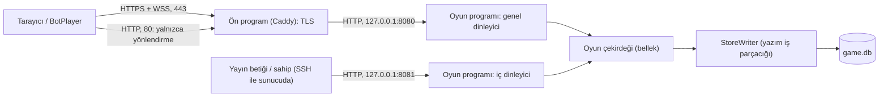

# Güvenlik Tasarımı — U1 Yürüyen İskelet

Bu belge, güvenlik, gizli bilgi ve kişisel veri gereksinimlerinin (NFR7.1–NFR7.14, NFR8.1–NFR8.5, NFR15.1) nasıl karşılanacağını katman katman tasarlar: ağ ve şifreleme, web yanıtları, canlı bağlantıya geçiş, oturum, mesaj doğrulama, yetki, kötüye kullanım sınırları, gizli bilginin süzülmesi, IP'nin hiçbir yere düşmemesi, sağlık kontrolünün iç kapısı, sırlar, bağımlılıklar ve süreç yetkileri. İskelet baştan herkese açık adreste çalıştığı için bütün önlemler iskeletten itibaren geçerlidir. Sunucunun kurulum ayarları (ön program, ağ kuralları, hizmet yöneticisi) Altyapı Tasarımı'nda yazılır; burada her önlemin ne olduğu ve nasıl sınandığı sabitlenir.

## Sources

- Güvenlik gereksinimleri: `nfr-requirements/security-requirements.md` (security-requirements; Tehdit Özeti, NFR7.1–NFR7.14, NFR8.1–NFR8.5, NFR15.1, Uyum, Sözleşme ve Tasarım Değişiklikleri).
- Hız gereksinimleri: `nfr-requirements/performance-requirements.md` (performance-requirements; NFR1.4 görünüm birleştirme, NFR1.6 statik dosyalar).
- Ölçek gereksinimleri: `nfr-requirements/scalability-requirements.md` (scalability-requirements; NFR2.5 genel koruma sınırları).
- Dayanıklılık gereksinimleri: `nfr-requirements/reliability-requirements.md` (reliability-requirements; NFR5.5 bağlantı olayları, NFR5.9 iki depo dosyası ve bozuk depo davranışı).
- İzleme gereksinimleri: `nfr-requirements/observability-requirements.md` (observability-requirements; NFR13.1 iki kapıdaki `/healthz`, NFR13.2 günlükte yasak alanlar, NFR13.3 uyarı düzeyleri).
- Teknoloji kararları: `nfr-requirements/tech-stack-decisions.md` (tech-stack-decisions; `ws` + `node:http`, `zod` ortak şemalar, `node:crypto`, Caddy + `systemd`, TD-04).
- Fonksiyonel tasarım: `functional-design/functional-spec.md` (functional-spec; Komut Yönlendirme Tablosu, A12 komut işleme, A13 sağlık kontrolü) ve `functional-design/rules.md` (rules; BR2.2, BR6.4, BR9.1, BR9.5, BR10.1, BR10.3, BR10.4, BR10.6, BR11.1–BR11.5, BR12.1–BR12.3).
- Sözleşmeler: `inception/contract-design/contract-summary.md` (contract-summary; C1 kuralları ve ReasonCode, C2 `/healthz`, C5 görünüm kuralları, C6 olaylarda IP ve metin yok, C9 IP alanı yok).
- Hız ve dayanıklılık tasarımı: `performance-design.md` (görünüm gönderim turu), `reliability-design.md` (yeniden bağlanma, kapanış kodları).
- Proje kuralları: `memory/project.md` (IP saklama yasağı, sır yasağı, sırların ortam değişkeninde tutulması, gizli bilginin yalnızca hak edene gitmesi).
- Özet onayı: `nfr-design-questions.md` (Looks correct).

## Güven Sınırları



<!-- Text fallback: Tarayıcı ve test botları yalnızca 443 numaralı kapıdan HTTPS ve WSS ile ön programa (Caddy) ulaşır; 80 numaralı kapı yalnızca HTTPS'e yönlendirir. Caddy TLS'i sonlandırır ve isteği 127.0.0.1:8080'deki oyun programının genel dinleyicisine iletir. 127.0.0.1:8081'deki iç dinleyiciye yalnızca sunucunun içinden (yayın betiği, SSH ile bağlanan sahip) ulaşılır; Caddy onu dışarı açmaz. Genel ve iç dinleyici aynı oyun çekirdeğini kullanır. Depoya yalnızca StoreWriter yazım iş parçacığı dokunur. -->

| Sınır | İçeriden geçen | Güvenilir mi |
|---|---|---|
| İnternet → Caddy | Her şey | Hayır: her istek kötü niyetli olabilir |
| Caddy → genel dinleyici | Şifresi çözülmüş istekler | Hayır: içerik hâlâ dışarıdan gelir; yalnızca TLS'in yapıldığı bilinir |
| Sunucu içi → iç dinleyici | Sağlık sorguları | Evet: yalnızca sunucuda oturum açmış kişi ya da yayın betiği |
| Oyun çekirdeği → StoreWriter | Doğrulanmış yazım istekleri | Evet (aynı süreç) |

## Tehdit → Önlem Eşlemesi

| Tehdit (STRIDE) | Saldırı yolu | Önlem | Bölüm |
|---|---|---|---|
| Kimlik taklidi | Belirteci tahmin etmek | 256 bit kriptografik belirteç, depoda yalnızca özeti | Oturum |
| Kimlik taklidi | Belirteci betik enjeksiyonuyla çalmak | Düz metin çizim, sıkı içerik güvenlik politikası | Betik Enjeksiyonu |
| Kimlik taklidi | Başka siteden kurbanın tarayıcısıyla bağlantı açmak | `Origin` denetimi | Canlı Bağlantıya Geçiş |
| Kurcalama | Durumu istemciden değiştirmek, başkası adına komut | Durum yalnızca sunucuda; aktör oturumdan; her komut doğrulanır | Yetki |
| Bilgi sızması | Görünümden rol, işaret ya da sohbet sızması | Tek süzgeç, tek gönderim yolu, gece eşit gönderim | Gizli Bilgi |
| Bilgi sızması | Gönderim zamanlamasından kimin uyandığını anlamak | Adım değişiminde herkese aynı tur | Gizli Bilgi |
| Bilgi sızması | IP'nin günlüğe ya da depoya düşmesi | IP hiç okunmaz; günlük alan beyaz listesi; ön program ve sistem günlükleri | Kişisel Veri |
| Bilgi sızması | Sağlık sayılarının dışarı verilmesi | Ayrı iç dinleyici | Sağlık Kontrolü |
| Bilgi sızması | Silinen oda verisinin diskte kalması | `secure_delete`, WAL kısaltma | Kişisel Veri |
| Hizmet engelleme | Mesaj, bağlantı, oda ya da oturum seli | Bellek içi sayaçlar ve genel üst sınırlar | Kötüye Kullanım Sınırları |
| Hizmet engelleme | Dev mesaj | 64 KB dinleyici sınırı + 16 KB uygulama sınırı | Mesaj Doğrulama |
| Yetki yükseltme | Oyuncunun moderatör komutu göndermesi | Moderatörlük oturumdan; BR2.2 | Yetki |
| Yetki yükseltme | İstemcinin sistem komutu göndermesi | `system.*` istemci şemasında yok | Mesaj Doğrulama |
| Yetki yükseltme | Programdaki bir açıkla sunucuyu ele geçirmek | Ayrıcalıksız kullanıcı, `systemd` kısıtları | Süreç Yetkileri |

## Ağ ve Şifreleme (NFR7.1, NFR7.2)

- Oracle ağ kuralları dışarıya yalnızca 80 ve 443'ü açar; SSH (22) yalnızca anahtarla, parola girişi kapalı. Güvenlik duvarının paket günlüğü kapalıdır (Kişisel Veri).
- Caddy 443'te TLS 1.2 ve 1.3 ile dinler (TLS 1.0/1.1 kapalı), ücretsiz sertifikayı kendisi alır ve yeniler; 80'e gelen her istek kalıcı yönlendirmeyle (308) HTTPS'e gider. Caddy yalnızca `127.0.0.1:8080`'e iletir; `127.0.0.1:8081`'i hiç iletmez.
- Oyun programının iki dinleyicisi de yalnızca `127.0.0.1`'e bağlanır; dış adresten erişilemez. Kapı numaraları ortam değişkeniyle verilir (`PORT_PUBLIC=8080`, `PORT_INTERNAL=8081`); bunlar sır değildir.
- `ws://` ile oyun mesajı alınmaz: dışarıdan tek yol Caddy'nin 443'üdür; Caddy 80'de WebSocket geçişini yönlendirmeyle karşılar, iletmez.
- **Güvenlik etkisi:** TLS'in ayrı bir programda yapılması oyun programının sertifika ve anahtar taşımamasını sağlar (sır yok, NFR7.8); karşılığında oyun programı Caddy'ye güvenmez, yalnızca ondan gelen isteği işler ve içeriğini dışarıdan gelmiş sayar.

## Web Yanıtları ve Güvenlik Başlıkları (NFR7.1, NFR7.9)

Oyun programının genel dinleyicisi şu yolları verir: `/`, `/oda/{roomCode}`, `/static/{path}`, `/ws`, `/healthz` (C2). Başka her yol 404 döner. Güvenlik başlıklarını oyun programı ekler (tek yerde ve entegrasyon testiyle doğrudan sınanabilsin diye); Caddy başlık eklemez ve kaldırmaz.

| Başlık | Değer | Hangi yanıtlarda |
|---|---|---|
| `Strict-Transport-Security` | `max-age=31536000` | Hepsi |
| `Content-Security-Policy` | `default-src 'self'; script-src 'self'; style-src 'self'; img-src 'self' data:; connect-src 'self' wss://<site>; object-src 'none'; base-uri 'none'; frame-ancestors 'none'` | HTML yanıtları |
| `X-Content-Type-Options` | `nosniff` | Hepsi |
| `Referrer-Policy` | `no-referrer` | Hepsi |
| `Cache-Control` | HTML: `no-cache`; içerik özetli statik: `public, max-age=31536000, immutable`; `/healthz`: `no-store` | Yola göre |

- `<site>`, `PUBLIC_ORIGIN` ortam değişkeninin (ör. `https://gulyabani.example`) **ana makine ve kapı kısmıdır** (`gulyabani.example`); `connect-src` değeri `wss://` öneki ile bu kısımdan kurulur (`wss://gulyabani.example`), `PUBLIC_ORIGIN` olduğu gibi yazılmaz. Açılışta `PUBLIC_ORIGIN` bir URL olarak ayrıştırılır; şeması `https` değilse ya da yol, sorgu veya parça içeriyorsa program çıkar. Bot testi kendi `https://localhost:<kapı>` adresini verir ve politika `wss://localhost:<kapı>` olur. Politika açılışta bir kez üretilir; istekten türetilmez (başlık enjeksiyonu yok).
- `/oda/{roomCode}` yalnızca `^[0-9]{6}$` kalıbına uyan kodu kabul eder; uymazsa 404. Kod HTML'e yazılmaz; uygulama kodu adres çubuğundan okur. Böylece sayfa her kod için aynı statik HTML'dir.
- `/static/{path}` yalnızca derleme klasöründeki dosya listesinden (açılışta okunan bir izin listesi) dosya verir; yol birleştirmesi yapılmaz, `..` ya da kodlanmış ayraçlar listede olmadığı için 404 alır.
- Sunucu sürüm bilgisini başlıkta vermez (`Server`, `X-Powered-By` yok).

## Canlı Bağlantıya Geçiş (NFR7.3, NFR7.7 f–g)

WebSocket geçişi `ws` paketinin kendi sunucusu yerine (`noServer`) programın geçiş işleyicisinde, şu sırayla denetlenir; ilk başarısız denetim isteği bitirir:

| Sıra | Denetim | Başarısızsa |
|---|---|---|
| 1 | Yol tam olarak `/ws` | 404 |
| 2 | `Origin` başlığı var ve `PUBLIC_ORIGIN` ile tam aynı (büyük/küçük harf ve sondaki `/` normalleştirilerek) | 403 |
| 3 | Program "hazır" kipinde (açılış bitti) ve kapanış aşamasında değil | 503 |
| 4 | Toplam bağlantı 2.000'in altında ve `hello` göndermemiş bağlantı 200'ün altında | 503 |

- Test botları sitenin adresini `Origin` olarak gönderir; testlerde denetim gevşetilmez (bot testinin sunucusu kendi adresini `PUBLIC_ORIGIN` olarak alır).
- 403 ve 503 yanıtları C2'de `/ws` için tanımlı değildi; bu bir ekleme olarak Sözleşme Hizalamaları'nda listelidir.
- Dinleyici ayarları: `maxPayload: 65536` (bunu aşan mesajda `ws` bağlantıyı kendisi 1009 koduyla kapatır), `perMessageDeflate: false` (sıkıştırma bombasına karşı da kapalı).
- Bağlantı açılınca 10 saniyelik `hello` süresi başlar (BR9.5); `hello` gelmezse bağlantı `closed{unsupported_protocol}` gönderilip kapatılır.
- **Tek kural:** program bir bağlantıyı bilerek kapattığı her durumda (süre aşımı, bozuk mesaj, sınır, oturum geçersiz) önce tek bir `closed{reasonCode}` gönderir, sonra kapatır (C1 `closed` tanımı). `closed` yalnızca neden kodu taşır; kimliği belirsiz bağlantıya gitmesi hiçbir bilgi vermez. İstisnalar yalnızca `ws` paketinin kendisinin kapattığı 64 KB üstü mesaj (1009) ve programın kapanışıdır (1012).

## Oturum ve Kimlik (NFR7.4, NFR4.3)

- Yeni oturumda belirteç `crypto.randomBytes(32)` ile üretilir ve base64url (43 karakter) olarak yalnızca `welcome` mesajında bir kez gönderilir. Bellekte ve depoda yalnızca `SHA-256` özeti (hex) tutulur (`Session.tokenHash`).
- Belirteçle gelen `hello`'da özet hesaplanır ve özet anahtarlı tablodan oturum bulunur. Arama özetle yapıldığı için belirtecin kendisi hiçbir karşılaştırmaya girmez; zamanlama farkından belirteç tahmin edilemez.
- Bulunamayan, iptal edilmiş (çıkarılan kişi, BR2.3) ya da odası süresi dolmuş oturum: `ack` değil `closed{session_invalid}` gönderilir ve bağlantı kapanır; istemci belirteci siler ve giriş ekranına döner.
- Aynı oturumla yeni bağlantı gelince son bağlantı geçerli olur, eskisi kapatılır (BR9.4; U1'de yalnızca son bağlantı).
- Komutun aktörü (katılımcı, koltuk, moderatör mü) **yalnızca bağlantının oturumundan** çıkarılır; mesajdaki hiçbir alan aktörü belirlemez.
- Tarayıcı belirteci yerel depoda tutar (C1, FR14.1). Bu, betik enjeksiyonu olursa okunabilir demektir; bu yüzden betik enjeksiyonunun önlenmesi (aşağıda) oturum güvenliğinin parçasıdır. Çerez kullanılmaz; bu yüzden CSRF yoktur, başka siteden bağlantıya karşı `Origin` denetimi yeterlidir.
- Belirteç hiçbir günlüğe, olaya, görünüme ya da hata mesajına yazılmaz; günlük alan beyaz listesinde belirteç alanı yoktur (İzleme ile birlikte, `observability-design.md`).

## Mesaj Doğrulama (NFR7.5)

Her gelen mesaj sıraya girmeden önce bu hattan geçer:

```text
onMessage(raw):
  if !frameBucket(conn).take(): closeWith("rate_limited")   // (f) her çerçeve sayılır, ayrıştırmadan önce
  if raw.byteLength > 16_384: closeWith("unsupported_protocol")
  msg = tryJsonParse(raw) ?? closeWith("unsupported_protocol")
  env = ClientMessage.safeParse(msg)            // src/shared, zod; tanınmayan alanlar atılır
  if !env.success: drop or reject (aşağıdaki tablo)
  if env.type == "command":
     if name not in ClientCommandNames: ack(rejected, "not_your_turn")   // system.* dahil
     args = CommandArgs[name].safeParse(env.args) ?? ack(rejected, alan koduna göre)
  ruleLimits(conn, env)   // (a)–(e): sohbet, oda kodu, genel sınırlar
  enqueue(roomQueue, actorFromSession(conn), env)
```

Mesaj seli sınırı (f) ilk satırdadır: geçerli ya da bozuk, her gelen çerçeve JSON ayrıştırmasından önce sayılır; böylece bozuk zarf seli de sınıra takılır ve ayrıştırma maliyeti bağlantı başına saniyede 20 çerçeveyle sınırlı kalır.

| Durum | Davranış |
|---|---|
| 16 KB'tan büyük ya da JSON değil | `closed{unsupported_protocol}`, bağlantı kapanır |
| `type` bilinmiyor ya da `hello` öncesi başka mesaj | `closed{unsupported_protocol}` |
| `hello`'da `protocolVersion` 1 değil | `closed{unsupported_protocol}` |
| `command` zarfı bozuk (`commandId` UUID değil, `name` yok) | Mesaj işlenmez, sayılır; `ack` gönderilemez (numara yok) |
| Komut adı istemci listesinde yok (`system.deadlineReached` dahil) | `ack rejected not_your_turn` (BR10.6) |
| Komut alanları bozuk | Alanın koduyla red: nick → `nick_invalid`, sohbet → `message_empty` / `message_too_long`, oda kodu → `room_not_found`; diğerleri → `invalid_target` |

- Sınırlar ortak şemada sabittir: `commandId` UUID; oda kodu `^[0-9]{6}$`; nick boşluklar atılıp Unicode NFC'ye çevrildikten sonra 2–16 karakter, kontrol karakteri yok (BR1.3); sohbet metni 1–300 karakter, kontrol karakterleri (satır sonu hariç) atılır (BR6.4).
- Ortak şema dosyası (`src/shared/`) sunucu, tarayıcı ve botlar tarafından aynen kullanılır; şema değişirse üçü birden derlenir (C1 Doğrulama).
- **Güvenlik etkisi:** doğrulama sıraya girmeden yapıldığı için bozuk mesaj odanın sırasını hiç meşgul etmez; tanınmayan alanların atılması, istemcinin fazladan alanla iç durumu etkilemesini engeller.

## Yetki (NFR7.6)

- Oyun durumu ve kurallar yalnızca sunucudadır; istemci durum değil yalnızca komut gönderir (C1).
- Her komut, Komut Yönlendirme Tablosu'ndaki yapı taşında doğrulanır (functional-spec): moderatör komutları yalnızca odanın moderatör katılımcısının oturumundan kabul edilir, değilse `not_moderator` (BR2.2); oyun komutları kural motorunun `decide` çağrısında gönderenin hakkına, faza ve hedefe göre doğrulanır, değilse `not_your_turn` / `invalid_target` / `phase_closed` (BR10.1).
- Geçersiz komut durumu değiştirmez ve depoya yazılmaz.
- `system.*` komutları yalnızca program içinden (zamanlayıcı, bağlantı izleyicisi) sıraya konur; istemci yolundan sıraya girmenin bir yolu yoktur (yukarıdaki doğrulama tablosu).
- Kural testleri her komut için yetkisiz gönderen durumunu sınar: durum aynı kalır, doğru neden kodu döner.

## Kötüye Kullanım Sınırları (NFR7.7, NFR2.5)

Bütün sayaçlar yalnızca bellektedir, IP kullanmaz; program yeniden başlayınca sıfırlanır (reliability-requirements Bozulma Öncelikleri).

| Kural | Anahtar | Yöntem | Aşılınca |
|---|---|---|---|
| (a) Sohbet: 10 sn'de 5 mesaj | Katılımcı | Kayan pencere (son 5 mesajın zamanı) | `rate_limited` |
| (a) Oda kodu denemesi: dakikada 10 | Bağlantı | Kayan pencere | `rate_limited` |
| (b) Genel başarısız `room.join`: dakikada 60 | Bütün sunucu | Sabit dakika penceresi; yalnızca `room_not_found` sayılır | O dakikanın kalanında her `room.join` → `rate_limited` |
| (c) Oda kurma: dakikada 20 | Bütün sunucu | Sabit dakika penceresi | `rate_limited` |
| (d) Odaya bağlanmayan oturum | Oturum | 10 dakika sonra silinir (temizlik); aynı anda en fazla 3.000 oturum | 3.001. oturum: `hello` → `closed{server_busy}` |
| (e) Boş lobi | Oda | Lobide 15 dakika bağlı kimse yoksa süresi doldu sayılır | Oda "bulunamadı"; temizlikte silinir |
| (f) Mesaj seli: saniyede 20 | Bağlantı | Kova (saniyede 20 jeton, en fazla 20 birikir) | Bağlantı `closed{rate_limited}` ile kapanır |
| (f) `hello` süresi 10 sn; `hello`'suz en fazla 200 bağlantı | Bağlantı / sunucu | Zamanlayıcı / sayaç | Kapatılır / 503 |
| (g) En fazla 2.000 bağlantı | Sunucu | Sayaç | Geçiş isteği 503 |
| (g) En fazla 300 etkin oda | Sunucu | Sayaç | `room.create` → `server_busy` |

- (b)'nin bağlantıdan bağımsız olması, bağlantı değiştirerek oda kodu taramayı (10⁶ kod) dakikada 60 denemeyle sınırlar; bütün kodların taranması 11 günden uzun sürer, oda ise 24 saat yaşar.
- Sınırların %80'ine ulaşılınca dakikada en fazla bir kez `warn` günlüğü yazılır (NFR13.3).
- `closed{server_busy}` ve `closed{rate_limited}` C1'de `closed` için yeni kullanımlardır; kodlar listede vardır (`rate_limited`) ya da bu parçada eklenir (`server_busy`).
- **Kalan risk:** IP kullanılmadığı için genel (sunucu çapındaki) sınırlar tek bir saldırgan tarafından ucuza doldurulabilir ve o süre boyunca herkesi etkiler. Bu sıfır bütçeli hobi oyunu için kabul edilen risktir (security-requirements NFR7.7):

| Doldurulan sınır | Saldırganın gereği | Herkese etkisi | Süresi |
|---|---|---|---|
| (g) 2.000 bağlantı | Çok sayıda açık bağlantı | Yeni kimse bağlanamaz; bağlı olanlar oynar | Saldırı sürdükçe |
| (f) 200 `hello`'suz bağlantı | 10 sn'de bir yenilenen 200 bağlantı | Yeni bağlantılar 503 alabilir | Saldırı sürdükçe |
| (b) 60 başarısız `room.join` / dk | Birkaç bağlantıdan yanlış kodlar | O dakikanın kalanında doğru kodla da kimse katılamaz; süren oyunlar etkilenmez | Dakikalık |
| (c) 20 `room.create` / dk | Birkaç oturum | O dakikanın kalanında yeni oda kurulamaz | Dakikalık |
| (d) 3.000 oturum | Belirteçsiz `hello` seli | Yeni ziyaretçi oturum alamaz; var olan oturumlar çalışır | En fazla 10 dk (bağlanmayan oturum silinir) |
| (g) 300 etkin oda | Oda kurmak (dakikada 20 sınırıyla en az 15 dk) | Yeni oda kurulamaz | En fazla 15 dk (boş lobi silinir, NFR7.7 e) |

  Ortak hafifletme: süren oyunlar hiçbir durumda etkilenmez (sınırlar yalnızca yeni bağlantı, oturum, oda ve katılmaya uygulanır); her sınırın %80'inde ve tetiklenmesinde `warn` günlüğü yazılır, sahip gerekirse sunucuyu yeniden başlatır ya da güvenlik duvarında elle önlem alır.

## Gizli Bilgi (NFR8.1–NFR8.5)

- **Tek süzgeç, tek gönderim yolu:** istemciye oyun ve oda bilgisi taşıyan tek mesaj `view`'dır. `view` gönderen tek fonksiyon ViewDispatcher'daki `sendView`'dur ve yalnızca VisibilityFilter'ın ürettiği `FilteredView` türünü kabul eder. `FilteredView` dışarıdan oluşturulamayan işaretli bir türdür (yalnızca süzgeç modülü üretir); ham durumu gönderen kod derlenmez.

```text
// src/server/visibility/filter.ts — yalnızca bu modül FilteredView üretir
type FilteredView = RecipientView & { readonly __brand: unique symbol }
function render(room, match, recipient): FilteredView
// src/server/gateway/dispatch.ts
function sendView(conn: Connection, view: FilteredView): void
```

- `ack`, `welcome`, `pong`, `reload`, `closed` mesajları oyun bilgisi taşımaz (yalnızca numara, durum, neden kodu, saat).
- Süzgeç kuralları (BR11.1–BR11.5): oyuncu yalnızca kendi rolünü görür; yaşayan gulyabaniler birbirini, gulyabani işaretlerini ve gulyabani sohbetini görür; oylar `liveVotes` ayarına göre; açılan kartlar herkese; moderatör tam görünüm. Hakkı olmayan alan görünümde **hiç yer almaz** (anahtar olarak da yoktur); süzgeç izin listesiyle alan ekler, yasak listesiyle silmez.
- **Gece eşit gönderim (NFR8.3, BR4.7):** sırası gelmeyen herkesin `game` bloğu aynı kaynaktan üretilir; sırası gelenin farkı yalnızca `myAction`'dadır. Gönderim turunda faz ya da adım değiştiyse "önceki görünümle aynıysa gönderme" kısaltması kapatılır ve görünüm odadaki herkese aynı turda gider; aksi hâlde yalnızca uyanan kişiye mesaj gitmesi, ağ trafiğinden kimin uyandığını belli ederdi.
- **Lobi (NFR8.5):** rol eşleşmesi yalnızca `lobby.startGame` kesinleşince üretilir; lobide durumda rol alanı yoktur. Oyun sürerken giriş reddedilen kişiye yalnızca `ack rejected` gider; görünüm gitmez.
- **Olaylar (C6):** program içi olaylar istemciye hiç gönderilmez; yalnızca görünüm üretimini tetikler.
- **Sınama (NFR8.2):** her alıcı türü (yaşayan köylü, yaşayan gulyabani, ölü oyuncu, moderatör, lobideki kişi) için süzgeç testleri; bot testinde köylü botlarına gelen bütün mesajlar oyun boyunca taranır (başka koltuğun açılmamış `roleId`'si, `ghulMarks`, `ghul` kanalı bulunmamalı); gece görünümlerinin `game` blokları bayt bayt karşılaştırılır.

## Betik Enjeksiyonu (NFR7.9)

- Ekranlar Preact ile çizilir; nick ve sohbet metni her zaman metin düğümü olarak eklenir (Preact metni kendisi kaçışlar). HTML olarak ekleme yapan özellik (`dangerouslySetInnerHTML`) ESLint kuralıyla yasaklanır; CI'da hata verir.
- İçerik güvenlik politikası satır içi betik ve stile izin vermez (`unsafe-inline` yok). Derlenmiş HTML'de satır içi `style` özniteliği ya da `<style>` bloğu olmadığını CI'daki bir denetim doğrular. Değişen görünümler (geri sayım çubuğu gibi) sınıfla ya da betikten stil özelliği atanarak yapılır; bu yol politikaya takılmaz.
- Görsel kaynakları yalnızca kendi sitesi ve `data:`'dır; dış kaynak yoktur.
- Uçtan uca test: `<script>` ve `` içeren nick ve sohbet mesajı ekranda metin olarak görünür, çalışmaz.

## Kişisel Veri ve IP (NFR7.11, NFR8.4, NFR7.14, Uyum)

- **Oyun programı IP okumaz:** kod hiçbir yerde `socket.remoteAddress`, `req.socket` adresi ya da `X-Forwarded-For` / `Forwarded` başlığını okumaz. ESLint `no-restricted-properties` / `no-restricted-syntax` kuralları bu adların kullanımını hata sayar; böylece IP'nin günlüğe düşme yolu kaynağında kapanır. Ülke bilgisi iskelette yoktur (U7).
- **Depo:** hiçbir tabloda IP alanı yoktur (C9); bot oyunundan sonra depo ve WAL dosyaları IPv4/IPv6 desenleriyle taranır.
- **Program günlüğü:** günlük fonksiyonu yalnızca beyaz listedeki alanları kabul eder (olay adı, düzey, sürüm, oda kodu, oyun numarası, komut adı, `commandId`, neden kodu, süre, sayı, bağlantı kimliği, hata). Nick, sohbet metni, rol, belirteç, IP için alan yoktur; tür denetimi başka alanı derletmez.
- **Hata alanı mesaj metni taşımaz:** `err` alanı yalnızca hata türünün adını (`TypeError`, `SqliteError`), varsa sabit hata kodunu (`SQLITE_BUSY`, programın kendi kodları) ve yığın izinin dosya:satır çerçevelerini taşır; hatanın mesaj metni hiçbir zaman yazılmaz. Neden: yerleşik hataların mesajları kullanıcı girdisinden parça içerebilir (bozuk JSON'un ayrıştırma hatası, şema hatası, SQLite kısıt hatası). Doğrulama hatalarının ayrıntısı da günlüğe yazılmaz; yalnızca neden kodu yazılır. Günlük taraması testi, bot testinde kullanılan nick ve sohbet metinlerinin günlükte hiç geçmediğini denetler; test bilerek hata doğuran girdileri de gönderir: bozuk JSON (içinde ayırt edici bir metin), şemaya uymayan alanlar, `<script>` içeren nick ve sohbet mesajı, 300 karakterden uzun mesaj. Bu girdilerin hiçbir parçası günlükte bulunmamalıdır.
- **Ön program (Caddy):** erişim günlüğü açılmaz. Caddy'nin TLS el sıkışma hataları gibi satırlarda uzak adres yapılandırılmış bir alanda değil ileti metninin içinde ("TLS handshake error from <adres>") yer alabilir; alan silen bir süzgeç bunu temizlemez. Bu yüzden önlem süzgeç değil, kaynaktır: bu satırları üreten günlükçü (`http.stdlib`) ve erişim günlükçüsü (`http.log.access`) Caddy'nin genel günlüğünden dışlanır, kalan çalışma günlüğü `ERROR` düzeyindedir. İskelet denetimindeki sistem günlüğü taraması (NFR7.11 ölçütü) engelleyicidir: taramada bir adres bulunursa Caddy'nin çalışma günlüğü tamamen kapatılır (çıktı atılır) ve yalnızca hizmetin başlayıp durduğu bilgisi `systemd` kayıtlarında kalır. Kesin ayar Altyapı Tasarımı'ndadır.
- **Sistem:** güvenlik duvarının paket günlüğü kapalıdır; SSH girişleri sahibin kendi bağlantısıdır, oyun trafiği değildir.
- **Sınama:** otomatik test (bot oyunu sonrası depo + program günlüğü) ve iskelet denetiminde Oracle sunucusundaki oyun programının ve Caddy'nin sistem günlüğü kayıtlarının aynı desenlerle taranması (NFR7.11'in ölçütü).
- **Fiziksel silme (NFR7.14):** oyun deposu `PRAGMA secure_delete=ON` ile açılır (silinen satırların sayfaları sıfırlanır). Her temizlik taraması bittikten sonra `PRAGMA wal_checkpoint(TRUNCATE)` çalıştırılır; WAL dosyası diske aktarılıp sıfır boyuta kısaltılır. Böylece silinen oda verisi ne boş sayfada ne günlük dosyasında kalır. Kenara alınan bozuk depo dosyası (`game.db.corrupt-<zaman>`) da 24 saat sonra silinir (NFR5.9).
- **KVKK:** ana sayfada ve giriş ekranında kısa bilgilendirme metni (`tr.json`; BR1.5).

## Sağlık Kontrolünün İç Kapısı (NFR7.12, NFR13.1)

- Genel dinleyicideki `/healthz`: yalnızca `{status, version}`; açılış bitmediyse ya da depo yazım iş parçacığı 1 saniyede yanıt vermiyorsa 503. İsteğin kaynak adresine ve başlıklarına hiç bakmaz; `X-Forwarded-For` gönderilse de çıktı değişmez.
- İç dinleyicideki `/healthz`: aynı alanlar + `activeRooms`, `activeMatches`, `connections`, `errorCount` ve izleme ölçümleri (`observability-design.md`). İç dinleyici yalnızca `/healthz`'i verir; başka her yol 404.
- "İçeriden mi" kararı isteğin geldiği dinleyiciyle verilir; Caddy iç kapıyı iletmediği için dışarıdan gelen hiçbir istek iç dinleyiciye ulaşamaz.

**Karar — iç kapı ile kaynak adres ya da gizli anahtar**

- *Bağlam:* Caddy aynı sunucuda olduğu için her istek `127.0.0.1`'den gelir; C2'deki "127.0.0.1'den sorulduğunda" kuralı olduğu gibi uygulanırsa sayılar dışarı açılırdı.
- *Karar:* Ayrı iç dinleyici (security-requirements NFR7.12).
- *Reddedilen seçenekler:* (1) `X-Forwarded-For` başlığına bakmak: hem IP okumayı gerektirir (NFR7.11'e aykırı) hem de başlık sahtelenebilir. (2) Sorguya gizli bir anahtar eklemek: depoda ya da betikte bir sır doğurur (NFR7.8) ve anahtar sızarsa sayılar dışarı açılır.
- *Güvenlik etkisi:* iç kapıya erişim, sunucuya SSH ile girebilmeye eşittir; ek bir sır yoktur.

## Sırlar ve Bağımlılıklar (NFR7.8, NFR7.10)

- İskelet çalışırken sır gerektirmez: TLS anahtarını Caddy yönetir; oyun programının ortam değişkenleri (`PUBLIC_ORIGIN`, `PORT_PUBLIC`, `PORT_INTERNAL`, `DATA_DIR`, `APP_VERSION`) sır değildir. İleride gereken her sır sunucuda yalnızca oyun kullanıcısının okuyabildiği ortam dosyasında (izin 600) tutulur, programa ortam değişkeni olarak verilir.
- Depoda `.env` ve `*.db*` dosyaları `.gitignore`'dadır. CI'da sır taraması (gitleaks) çalışır; bulgu birleştirmeyi durdurur.
- Çalışma zamanı bağımlılıkları dört pakettir: `ws`, `better-sqlite3`, `zod` (sunucu ve tarayıcı), `preact` (tarayıcı). Geliştirme araçları ayrıdır. Sürümler kilit dosyasıyla sabitlenir; CI'da `npm ci` ve `npm audit --audit-level=high` çalışır, yüksek ya da kritik bulgu birleştirmeyi durdurur.

## Süreç Yetkileri (NFR7.13)

- Oyun programı kendi ayrıcalıksız sistem kullanıcısıyla (`gulyabani`, giriş kabuğu yok) çalışır. Veri klasörü (`DATA_DIR`, ör. `/var/lib/gulyabani`) ve içindeki depo dosyaları bu kullanıcıya aittir ve izinleri 600'dür (klasör 700); ortam dosyası 600.
- `systemd` hizmet kısıtları: `NoNewPrivileges=yes`, `ProtectSystem=strict`, `ProtectHome=yes`, `PrivateTmp=yes`, `ReadWritePaths=` yalnızca veri klasörü, `CapabilityBoundingSet=` boş (1024'ün altındaki kapıyı Caddy dinler, oyun programı gerek duymaz). Kesin hizmet dosyası Altyapı Tasarımı'ndadır.
- Caddy kendi kullanıcısıyla çalışır; oyun verisini okuyamaz.

## Rastgelelik (NFR15.1)

- Rol dağıtımı, oda kodu ve gulyabani eşitlik bozması `node:crypto` `randomInt` ile yapılır. Kural modülü rastgeleliği `RandomSource` arayüzüyle dışarıdan alır (C3); testlerde sabit tohumlu kaynak verilir.
- Oda kodu: `randomInt(0, 1_000_000)` altı haneye sıfırla doldurulur; etkin bir odayla çakışırsa yeniden üretilir (en fazla 10 deneme, sonra `server_busy`).
- Ki-kare sınaması (1.000 dağıtım) birim testidir.

## Güvenlik Doğrulama Tablosu

| Önlem | Otomatik test | Elle / altyapı denetimi |
|---|---|---|
| NFR7.1 TLS, yönlendirme, HSTS | HSTS başlığı (entegrasyon) | `http://` → 308; TLS 1.1 el sıkışması başarısız (iskelet denetimi) |
| NFR7.2 yalnızca 127.0.0.1 | — | Sunucuda dinlenen kapı listesi |
| NFR7.3 `Origin` | Yabancı / yok / doğru `Origin` (entegrasyon) | — |
| NFR7.4 belirteç | Depoda belirteç yok, günlükte belirteç deseni yok, geçersiz belirteç → `session_invalid` | — |
| NFR7.5 doğrulama | Her sınırın altı/üstü; bozuk JSON kapatır; `system.*` → `not_your_turn` | — |
| NFR7.6 yetki | Her komut için yetkisiz gönderen (kural testleri) | — |
| NFR7.7 sınırlar | (a)–(g) her biri (birim + entegrasyon) | — |
| NFR7.8 sırlar | CI sır taraması | — |
| NFR7.9 enjeksiyon | Başlıklar; derlenmiş HTML'de satır içi stil yok; `<script>` nick (uçtan uca) | — |
| NFR7.10 bağımlılık | CI `npm audit` | — |
| NFR7.11 IP | Depo + program günlüğü taraması; ESLint kuralı | Oracle'da sistem günlüğü taraması |
| NFR7.12 iç kapı | İki kapının alanları; `X-Forwarded-For` ile genel kapı | İç kapı dışarıdan erişilemez |
| NFR7.13 yetkiler | — | Kullanıcı, izinler, hizmet kısıtları |
| NFR7.14 fiziksel silme | Silmeden sonra depo + WAL'da nick ve metin baytı yok | — |
| NFR8.1–NFR8.5 gizli bilgi | Süzgeç testleri, bot testi taraması, gece karşılaştırması | — |
| NFR15.1 rastgelelik | Ki-kare | — |

## Sözleşme Hizalamaları

Bu tasarım sözleşmelere yalnızca ekleme yapar; Kod Üretimi'nde metinler bunlarla hizalanır.

| Nerede | Ekleme |
|---|---|
| C2 `/ws` | 403 (`Origin` uymuyor) ve 503 (kapanış ya da bağlantı sınırı) yanıtları |
| C1 `closed` | `server_busy` (oturum sınırı) ve `rate_limited` (mesaj seli) kullanımları |
| C1 komut reddi | İstemci listesinde olmayan her komut adı `not_your_turn` alır (BR10.6'nın genellemesi) |

## Assumptions & Open Questions

- [assumption] Oyun programının güvenlik başlıklarını kendisinin eklemesi (Caddy'nin değil) benim seçtiğim varsayılandır; başlıkların tek yerde olması ve entegrasyon testinin doğrudan sınaması için. Caddy'de aynı başlıkların ikinci kez eklenmemesi Altyapı Tasarımı'nda denetlenir.
- [assumption] İç dinleyici kapısı 8081, genel dinleyici 8080 benim seçtiğim varsayılandır; ortam değişkeniyle değiştirilebilir.
- [assumption] Bozuk `command` zarfına (numarasız) `ack` gönderilmemesi, numara olmadan istemcinin onayı eşleyemeyeceği içindir; mesaj seli sınırı (f) bu mesajları da sayar (Mesaj Doğrulama'nın ilk satırı).
- [assumption] Oturum sınırına takılan `hello`'ya `closed{server_busy}` gönderilmesi, `server_busy`'nin (bu parçada eklenen kod) ikinci kullanımıdır; Türkçe metni aynıdır.
- Açık soru: Caddy'nin günlük süzgecinin kesin ayarı ve Oracle ağ kuralları Altyapı Tasarımı'nda yazılır; NFR7.1, NFR7.2, NFR7.11 ve NFR7.13 orada sınanabilir hâle gelir.
