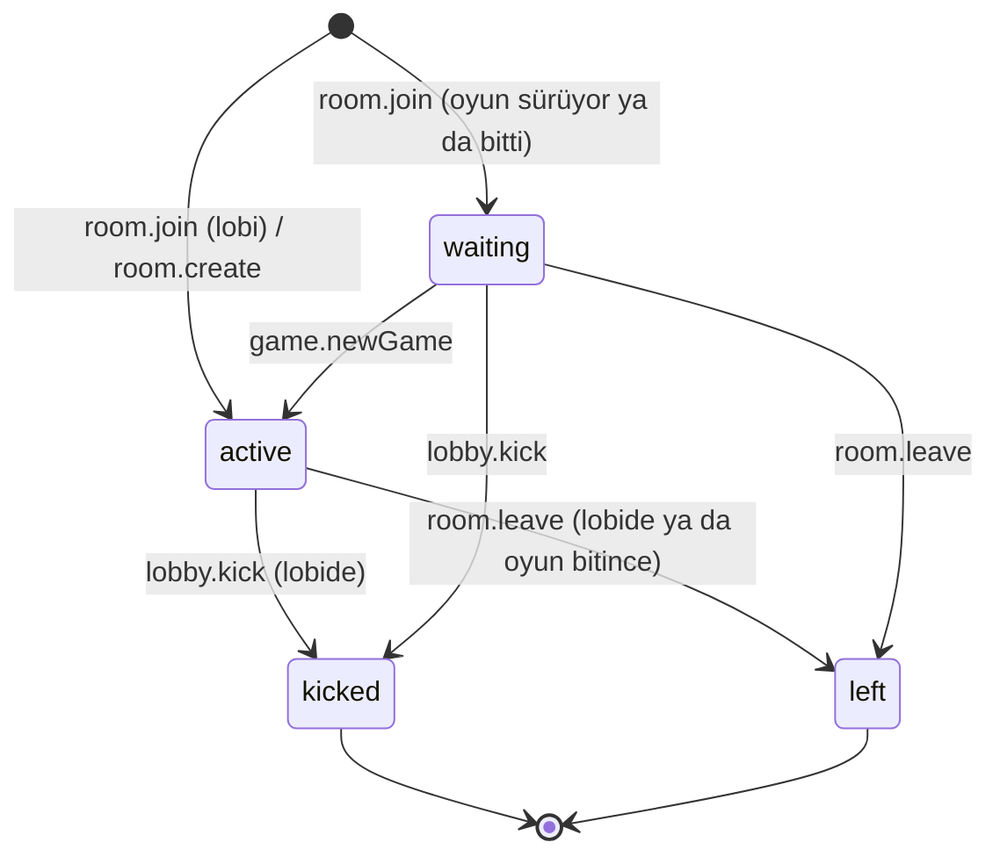
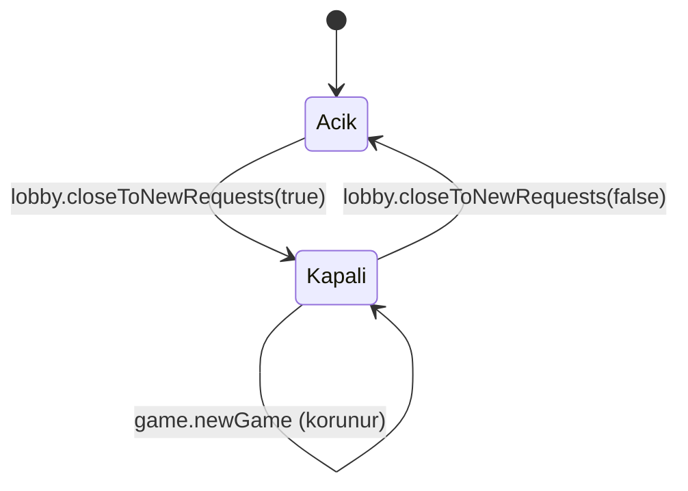
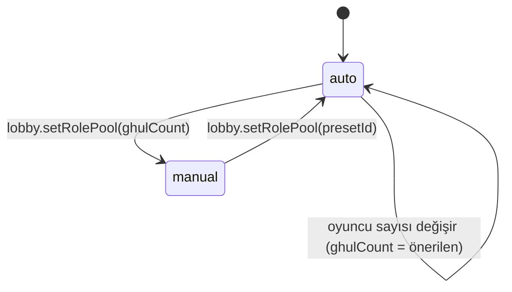
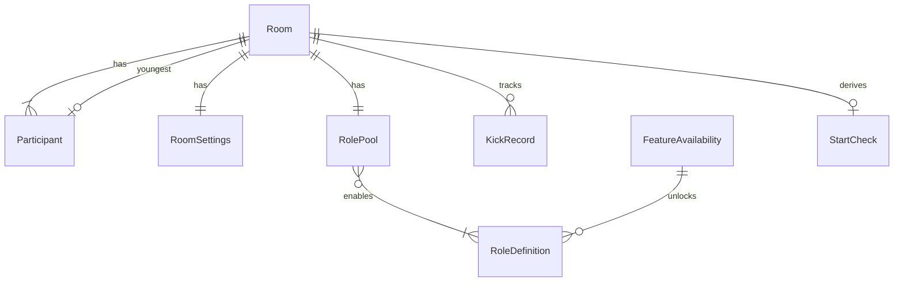

# Fonksiyonel Şartname — U2 Oda ve Lobi

Bu belge U2'nin akışlarının ve durum geçişlerinin tek doğru kaynağıdır. Veri biçimi `entities.md`'de, karar mantığı `rules.md`'dedir; buradaki ilişki diyagramı ve kural özeti onlardan türetilmiştir.

Bu parça `stories.md`'deki şu hikâyeleri gerçekleştirir:
- **US1.3** Oyun sürerken gelen kişinin beklemesi;
- **US1.5** Oyun ayarları;
- **US2.1** Rol havuzunu seçme;
- **US7.2**'nin U2 payı: bekleyenlerin yeni oyunda lobiye alınması ve 22 saat kuralı.

Parça tanımının (`unit-of-work.md`) U2'ye verdiği diğer işler de buradadır:
- lobide moderatörlük devri (FR2.2),
- çıkarma yasağı ve "Yeni isteklere kapat" (FR2.3),
- köyün en genci (FR2.7),
- "Nasıl oynanır?" kartı (FR2.5),
- son ayarların hatırlanması (FR2.8).

## Sources

- Parça tanımı: `inception/units-generation/unit-of-work.md` (unit-of-work; U2).
- Hikâye eşlemesi: `inception/units-generation/unit-of-work-story-map.md` (unit-of-work-story-map; US1.3, US1.5, US2.1, US7.2).
- Kabul ölçütleri: `inception/user-stories/stories.md` (stories).
- Gereksinimler: `inception/requirements-analysis/requirements.md` (requirements; FR1.6, FR2.2–FR2.8, FR3, FR9.2, FR17.2, A7, A8, A10).
- Yapı taşları: `inception/domain-design/components.md` (components; RoomManager, ContentCatalog, GameRules, VisibilityFilter, WebClient).
- Sözleşmeler: `inception/contract-design/contract-summary.md` (contract-summary; C1, C3, C4, C5, C6, C9).
- Etkileşim şartnamesi ve ekranlar: `inception/refined-mockups/interaction-spec.md`, `inception/refined-mockups/mockups.md` (M-02b bekleme, M-04 lobi, M-11 moderatör oyuncular).
- U1 tasarımı: `construction/u1-walking-skeleton/functional-design/` (genişletilen kurallar BR2.3, BR3.1, BR6.5, BR6.7, BR7.3).
- Sahip kararı: `functional-design-questions.md` Q1 = A.

## Kapsam

**Bu parçada var:**
- bekleme ekranı ve 26 kişi sınırı;
- 9 satırlık giriş kararının U2 satırları (2–7);
- lobide ve beklemede çıkarma, art arda 2 çıkarmada 30 dakika yasak;
- "Yeni isteklere kapat" anahtarı;
- lobide moderatörlük devri;
- köyün en genci işareti ve eşitlikte oyunun 2 sayılması;
- 17 ayar ve Ayarlar sekmesi;
- 9 rollük katalog, Rol Havuzu paneli, ön ayarlar, havuz doğrulaması ve havuzdan deste kurma;
- 22 saat kuralı;
- "Nasıl oynanır?" kartı;
- son ayar ve havuzun tarayıcıda hatırlanması;
- canlı olmayan oylar ve çekimser seçeneğinin ekranı;
- bekleyen kişinin odadan çıkması.

**Bu parçada yok:**
- Rol yetenekleri ve oyun sırasında çıkarma, yani giriş satırı 1 (U3).
- Yeniden katılma isteği, yani giriş satırları 8–9 (U5). U5 gelene kadar bu satırlar `nick_taken` verir.
- Hayalet modu (U4).
- Kart görselleri (U6). U2'de yer tutucu simge kullanılır.

**Sahip kararı (Q1 = A):** yeteneği yazılmamış roller canlı sürümde görünür ama kilitlidir ("Yakında"). Q1 yalnızca rolleri sordu; tutarlılık için aynı kural, özelliği henüz çalışmayan ayarlara da uygulandı: görünürler, varsayılan değerlerinde kilitli kalırlar (BR16.5). Testler 9 rolün ve 17 ayarın hepsi açıkken de çalışır.

## Sözleşmeye Eklemeler (yalnızca ekleme)

| Sözleşme | Ekleme |
|---|---|
| C1 komutlar | `lobby.setSettings {settings: kısmi}`, `lobby.setRolePool {enabledSpecialRoleIds?, ghulCount?, presetId?}`, `lobby.transferModerator {participantId}`, `lobby.closeToNewRequests {closed}`, `lobby.markYoungest {participantId \| null}` (C1'de adı geçenler); `room.create` ve `room.join`'a isteğe bağlı `browserKey`; `room.create`'e isteğe bağlı `settings`, `rolePool` |
| C1 neden kodları | `settings_out_of_range`, `pool_invalid`, `room_expiring`, `closed_to_new`, `kick_banned` kullanılır. `waiting_full` ayrılmış kalır, ekranda `room_full` ile aynı mesajı verdiği için `room_full` döner (BR13.4) |
| C4 katalog | 7 yeni rol satırı; `shortText`, `cardImage`, `countsAsGhul`, `fullVillageOrder` alanları |
| C5 görünüm | `me.kind: waiting`; `room.settings` (moderatöre tamamı, oyuncuya özet); `room.rolePool` ve `room.startBlock` (yalnızca moderatöre); `room.closedToNew` (yalnızca moderatöre); `participants[].isYoungest`; `room.availableRoleIds`, `room.availableFeatures`; `room.waiting` (yalnızca moderatöre: bekleyenlerin nickleri); `game.myAction.abstain` |
| C6 olaylar | `settings.changed`, `rolePool.changed`, `moderator.transferred`, `room.closedToNew` (C6'da adı geçenler); `participant.waiting` |
| C9 depo | `room_rooms`'a `closed_to_new`, `role_pool`, `youngest_participant_id`; `room_participants`'a `browser_key_hash` ve `waiting` durumu; yeni `room_kick_records` tablosu. Göçler yalnızca ekleme |

## Komut Yönlendirme Eklemeleri

| Komut | Yapı taşı | Not |
|---|---|---|
| `lobby.setSettings`, `lobby.setRolePool`, `lobby.transferModerator`, `lobby.closeToNewRequests`, `lobby.markYoungest` | RoomManager | Oda düzeyi; sürüm +1, komut numarası oda kaydında (U1 BR10.2) |
| `room.join` | RoomManager | BR13.1 sırası; KickRecord okunur |
| `lobby.kick` | RoomManager | BR14.1 hedef genişler; KickRecord yazılır |
| `room.leave` | RoomManager | BR19.4; bekleyen de çıkabilir |
| `lobby.startGame` | RoomManager → GameRules | StartCheck (BR18.2); deste havuzdan (BR17.6); KickRecord sıfırlama |
| `game.newGame` | RoomManager | Bekleyenler active (BR18.3) |

## Akışlar

### B1 — Oyun sürerken gelen kişi (US1.3)

1. Kişi oda linkiyle gelir ve nick girer (`room.join` + `browserKey`).
2. Sunucu BR13.1 sırasını uygular. Oyun sürüyor ya da bitmişse ve oda dolu değilse kişi `waiting` olur (BR13.2).
3. Kişinin ekranı bekleme ekranıdır (M-02b): "Oyun sürüyor. Moderatör yeni oyun başlatınca lobiye alınacaksın." Ekranda yalnızca oda kodu, moderatörün nicki, KVKK kısa notu ve "Odadan çık" düğmesi vardır. Oyun ve sohbet verisi gelmez (BR13.5, AC1.3.1).
4. Moderatörün Oyuncular sekmesinde "Bekleyenler" listesi görünür; moderatör bekleyeni çıkarabilir (BR14.1).
5. Moderatör "Yeni oyun" deyince bekleyen kişi lobiye geçer (BR18.3, AC1.3.2, AC7.2.2).
6. 26. oyuncudan sonra gelen kişi "Bu oda dolu." görür (BR13.4, AC1.3.3).

### B2 — Giriş kararı (9 satır)

1. Oda yok ya da süresi dolmuş → `room_not_found`.
2. Satır 2: tarayıcı yasaklı → `kick_banned` (BR14.4).
3. Satır 3: nick kuralı bozuk → `nick_invalid`.
4. Satır 4: nick odada var (moderatör, lobideki, oyundaki ya da bekleyen biri) → `nick_taken`. Her oda durumunda uygulanır; iki bekleyen aynı nicki alamaz.
5. Satır 5: oda kapalı → `closed_to_new` (BR14.5). Buraya yalnızca odada olmayan yeni nickler gelir.
6. Satır 6: lobi → active.
7. Satır 7: oyun sürüyor ya da bitmiş → waiting; dolu ise → `room_full`.
8. Satır 1 (U3) ve 8–9 (U5) sonraki parçalarda eklenir. O zamana kadar koltuktaki bir oyuncunun nickiyle gelen kişi 4. satırdan `nick_taken` alır.
9. Test maddeleri: oyun sürerken bekleyenle aynı nick → `nick_taken`; kapalı odada odadaki birinin nicki → `nick_taken`, yeni nick → `closed_to_new`.

### B3 — Çıkarma ve yasak (FR2.3)

1. Moderatör lobideki ya da bekleyen kişinin yanındaki "Çıkar"a basar. Onay sorusundan sonra `lobby.kick` gider.
2. Kişinin oturumu kapanır ve "Moderatör seni odadan çıkardı." görür.
3. Kişinin tarayıcı anahtarı için `consecutiveKicks` 1 artar.
4. İkinci çıkarmada `bannedUntil` 30 dakika sonraya ayarlanır ve sayaç sıfırlanır (BR14.2).
5. Yasak sürerken giriş "Bu odaya bir süre istek gönderemezsin. 30 dakika sonra tekrar dene." alır.
6. Kişi bir oyunda koltuk alırsa sayacı sıfırlanır.

### B4 — Odayı yeni isteklere kapatma

1. Moderatör lobide (Oyuncular bölümü) ya da oyun sırasında (Oyuncular sekmesi) "Yeni isteklere kapat" anahtarını açar (`lobby.closeToNewRequests {closed: true}`).
2. Odadakiler ve bekleyenler etkilenmez. Yeni gelen "Bu oda şu an yeni oyunculara kapalı." görür.
3. Anahtar yeni oyunda da açık kalır. Yalnızca moderatör görür.

### B5 — Moderatörlük devri (FR2.2)

1. Lobide moderatör, oyuncunun yanındaki "Moderatörlüğü devret"e basar.
2. "Ayşe moderatör olsun mu? Sen oyuncu olursun." onayından sonra `lobby.transferModerator` gider.
3. Kabul edilince yeni moderatör ayar, havuz ve başlatma bloğunu alır; eski moderatör oyuncu listesine girer (BR15.1, BR15.2).
4. Oyun başladıktan sonra seçenek görünmez.

### B6 — Ayarlar (US1.5)

1. Moderatör lobide "Ayarlar" sekmesini açar. 17 ayarın hepsi varsayılan değerleriyle görünür, örneğin "Hayalet modu: açık" (AC1.5.1). Bu sürümde çalışmayan özelliklerin ayarları "Yakında" etiketiyle kilitlidir (BR16.5).
2. Süreler adım düğmeli (stepper) alanlardır, seçenekler anahtar ya da tek seçimdir. Değer değişince `lobby.setSettings` gider.
3. Aralık dışı değer reddedilir ve alanın altında izinli aralık yazar, örneğin "1–15 dk" (BR16.2, AC1.5.2). Adım düğmeleri zaten aralığın dışına çıkmaz; elle yazılan değer de sunucuda denetlenir.
4. Eşitlik kuralı "Köyün en genci" seçilince oyuncu listesinde her oyuncunun yanında "En genç olarak işaretle" çıkar. Kural "Yeniden oylama"ya dönünce işaret silinir ve görünmez (BR15.3, BR15.4, AC1.5.3).
5. Kabul edilen son ayarlar tarayıcıda saklanır. Aynı tarayıcıdan kurulan yeni odada varsayılan olarak gelir (BR19.1, AC1.5.4).
6. Oyuncular lobide salt okunur kısa bir ayar özeti görür, örneğin "Gündüz 4 dk · Eşitlikte yeniden oylama" (BR16.3).

### B7 — Rol havuzu (US2.1)

1. Moderatör lobide "Rol Havuzu" panelini açar. 9 rol kart simgesi, kısa açıklama ve anahtarla listelenir. Gulyabani ve Köylü açık ve pasiftir (BR17.1, AC2.1.1).
2. Yeteneği bu sürümde yazılmamış roller "Yakında" yazısıyla kilitlidir (BR17.8).
3. Ön ayar düğmeleri Acemi, Klasik ve Dolu Köy'dür (BR17.3). 9 oyuncu varken ve bütün roller açıkken "Klasik" Bekçi ile 2 Ahbap'ı açar; önerilen gulyabani sayısı 2 görünür (AC2.1.2).
4. Gulyabani adet seçicisi 1'in altına inmez (BR17.4, AC2.1.4). Elle değiştirilince sayı oyuncu sayısını izlemez; ön ayar seçilince yeniden izler.
5. Panelin altında StartCheck görünür: engel nedeni, örneğin "6 rol var, 5 oyuncu", ve uyarılar, örneğin "Dengesiz: önerilen 1 gulyabani" (BR17.5, AC2.1.3).
6. Kabul edilen havuz tarayıcıda saklanır (BR19.1).
7. Oyun başlayınca panel salt okunur olur (BR17.7, AC2.1.5).

### B8 — Oyunu başlatma ve yeni oyun (US7.2 payı)

1. "Oyunu Başlat"ın durumu StartCheck'ten gelir. Engel önceliği: oyuncu azlığı → oda süresi (22 saat) → havuz (BR18.2).
2. 22 saat geçmişse buton pasiftir ve "Oda süresi dolmak üzere, yeni oda kur" yazar (BR18.1, AC7.2.3).
3. Başlatılınca deste havuzdan kurulur (BR17.6). Ayarlar ve en genç koltuğu oyuna kopyalanır, koltuk alanların çıkarma sayacı sıfırlanır (BR16.4, BR18.4).
4. Oyun bitince moderatör "Yeni oyun" der. Herkes ve bekleyenler aynı odanın lobisine geçer; ayarlar, havuz, kapatma anahtarı ve en genç işareti korunur (BR18.3, AC7.2.2).

### B9 — İlk kez gelen oyuncu (FR2.5)

1. Oyuncu lobiye ilk kez girdiğinde "Nasıl oynanır?" kartı açılır. Kart, Ana sayfadaki metinle aynı kısa anlatımı ve "Kapat" düğmesini içerir.
2. Kapatınca aynı tarayıcıda bir daha açılmaz (BR19.2).

### B10 — Oylamada eşitlik: köyün en genci (FR9.2)

1. Oylama kapanır ve eşitlik vardır. Kural "Köyün en genci" ise işaretli koltuğun oyu 2 sayılarak yeniden hesaplanır.
2. Tek lider çıkarsa son söz başlar. Yine eşitse ya da işaretli kişi ölü, oy vermemiş ya da yoksa o gün infaz yapılmaz ve gece başlar (BR15.5).

## Durum Makineleri

### Participant.status

<!-- Text fallback: Katılımcı lobiye girerse active, oyun sürerken ya da bitmişken girerse waiting olur. waiting, Yeni oyun ile active olur. active (lobide) ve waiting, moderatör çıkarınca kicked; kendisi çıkınca left olur. kicked ve left son durumlardır; aynı kişi yeni bir katılımcı olarak yeniden girer. -->

### Room.closedToNew

<!-- Text fallback: Oda yeni isteklere açık başlar. Moderatör anahtarı açınca kapalı olur, kapatınca açık olur. Yeni oyun durumu değiştirmez. -->

### RolePool.ghulCountMode

<!-- Text fallback: Gulyabani sayısı otomatik başlar ve oyuncu sayısına göre önerilen sayıyı izler. Moderatör sayıyı elle değiştirince elle moduna geçer; bir ön ayar seçilince yeniden otomatiğe döner. -->

## Ekranlar (WebClient)

| Ekran ya da parça | Kimde | İçerik |
|---|---|---|
| Bekleme ekranı (M-02b) | Bekleyen | Durum metni, oda kodu, moderatör nicki, KVKK kısa notu, "Odadan çık" (onaylı) |
| Lobi — oyuncu | Oyuncu | U1 lobisi + ayar özeti + en genç rozeti (kural seçiliyse) + ilk kez "Nasıl oynanır?" kartı |
| Lobi — moderatör | Moderatör | U1 lobisi + sekmeler: Oyuncular (çıkar, devret, en genç işareti, Bekleyenler listesi, "Yeni isteklere kapat"), Ayarlar, Rol Havuzu; altta StartCheck ve "Oyunu Başlat" |
| Moderatör oyun ekranı — Oyuncular sekmesi | Moderatör | "Bekleyenler" listesi ve çıkar düğmesi; "Yeni isteklere kapat" anahtarı |
| Oy paneli | Oyuncu | Çekimser açıksa "Çekimser" seçeneği (BR16.7); canlı oylar kapalıysa sayılar oylama kapanınca görünür (BR16.6) |

- Bütün metinler `content/tr.json`'dadır.
- Anahtarlar ve adım düğmeleri en az 44 px dokunma alanı taşır.
- Seçili durum yalnızca renkle değil, ✓ işaretiyle ve ekran okuyucu etiketiyle de anlatılır (WCAG 2.1 AA).
- 320 px genişlikte yatay kaydırma olmaz.

## Varlık İlişkileri (türetilmiş görünüm)

<!-- Text fallback: Bir oda birden çok katılımcıya, bir ayar kümesine ve bir rol havuzuna sahiptir; tarayıcı başına çıkarma kayıtlarını tutar ve en fazla bir katılımcıyı köyün en genci olarak işaretler. Rol havuzu katalogdaki rolleri açar; FeatureAvailability hangi rollerin açılabileceğini belirler. StartCheck odadan hesaplanır, saklanmaz. -->

## Kural Özeti (türetilmiş görünüm)

Kaynak: `rules.md`.

| Grup | Kurallar |
|---|---|
| Giriş ve bekleme | BR13.1–BR13.5 |
| Çıkarma, yasak, kapatma | BR14.1–BR14.6 |
| Devir ve köyün en genci | BR15.1–BR15.5 |
| Ayarlar | BR16.1–BR16.7 |
| Rol havuzu ve katalog | BR17.1–BR17.8 |
| Başlatma ve yeni oyun | BR18.1–BR18.4 |
| Tarayıcı ve ayrılma | BR19.1–BR19.4 |

## Hata ve Kenar Durumları

| Durum | Davranış |
|---|---|
| İki moderatör komutu aynı anda gelir (ör. ayar ve başlatma) | Oda komutları sırayla işlenir (U1 BR10.2). Başlatma, işlendiği andaki ayarlarla yapılır |
| Ayar değişirken oyuncu sayısı değişir | StartCheck her görünümde yeniden hesaplanır; saklanmaz |
| Önerilen sayı değişir, ghulCount manual | Sayı değişmez; fazlaysa "dengesiz" uyarısı çıkar (BR17.5) |
| Devralan kişi o anda bağlantısız | Devir yine kabul edilir. Moderatör kopması kuralı U1'deki gibi işler (oyun yokken bekleme gerekmez) |
| İşaretli en genç kişi odadan çıkar | İşaret silinir; başlatmada youngest_unmarked uyarısı çıkar (BR15.4, BR18.2) |
| Tarayıcı deposu kapalı ya da gizli pencere | Anahtar her açılışta yeni üretilir, yasak denetimi o kişi için zayıflar (A8). Hatırlanan ayar ve "Nasıl oynanır?" işareti tutulamaz, varsayılanlar gelir |
| Eski sürümden kalan hatırlanmış ayar geçersiz | room.create'te o alan varsayılana döner, oda yine kurulur (BR19.1) |
| Bekleyen kişi kopar | Oturumu geçerli kalır; sayfa açılınca bekleme ekranına döner (U1 yeniden bağlanma) |
| 26 kişi varken moderatör devreder | Hedef moderatör olur, eski moderatör oyuncu olur; oyuncu sayısı 26'da kalır ve devir kabul edilir (BR15.1) |
| 22. saatte oyun sürüyor | Oyun sürer; bittikten sonra yeni oyun başlatılamaz (BR18.1). Oda 24. saatte silinir (U1 BR12) |

## Assumptions & Open Questions

- [assumption] **Tarayıcı anahtarı:** tarayıcı, ilk açılışta üretilen ve tarayıcıda saklanan rastgele bir anahtarla tanınır. Sunucu yalnızca özetini tutar ve oda ile birlikte siler; IP kullanılmaz (FR2.3, C-14).
- [assumption] **Dolu Köy açılma sırası:** Bekçi, Ahbaplar, Görücü, Celalli Damat, Dertli, Ürkek, Boşboğaz. Gereksinim sıra vermiyor; en çok bilinen rollerden az bilinene doğru seçildi.
- [assumption] **Gulyabani sayısı otomatik izler:** moderatör elle değiştirene kadar oyuncu sayısını izler. Gereksinim yalnızca "önerilen sayı gösterilir" diyor.
- [assumption] **`waiting_full` yerine `room_full`:** ekranda aynı mesajı verdiği için `room_full` döner. `waiting_full` sözleşmede ayrılmış kalır.
- [assumption] **Satır 8–9 geçici olarak `nick_taken`:** U5 yeniden katılma isteğini getirene kadar oyundaki bir nick ile gelen kişi `nick_taken` alır.
- [assumption] **Ayar görünürlüğü:** oyunculara gönderilen ayar özeti gizli bilgi taşımaz. Açık roller zaten herkese görünür (FR2.1).
- [assumption] **Q1 = A'nın ayarlara uygulanması:** sahip yalnızca rolleri sordu. Özelliği henüz çalışmayan 7 ayar, rollerle tutarlı olsun diye görünür ama "Yakında" kilidiyle varsayılanında kalır (BR16.5).
