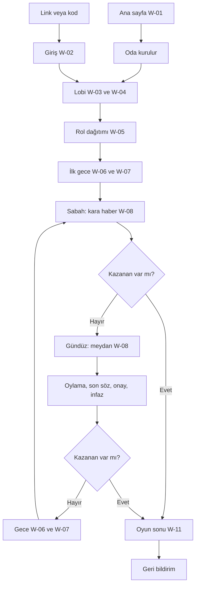

# Kullanıcı Akışları — Gulyabani–Köylü (çalışma adı)

Moderatörün ve oyuncuların v1'deki ana yolları. Ekran kodları (W-01…W-14) `wireframes.md` dosyasındadır.

## Sources

- [desc] Initial description: "gulyabani-koylu-intent.md dosyasındaki oyunu sıfırdan geliştir. Sadece v1 kapsamı; v2 maddeleri kapsam dışı." Oyun akışı bu dosyanın 7., 9., 10. ve 11. bölümlerinden gelir.
- [scope] Workflow-selected scope: `mvp`.
- [Q1]–[Q6]: `rough-mockups-questions.md` içindeki cevaplar (özet onayı: Looks correct).
- Onaylanan niyet beyanı: `ideation/intent-capture/intent-statement.md` (intent-statement).
- Kapsam belgesi: `ideation/scope-definition/scope-document.md` (scope-document).
- İş listesi: `ideation/scope-definition/intent-backlog.md` (intent-backlog).

## Kişiler

| Kişi | Kim | Cihaz |
|---|---|---|
| Moderatör | Odayı kuran ya da moderatörlüğü devralan kişi; rol almaz, her şeyi görür | Telefon veya bilgisayar, ikisi eşit sıklıkta [Q1] |
| Oyuncu | Rol alan katılımcı | Çoğunlukla telefon; toplantı aynı telefonda ya da ayrı bilgisayarda (scope-document) |
| Ölü oyuncu | Ölmüş ve mezarlığa geçmiş oyuncu | Oyuncu ile aynı |
| Oyunun sahibi | Raporu üreten kişi | Ekran yok; sunucuda komut (scope-document) |

## Ana Akış (bir oyunun baştan sona yolu)

<!-- Text fallback: Ana sayfadan oda kurulur ve lobiye geçilir; oyuncular link veya kodla giriş ekranından lobiye gelir. Moderatör oyunu başlatınca roller dağıtılır, ilk gece oynanır, sabah kara haber açıklanır. Kazanan yoksa gündüz meydan toplantısı, oylama, son söz, onay oylaması ve infaz yapılır; yine kazanan yoksa gece gelir ve sabaha dönülür. Herhangi bir kazanma kontrolünde kazanan çıkarsa oyun sonu ekranı ve geri bildirim gelir. -->

## Akışlar

### F-01 Moderatör oda kurar ve oyunu başlatır

- Kişi: Moderatör. Tetik: Ana sayfada "Oda Kur". (IB-01, IB-05)
- Adımlar:
  1. W-01 -> "Oda Kur" -> nick ekranı (W-02) -> moderatör lobisi (W-04).
  2. W-04 -> linki kopyalar veya paylaşır -> oyuncular katıldıkça listede görünür.
  3. W-04 Roller -> ön ayar seçer, anahtarlarla düzeltir -> sistem doğrular, öneri ve uyarı gösterir.
  4. W-04 Ayarlar -> süreleri ve kuralları seçer.
  5. W-04 -> "Oyunu Başlat" -> herkes rol dağıtımına (W-05) geçer.
- Başarı: Herkes kartını görür; moderatör ekranı (W-09) ilk gecenin ilk adımını gösterir.
- Hata yolları:
  - 3'ten az oyuncu -> "Oyunu Başlat" pasif, "En az 3 oyuncu gerekli".
  - Roller oyuncu sayısını aşıyor -> pasif, nedeni yazar; moderatör rol kapatır veya oyuncu bekler.
  - Dengesiz kombinasyon -> uyarı; başlatma engellenmez.
  - Moderatör lobiden ayrılmak isterse -> önce "Moderatörlüğü devret".

### F-02 Oyuncu linkle ya da kodla katılır

- Kişi: Oyuncu. Tetik: Paylaşılan link ya da ana sayfada kod. (IB-01, IB-11)
- Adımlar:
  1. Link -> giriş ekranı (W-02); ya da W-01 -> kod -> "Katıl" -> W-02.
  2. W-02 -> gizlilik bilgilendirmesini görür, nick yazar -> "Odaya Gir".
  3. Oyuncu lobisi (W-03) -> ilk kez geldiyse "Nasıl oynanır?" kartı bir kez açılır.
- Başarı: Oyuncu katılımcı listesinde görünür ve aktif rolleri görür.
- Hata yolları: Nick uzunluğu yanlış veya nick kullanılıyor -> W-02'de alan altında neden, yazılan korunur. Oda yok, süresi dolmuş veya dolu -> W-14.

### F-03 Rol dağıtımı ve ilk gece

- Kişi: Herkes. Tetik: Moderatör oyunu başlatır. (IB-02, IB-06, IB-07, IB-08)
- Adımlar:
  1. W-05 -> oyuncu kartına dokunur, rolünü görür -> "Gördüm".
  2. Moderatör (W-09) ilk gece anonsunu okur -> "Sonraki Adım" -> herkes uyku ekranına (W-06) geçer.
  3. Yalnızca aktif rollerin adımları sırayla: Görücü seçer -> sevdalılar birbirini görür -> ahbaplar birbirini görür -> gulyabaniler birbirini tanır -> Bekçi yoklar -> gulyabaniler kurban seçer ("ilk gece kimse kaçırılmaz" ayarı açıksa bu adım yok). [desc]
  4. Her adımda yalnızca sırası gelenin ekranı eylem paneline (W-07) döner; telefon destekliyorsa kısa titreşim olur, ses yok. [Q4]
- Başarı: Sabah olur; kara haber (W-08) açılır.
- Hata yolları: Sırası gelen oyuncu süre içinde seçmezse panel "Süre doldu" der; moderatör ekranında durum görünür. Sırası gelen oyuncu kopuksa moderatör "kopuk" durumunu görür (W-09).

### F-04 Bir gündüz: meydan, oylama, son söz, infaz

- Kişi: Yaşayan oyuncular ve moderatör. Tetik: Sabah haberi açıklanır. (IB-02)
- Adımlar:
  1. W-08 sabah -> ölenin kartı herkesin ekranında açılır -> tetiklenen etkiler sırayla (Celalli Damat seçimi, sevdalı ölümü, Dertli kontrolü) -> kazanma kontrolü. [desc]
  2. Tema gündüze döner [Q5] -> meydan sohbeti ve geri sayım (W-08).
  3. Süre dolunca moderatöre "Oylamaya geç" hatırlatması -> moderatör geçirir veya süreyi uzatır.
  4. Oylama paneli (W-08b) -> herkes oy verir -> en çok oyu alan sanık olur; eşitlikte ayardaki kural işler.
  5. Son söz (W-08c) -> yalnızca sanık yazar.
  6. Onay oylaması -> oyuncular oyunu değiştirebilir -> sanık hâlâ tek başına öndeyse infaz; çoğunluk bozulursa yeni sanıkla son söze dönülür; günde en fazla 2 yeniden oylama. [desc]
  7. İnfaz -> kart açılır -> tetiklenen etkiler -> kazanma kontrolü -> gece (tema koyuya döner).
- Başarı: Gün infazla ya da infazsız biter, gece başlar veya oyun biter.
- Hata yolları: Oy gönderilemezse panelde "Gönderilemedi, tekrar dene" ve seçim korunur. Bir oyuncu kopuksa oyu yok sayılır mı, Gereksinim Analizi'nde belirlenir.

### F-05 Gulyabanilerin ortak kararı

- Kişi: Yaşayan gulyabaniler. Tetik: Gece gulyabani adımı. (IB-02, IB-07)
- Adımlar:
  1. W-07 gulyabani paneli -> her gulyabani bir hedef işaretler; diğerleri canlı görür; aynı ekranda gulyabani sohbeti.
  2. 2. geceden itibaren Ürkek bakar ve fark edilirse panelde "Pencerede bir gölge var: [isim]" uyarısı çıkar. [desc]
  3. Herkes aynı hedefi seçince "Kararı Onayla" aktif olur -> onaylanınca karar kilitlenir ve moderatöre gider.
- Başarı: Kurban kilitlenir; panel uyku ekranına döner.
- Hata yolları: Süre (varsayılan 90 sn) dolarsa çoğunluğun hedefi geçer; eşitlikte ayara göre rastgele seçilir ya da kimse kaçırılmaz. [desc]

### F-06 Ölüm ve mezarlık

- Kişi: Ölen oyuncu. Tetik: Gece kaçırılma, infaz, sevdalının ölümü, Celalli Damat'ın seçimi veya Boşboğaz'ın kelimeyi söylememesi. (IB-09)
- Adımlar:
  1. Kart herkesin ekranında açılır.
  2. Celalli Damat ise önce "Yanında götüreceğin kişiyi seç" paneli (W-07, 30 sn). [desc]
  3. Oyuncu otomatik olarak mezarlığa (W-10) geçer: canlı izler, yaşayanların sohbetini okur, mezarlık sohbetine yazar.
- Başarı: Ölü oyuncu oyunu izlemeye devam eder; yaşayanların sohbetine yazamaz.
- Hata yolları: Yok; mezarlık yalnızca izleme ve sohbettir.

### F-07 Kopma ve yeniden bağlanma

- Kişi: Herhangi bir oyuncu veya moderatör. Tetik: Telefon başka uygulamaya geçer, ekran kilitlenir, internet kesilir ya da sayfa kapanır. (IB-03, RSK-01)
- Adımlar:
  1. Bağlantı uyarısı şeridi (W-13) -> "Yeniden bağlanılıyor".
  2. Bağlantı gelince -> "Tekrar oyundasın" -> oyuncu aynı rol, aynı ekran ve aynı durumla devam eder.
  3. Sayfa kapandıysa -> aynı link açılır -> oyuncu kendiliğinden aynı yere döner.
  4. Moderatör ekranında oyuncunun yanında "kopuk" görünür, döndüğünde kalkar (W-09).
- Başarı: Oyun, kopan oyuncu için de kaldığı yerden sürer.
- Hata yolları: Bağlantı uzun süre gelmezse "Bağlanamadık. İnternetini kontrol edip sayfayı yenile." Oyuncu "Sorun bildir"e basarsa kopma geri bildirimi kayda düşer. (intent-statement)

### F-08 Oyun sonu ve geri bildirim

- Kişi: Herkes. Tetik: Kazanma koşulu oluşur. (IB-02, IB-13)
- Adımlar:
  1. W-11 -> kazanan taraf, varsa sevdalılar, herkesin rolü ve gece olay günlüğü açılır. [desc]
  2. "Oyun nasıldı?" -> kötü / orta / iyi yüzlerinden biri, isteğe bağlı açıklama -> "Gönder". [Q2]
  3. İsteyen "Öneri/Şikayet yaz" ile ayrı bir metin gönderir.
- Başarı: "Teşekkürler!" görünür; geri bildirim kayda düşer.
- Hata yolları: Gönderilemezse seçim ve metin korunur, "Tekrar dene".

### F-09 Sohbet mesajını şikayet etme

- Kişi: Oyuncu. Tetik: Uygunsuz bir mesaj. (IB-10)
- Adımlar: Mesaja uzun basar (klavyede mesajın menü düğmesi) -> "Şikayet et" -> kısa onay -> şikayet kayda düşer ve moderatörün Sohbet sekmesinde görünür.
- Başarı: "Şikayetin alındı" yazar.
- Hata yolları: Gönderilemezse "Tekrar dene".

### F-10 Moderatörün oyuncuyu çıkarması

- Kişi: Moderatör. Tetik: Rahatsız edici bir oyuncu. (IB-01, IB-10)
- Adımlar: W-04 Oyuncular (lobide) -> "Çıkar" -> "Ali odadan çıkarılsın mı?" onayı -> oyuncu listeden düşer; çıkarılan oyuncu W-14 mesajını görür.
- Oyun sırasında çıkarmanın nasıl işleyeceği (rolünün açılıp açılmayacağı) Gereksinim Analizi'nde belirlenir.

### F-11 Rehberi açma

- Kişi: Herkes. Tetik: "Rehber" düğmesi veya sekmesi. (IB-15)
- Adımlar: W-12 katman olarak açılır -> oyun arkada sürer -> oda içindeyse "Bu odada aktif" filtresi seçili -> karta dokununca ayrıntı -> Esc veya [X] ile kapanır, odak geri döner.

### F-12 Sahibin rapor üretmesi

- Kişi: Oyunun sahibi. Tetik: Sahibi raporu görmek ister. (IB-14)
- Adımlar: Ekran yoktur; sunucuda bir komut çalıştırılır ve rapor dosyası üretilir (oyun sayısı, süreler, kopma sayısı, memnuniyet ortalaması). (scope-document)

## Akışlarda Erişilebilirlik

- Her akış yalnızca klavyeyle de tamamlanabilir; seçim panelleri ok tuşlarıyla gezilir. [Q6]
- Faz değişimi ve "sıra sende" ekran okuyucuya duyurulur; gece herkes için aynı cümle okunur. [Q6]
- Zaman sınırlı adımlarda kalan süre belli aralıklarla okunur; moderatör süreyi uzatabilir. [Q6] [desc]

## Sonraki Aşamalara Bırakılanlar

- Gündüz oylamasında kopuk oyuncunun oyu (F-04).
- Oyun sırasında oyuncu çıkarmanın sonuçları (F-10).
- Bu ve `wireframes.md` dosyasındaki diğer açık noktalar Gereksinim Analizi'nde karara bağlanır.

## Assumptions & Open Questions

None.
