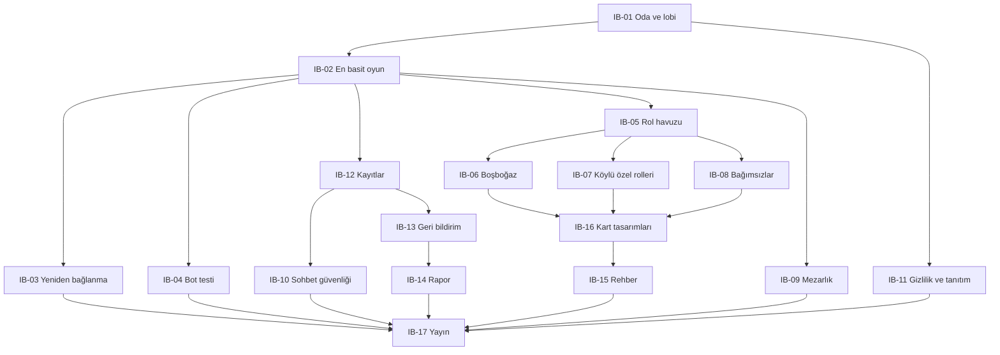

# Niyet İş Listesi (Intent Backlog) — Gulyabani–Köylü (çalışma adı)

v1'in önceliklendirilmiş iş listesi. Her madde bir ön birimdir (proto-Unit); kesin birimler Gereksinim Analizi ve Birim Oluşturma aşamalarında belirlenir. Sınırın gerekçesi `scope-document.md` dosyasındadır.

## Sources

- [desc] Initial description: "gulyabani-koylu-intent.md dosyasındaki oyunu sıfırdan geliştir. Sadece v1 kapsamı; v2 maddeleri kapsam dışı."
- [scope] Workflow-selected scope: `mvp`.
- [Q1]–[Q9]: `scope-definition-questions.md` içindeki cevaplar (özet onayı: Looks correct).
- Onaylanan niyet beyanı: `ideation/intent-capture/intent-statement.md` (intent-statement).
- Fizibilite değerlendirmesi: `ideation/feasibility/feasibility-assessment.md` (feasibility-assessment).
- Kısıt kaydı: `ideation/feasibility/constraint-register.md` (constraint-register).
- Risk ve bağımlılık kaydı: `ideation/feasibility/raid-log.md`.

## Önceliklendirme Yöntemi

- **MoSCoW** kullanıldı. v1 tek seferde yayınlandığı için v1'deki her madde yayını bekletir ve "Must" olarak işaretlendi; "Won't" listesi v1 sınırını korur. [Q1] [Q2]
- Sabit kapsamlı tek bir yayın olduğu için WSJF ve RICE kullanılmadı; bunlar için gerçek kullanım verisi de henüz yok.
- Öncelik, bu yüzden **yapım sırası** ile ifade edilir: değer ve risk birlikte; önce en basit oynanabilir oyun, ilk günden gerçek telefonlarda kopma denemesiyle. [Q3]

## İş Listesi

| ID | Ön birim | İçerik | MoSCoW | Dalga | Bağımlı olduğu | Kaynak |
|---|---|---|---|---|---|---|
| IB-01 | Oda ve lobi temeli | Oda kurma, 6 haneli kod ve link, nick ile giriş, katılımcı listesi, moderatör devri, oyuncu çıkarma, 3–26 oyuncu kuralı ve 6 altı uyarısı | Must | 1 | — | intent-statement, C-06 |
| IB-02 | En basit oynanabilir oyun | Yalnızca Gulyabani ve Köylü ile: rol dağıtımı ve kart görme, ilk gece, gulyabani ortak kararı ve sohbeti, sabah haberi ve kart açılışı, gündüz sohbeti ve geri sayım, oylama–son söz–onay oylaması–infaz, kazanma kontrolü, moderatör ekranı ve anons metinleri, uyku ekranı. Gizli bilgi yalnızca hak eden oyuncuya gider | Must | 1 | IB-01 | intent-statement, C-07 |
| IB-03 | Kopmaya dayanıklılık ve yeniden bağlanma | Sayfa yenilenince veya bağlantı kopunca oyuncu aynı rol ve durumla döner; gerçek telefonlarda başka uygulamaya geçiş ve ekran kilidiyle denenir | Must | 1 | IB-02 (birlikte yapılır) | intent-statement, feasibility-assessment, C-09, RSK-01, [Q3] |
| IB-04 | Bot oyunculu otomatik uçtan uca test | Farklı rol kombinasyonlarında tam bir oyunu baştan sona otomatik deneyen test; IB-02 ile başlar, her yeni rolle genişler | Must | 1'den itibaren | IB-02 | [Q7], [desc] |
| IB-12 | Kayıtlar | Giriş/çıkış, nick, oyundaki işlemler, kopmalar, zaman ve cihaz türü/tarayıcı/ülke (IP yok); 1 yıl saklama; odalar ve sohbetler 24 saatte silinir | Must | 2 | IB-01, IB-02 | intent-statement, C-14, C-15 |
| IB-05 | Rol havuzu paneli | Rolleri aç/kapa, adet seçimi, ön ayarlar (Acemi, Klasik, Dolu Köy), doğrulama ve uyarılar, son ayarların tarayıcıda hatırlanması | Must | 2 | IB-01, IB-02 | intent-statement |
| IB-06 | Boşboğaz Gulyabani | Gizli kelime kuralı, moderatör onay kutusu, "her gün yeni kelime" ayarı | Must | 3 | IB-05 | intent-statement |
| IB-07 | Köylü tarafının özel rolleri | Bekçi, Ürkek, Ahbaplar, Celalli Damat | Must | 3 | IB-05 | intent-statement |
| IB-08 | Bağımsızlar ve sevdalılar | Dertli, Görücü, sevdalılar kuralları (karışık çift dahil) | Must | 3 | IB-05 | intent-statement |
| IB-09 | Mezarlık | Ölüler odası, oyunu izleme, mezarlık sohbeti, hayalet modu ayarı | Must | 3 | IB-02 | intent-statement |
| IB-10 | Sohbet güvenliği | Kelime filtresi ve mesaj şikayeti (şikayet kayıtlara düşer); oyuncu çıkarma IB-01'de | Must | 4 | IB-02, IB-12 | C-17, DEP-04 |
| IB-11 | Gizlilik bilgilendirmesi ve tanıtım metni | Ana sayfada ve odaya girişte kısa KVKK bilgilendirmesi; ana sayfada oyunu anlatan kısa tanıtım metni | Must | 4 | IB-01 | C-16, [Q5] |
| IB-13 | Geri bildirim | Kopmalarda geri bildirim butonu; oyun sonunda simgeli memnuniyet anketi ve isteğe bağlı açıklama; öneri/şikayet girişi | Must | 4 | IB-12 | intent-statement |
| IB-14 | Basit rapor | Ekransız; sunucuda bir komutla rapor dosyası: oyun sayısı (ilk ay sayım kuralına göre), oyun süreleri, kopma sayısı, memnuniyet ortalaması | Must | 4 | IB-12, IB-13 | intent-statement, [Q4] |
| IB-16 | Kart tasarımları | 9 karakterin ön yüzü ve ortak arka yüz; linol baskı üslubunda SVG çizimler (v1'in tam illüstrasyonu); taraf rengi ve simgesi, WCAG AA kontrast; özgün görseller | Must | 5 | IB-06, IB-07, IB-08 | [Q6] [Q8], C-18 |
| IB-15 | Rehber | Kartlar, Nasıl Oynanır ve Moderatör Rehberi; oyunla aynı kart verisinden üretilir; ilk kez katılana "Nasıl oynanır?" kartı | Must | 5 | IB-16 | intent-statement, [Q2] |
| IB-17 | Yayın | Ücretsiz alt adreste herkese açık yayın; bulut hesabının açılması; nihai oyun adının kararı | Must | 6 | Tüm Must maddeleri, DEP-01, DEP-02, ISS-01 | intent-statement, C-04, C-12, C-13 |

Bütün maddeler için geçerli: Türkçe, mobil öncelikli, gece/gündüz temalı arayüz; bilgisayar ve telefondan karışık katılım. (intent-statement, C-09)

## Should / Could

Yok. Q1'de v1'in tek seferde yayınlanması seçildiği için v1'de "yayından sonra eklenebilir" madde bırakılmadı. [Q1]

## Won't (bu çalışmada yapılmaz)

| Madde | Kaynak |
|---|---|
| Tılsım kartları, "Ağız Bağlama", ek roller (Ebe Nine, Muhtar, Kahveci), bot moderatör, sesli anons, oyunculara gösterilen geçmiş/istatistik | intent-statement, C-05 |
| Rapor için ekran veya yönetici sayfası | [Q4] |
| Sosyal medya duyurusu ve bağlantı önizlemesi | [Q5] |
| Yayından önce ayrı arkadaş grubu denemesi | [Q9] |
| Kendi alan adı | C-04 |

## Dalgalar

| Dalga | Amaç | Maddeler | Bitti sayılması |
|---|---|---|---|
| 1 | En basit oynanabilir oyun, kopmaya dayanıklı | IB-01, IB-02, IB-03, IB-04 (başlangıç) | Gulyabani + Köylü ile tam oyun baştan sona oynanır; gerçek telefonlarda başka uygulamaya geçip dönen oyuncu aynı rol ve durumla devam eder; bot testi bu oyunu baştan sona oynar |
| 2 | Kayıt ve rol seçimi | IB-12, IB-05 | Oyunlar ve kopmalar kayda düşer; moderatör rol havuzunu ayarlayabilir |
| 3 | Oyunun tamamı | IB-06, IB-07, IB-08, IB-09 | v1'deki 9 rol ve mezarlık çalışır; bot testi rol kombinasyonlarını kapsar |
| 4 | Herkese açılmaya hazırlık | IB-10, IB-11, IB-13, IB-14 | Filtre, şikayet, gizlilik notu, geri bildirim ve rapor komutu çalışır |
| 5 | Görünüm ve öğretici içerik | IB-16, IB-15 | 9 kart ve arka yüz tamam; rehberin üç bölümü tamam |
| 6 | Yayın | IB-17 | Oyun herkese açık adreste erişilebilir |

## Bağımlılık Haritası

<!-- Text fallback: IB-01 oda ve lobi, IB-02 en basit oyunun ön koşuludur. IB-02'den sonra yeniden bağlanma (IB-03), bot testi (IB-04), kayıtlar (IB-12), rol havuzu (IB-05) ve mezarlık (IB-09) gelir. Rol havuzu üç özel rol grubunun (IB-06, IB-07, IB-08) ön koşuludur; bu üçü kart tasarımlarının (IB-16), kart tasarımları da rehberin (IB-15) ön koşuludur. Kayıtlar sohbet güvenliği (IB-10) ve geri bildirimin (IB-13), geri bildirim de raporun (IB-14) ön koşuludur. Gizlilik ve tanıtım (IB-11) yalnızca IB-01'e bağlıdır. Yayın (IB-17) bütün maddeler bitince yapılır. -->

## Notlar

- Yayın aşamaları çalışma planında henüz yok; IB-17'un yapılabilmesi için plana eklenmeleri gerekir. (ISS-03)
- Bulut sağlayıcısı ve teknoloji seçimi tasarım aşamalarında yapılacak; bu liste teknoloji seçimi içermez. (ISS-02)

## Assumptions & Open Questions

None.
