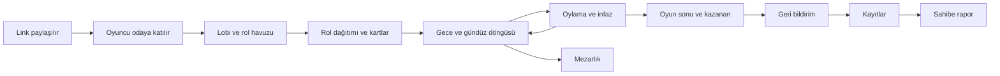

# Kapsam Belgesi — Gulyabani–Köylü (çalışma adı)

v1'in sınırını (neyin içinde, neyin dışında olduğunu), yayın yaklaşımını ve işlerin sırasını tanımlar. Önceliklendirilmiş iş listesi `intent-backlog.md` dosyasındadır.

## Sources

- [desc] Initial description: "gulyabani-koylu-intent.md dosyasındaki oyunu sıfırdan geliştir. Sadece v1 kapsamı; v2 maddeleri kapsam dışı."
- [scope] Workflow-selected scope: `mvp`.
- [Q1]–[Q9]: `scope-definition-questions.md` içindeki cevaplar (özet onayı: Looks correct).
- Onaylanan niyet beyanı: `ideation/intent-capture/intent-statement.md` (intent-statement).
- Fizibilite değerlendirmesi: `ideation/feasibility/feasibility-assessment.md` (feasibility-assessment).
- Kısıt kaydı: `ideation/feasibility/constraint-register.md` (constraint-register); kısıt kimlikleri C-01…C-18.
- Risk ve bağımlılık kaydı: `ideation/feasibility/raid-log.md` (RSK, ASM, ISS, DEP kimlikleri).

## Özet

- v1, intent-statement'ta özetlenen içeriğin tamamıdır; v2 listesi kapsam dışıdır. [desc] (intent-statement)
- v1 tek seferde, tamamı bitince herkese açık yayınlanır; ayrı bir çekirdek sürüm yayını yoktur. [Q1] [Q2]
- Geliştirme, önce en basit oynanabilir oyunla başlar ve bu oyun ilk günden gerçek telefonlarda kopma/yeniden bağlanma ile birlikte denenir. [Q3]
- Kapsam, bir tarihe sığdırmak için kısılmaz; sabit bir yayın tarihi yoktur. (constraint-register C-03)
- feasibility-assessment'ın sonucu "uygulanabilir, koşullu"dur; bu kapsam o üç koşulu (ücretsiz sürekli sunucu, kopmaya dayanıklılık, sadelik) korur.

## Kapsam İçi (v1)

| Alan | İçerik | Kaynak |
|---|---|---|
| Oda ve lobi | Oda kurma, 6 haneli kod ve paylaşılabilir linkle katılma, yalnızca nick ile giriş (şifre yok), katılımcı listesi, moderatörlüğün devri, oyuncunun odadan çıkarılması | intent-statement, [desc] |
| Oyuncu sayısı | En az 3 oyuncu + bir moderatör; 6 oyuncunun altında lobide uyarı; en fazla 26 oyuncu | intent-statement, C-06 |
| Rol havuzu | Rollerin aç/kapa yapılması, adet seçimi, hazır ön ayarlar, doğrulama | intent-statement, [desc] |
| Roller | Gulyabani, Boşboğaz Gulyabani, Köylü, Bekçi, Ürkek, Ahbaplar, Celalli Damat, Dertli, Görücü (ve sevdalılar kuralları) | intent-statement |
| Oyun akışı | Rol dağıtımı, gece/gündüz döngüsü, gulyabani ortak kararı ve gulyabani sohbeti, sabah haberi ve kart açılışı | intent-statement |
| Gündüz | Gündüz sohbeti, oylama, son söz, onay oylaması, infaz | intent-statement |
| Mezarlık | Ölüler odası: oyunu izleme ve ölülerin kendi sohbeti | intent-statement |
| Oyun sonu | Kazanma kontrolü, kazananın ve tüm rollerin açılması | intent-statement |
| Bağlantı | Yeniden bağlanma; telefonda başka uygulamaya geçişte kopmaya dayanıklılık | intent-statement, feasibility-assessment, C-09, RSK-01 |
| Rehber | Kartlar, Nasıl Oynanır ve Moderatör Rehberi bölümleri | intent-statement, [Q2] |
| Kart tasarımları | 9 karakterin ön yüzü ve ortak arka yüz; baştan tam illüstrasyon. Çizimleri, kodu yazan AI linol baskı üslubunda sade vektör çizimler (SVG) olarak hazırlar; bunlar v1'in tam illüstrasyonu sayılır | [Q6] [Q8], C-18 |
| Arayüz | Türkçe, mobil öncelikli; bilgisayar ve telefondan karışık katılım | intent-statement, C-09 |
| Gizlilik | Ana sayfada ve odaya girişte kısa gizlilik bilgilendirmesi (KVKK); IP adresi saklanmaz | C-14, C-16 |
| Tanıtım | Ana sayfada oyunu anlatan kısa bir tanıtım metni | [Q5] |
| Sohbet güvenliği | Moderatörün oyuncuyu çıkarması, kelime filtresi, mesaj şikayeti (şikayet kayıtlara düşer) | C-17 |
| Kayıtlar | Giriş/çıkış, nick, oyundaki işlemler, kopmalar, zaman ve cihaz türü/tarayıcı/ülke; 1 yıl saklama; odalar ve sohbetler 24 saatte silinir | intent-statement, C-14, C-15 |
| Geri bildirim | Kopmalarda geri bildirim butonu; oyun sonunda simgeli memnuniyet anketi ve isteğe bağlı açıklama; öneri/şikayet girişi | intent-statement |
| Rapor | Oyun sayısı, oyun süreleri, kopma sayısı, memnuniyet ortalaması. Ekranı yoktur: sahibi sunucuda bir komutla rapor dosyası üretir | intent-statement, [Q4] |
| Otomatik test | Bot oyuncularla, farklı rol kombinasyonlarında tam bir oyunu baştan sona deneyen otomatik test (yalnızca test amaçlı; v2'deki bot moderatör değildir) | [Q7], [desc] (intent dosyası Bölüm 16) |
| Yayın | Herkese açık bir internet adresinde, önce sağlayıcının ücretsiz alt adresiyle, bu çalışmanın içinde yayın | intent-statement, C-04, C-13 |

## Kapsam Dışı

| Madde | Neden | Kaynak |
|---|---|---|
| Tılsım (güç) kartları | v2 listesinde | intent-statement, C-05 |
| "Ağız Bağlama" varyantı | v2 listesinde | intent-statement, C-05 |
| Ek roller (Ebe Nine, Muhtar, Kahveci) | v2 listesinde | intent-statement, C-05 |
| Otomatik (bot) moderatör | v2 listesinde | intent-statement, C-05 |
| Anonsların sesli okunması | v2 listesinde | intent-statement, C-05 |
| Oyunculara gösterilen oyun geçmişi/istatistik ekranları | v2 listesinde (sahibe özel rapor v1'de) | intent-statement, C-05 |
| Ayrı bir çekirdek sürüm yayını | v1 tek seferde yayınlanır | [Q1] |
| Rapor için ekran veya yönetici sayfası | Rapor sunucuda komutla üretilir | [Q4] |
| Sosyal medya duyurusu ve paylaşım bağlantısı önizlemesi | Tanıtım yalnızca ana sayfadaki kısa metin | [Q5] |
| Yayından önce ayrı bir arkadaş grubu denemesi | İlk oyunlar yayından sonra oynanır | [Q9] |
| Kendi alan adının alınması | Önce ücretsiz alt adres; alan adı ileride ayrı karar | C-04 |
| IP adresinin saklanması | Kişisel veriyi en aza indirmek için | C-14 |
| Kutu oyununun isim, metin ve görselleri | Kartlar ve metinler özgün olmalı | C-18 |

## Yayın Yaklaşımı (minimum uygulanabilir kapsam)

- Minimum uygulanabilir kapsam, v1'in tamamıdır: v1 tek seferde yayınlanır ve yayın için `intent-backlog.md` dosyasındaki tüm "Must" maddeleri tamamlanmış olmalıdır. [Q1] [Q2]
- Kart illüstrasyonları da yayından önce tamamlanır; yayın görsellere bağlıdır. [Q6] [Q8]
- Yayından önce ayrı bir arkadaş grubu denemesi yapılmaz; başarı ölçütlerindeki "ilk ay" yayın günü başlar ve güvenilirlik ölçütü ilk kez yayından sonra ölçülür. [Q9] (intent-statement, feasibility-assessment)
- Yayından önce nihai oyun adı kararlaştırılır. (ISS-01)

## Sıralama Yaklaşımı

Değer ve risk birlikte gözetilir. [Q3]

1. İlk iş, baştan sona oynanabilen en basit oyundur (yalnızca Gulyabani ve Köylü). Bu oyun ilk günden gerçek telefonlarda, başka uygulamaya geçiş ve ekran kilidiyle kopma/yeniden bağlanma açısından denenir. (RSK-01)
2. Bot oyunculu otomatik test bu ilk oyunla birlikte başlar ve her yeni rol ile genişler. [Q7]
3. Ardından kayıtlar ve rol havuzu, sonra özel roller ve mezarlık eklenir.
4. Herkese açık yayın için gerekenler (sohbet güvenliği, gizlilik bilgilendirmesi, geri bildirim, rapor) tamamlanır.
5. Rehber ve kart tasarımları, roller netleştikten sonra tamamlanır; rehber kart verisini kullanır.
6. En son yayın yapılır.

Ayrıntılı sıra ve bağımlılıklar `intent-backlog.md` dosyasındadır.

## Değer Akışı Haritası

<!-- Text fallback: Link paylaşılır, oyuncu odaya katılır (gizlilik bilgilendirmesi görülür), lobide moderatör rol havuzunu ayarlar, roller dağıtılır ve herkes kartını görür, gece ve gündüz döngüsü başlar, gündüz oylama ve infaz yapılır ve döngü tekrar eder; ölen oyuncu mezarlığa geçer. Kazanma koşulu oluşunca oyun biter, oyuncular geri bildirim verir, her şey kayıtlara düşer ve sahibi kayıtlardan rapor üretir. -->

| Adım | Kime değer üretir | İlgili backlog maddeleri |
|---|---|---|
| Link paylaşılır, odaya katılım | Oyuncu, moderatör | IB-01, IB-11 |
| Lobi ve rol havuzu | Moderatör | IB-01, IB-05 |
| Rol dağıtımı, gece/gündüz, oylama | Tüm oyuncular | IB-02, IB-06, IB-07, IB-08 |
| Kopmadan devam | Tüm oyuncular | IB-03 |
| Mezarlık | Ölen oyuncular | IB-09 |
| Rehber ve kartlar | Yeni oyuncular, moderatör | IB-15, IB-16 |
| Geri bildirim, kayıtlar, rapor | Oyunun sahibi | IB-12, IB-13, IB-14 |

## Gereksinim Analizi'ne Bırakılanlar

- Lobi ayarlarının varsayılanları ve intent dosyasının 17. bölümündeki açık sorular (ilk gece kimse kaçırılmaz, eşitlik kuralı, oyların canlı görünmesi, Ürkek'in fark edilme olasılığı, hayalet modu, her gün yeni gizli kelime). [desc]
- İnceleme notları R-05, R-06, R-07. (feasibility-assessment, ISS-04)
- Görüntü ve sesin oyun dışında ayrı bir uygulamayla sağlandığı varsayımının teyidi. (ASM-01)

## Kısıtlarla İlişki

Bu kapsam constraint-register'daki tüm kısıtlara uyar. Kapsamı doğrudan şekillendirenler:

- Bütçe sıfır (C-01, C-02): kart görselleri ücretli araç olmadan, SVG çizimlerle hazırlanır. [Q8]
- Tek kişilik, AI destekli bakım (C-11): rapor için ekran yerine komut seçildi; bot testi bakımı kolaylaştırır. [Q4] [Q7]
- Kopmaya dayanıklılık (C-09): ilk günden gerçek telefon denemesi. [Q3]
- Saklama ve gizlilik (C-14, C-15, C-16): kayıtlar ve bilgilendirme kapsam içinde.

## Açık Konular

- Nihai oyun adı; yayından önce kararlaştırılacak. (ISS-01)
- Bulut sağlayıcısı ve teknoloji seçimi; tasarım aşamalarında. (ISS-02)
- Yayın aşamaları (ortam kurulumu, dağıtım, izleme) çalışma planında henüz yok; plana eklenecek. (ISS-03)

## Assumptions & Open Questions

None.
