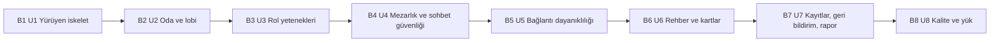

# Bolt Planı — Gulyabani–Köylü (çalışma adı)

Bu belge, yapım aşamasında 8 parçanın (U1–U8) hangi sırayla yapılacağını gösterir. Her parça bir **Bolt** olarak yapılır: Bolt, işin bir parçası üzerinden yapılan ve sonunda çalışan, sınanmış bir şey bırakan tek bir yapım turudur. İlk Bolt **yürüyen iskelettir**: parçaların birbirine gerçekten bağlandığını kanıtlayan, baştan sona oynanabilen en küçük tam oyun.

## Sources

- [desc] Initial description: "gulyabani-koylu-intent.md dosyasındaki oyunu sıfırdan geliştir. Sadece v1 kapsamı; v2 maddeleri kapsam dışı."
- [scope] Workflow-selected scope: `mvp`.
- Parçalar: `inception/units-generation/unit-of-work.md` (unit-of-work; U1–U8 sorumlulukları ve Ortak Kurallar).
- Parça bağımlılıkları: `inception/units-generation/unit-of-work-dependency.md` (unit-of-work-dependency; bağımlılık bloğu, paralel yazılabilecek çiftler).
- Hikâye–parça eşlemesi: `inception/units-generation/unit-of-work-story-map.md` (unit-of-work-story-map; 48 hikâye, çok parçalı hikâyelerin paylaşımı, parça içi yapım sırası).
- Sözleşmeler: `inception/contract-design/contract-summary.md` (contract-summary; C1–C10, sahiplik ve açık sorular; inceleme bulguları R-01, R-02, R-05).
- Gereksinimler: `inception/requirements-analysis/requirements.md` (requirements; FR1–FR21, NFR1–NFR15).
- Kullanıcı hikâyeleri: `inception/user-stories/stories.md` (stories; [İskelet] etiketli 16 hikâye).
- Ekranlar: `inception/refined-mockups/mockups.md` (mockups; her Bolt'un gösterimindeki ekranlar).
- Yapı taşları: `inception/domain-design/components.md` (components; yürüyen iskelette kullanılan yapı taşları).
- Ekip çalışma biçimi: `inception/practices-discovery/team-practices.md` (team-practices; yürüyen iskelet AÇIK, Bolt başına geçici dal ve squash, test sırası ve kapsam sınırları, tek ücretsiz sunucu).
- [Q1]: `delivery-planning-questions.md` — iskeletten sonra önce oyunun tamamı (A). Diğer ayrıntılar sahibin kuralı gereği (project.md Corrections) benim seçtiğim varsayılanlardır ve özet onayıyla onaylandı (Looks correct).

## Bolt Sırası

| Sıra | Bolt | Parça | İskelet | Büyüklük | Dayandığı Bolt'lar |
|---|---|---|---|---|---|
| 1 | B1 | U1 u1-walking-skeleton | **Evet** | XL | — |
| 2 | B2 | U2 u2-room-and-lobby | | M | B1 |
| 3 | B3 | U3 u3-role-abilities | | L | B2 |
| 4 | B4 | U4 u4-graveyard-and-chat-safety | | M | B1 |
| 5 | B5 | U5 u5-connection-resilience | | L | B3, B4 |
| 6 | B6 | U6 u6-guide-and-cards | | M | B2 |
| 7 | B7 | U7 u7-records-feedback-report | | M | B5 |
| 8 | B8 | U8 u8-quality-and-load | | M | B6, B7 |

Bu sıra parçaların numara sırasıdır ve `unit-of-work-dependency.md`'deki bağımlılıklara tam uyar: her Bolt, dayandığı bütün Bolt'lardan sonra gelir. Yapım, parçaların bağımlılık sırasını izleyen aynı yolu yürür; bu yüzden plan ile gerçek yapım sırası birbirinden ayrılmaz.

<!-- Text fallback: Oklar yapım sırasını gösterir: B1 (U1) → B2 (U2) → B3 (U3) → B4 (U4) → B5 (U5) → B6 (U6) → B7 (U7) → B8 (U8). Bolt'lar teker teker yapılır. -->

## Her Bolt İçin Ortak Bitti Tanımı

Bir Bolt ancak şunların hepsi doğruysa bitmiş sayılır (team-practices Testing Posture ve Way of Working; `unit-of-work.md` Ortak Kurallar):

- Parçanın tasarım aşamaları ve kodu tamamlandı; oyun kuralı kodunda testler koddan önce yazıldı.
- Bütün testler geçiyor; satır kapsamı tüm kodda en az %80, oyun kuralı kodunda en az %90.
- Bot oyunculu uçtan uca test, bu Bolt'un eklediği özellikle genişletildi ve tam bir oyunu kazananla bitiriyor.
- Bu Bolt'un eklediği her yeni bilgi alıcıya özel görünümden geçiyor ve onun gizli bilgi testi var (C5, NFR8).
- Yeni ekranlar Türkçe metin dosyasını kullanıyor, mobil öncelikli ve WCAG 2.1 AA kurallarıyla yazıldı.
- IP adresi hiçbir yerde saklanmıyor; şifre ve anahtar koda ya da depoya yazılmadı.
- Sözleşmelere (`contract-summary.md`) yalnızca ekleme yapıldı.
- Sahip parçanın denetim noktasını onayladı; parça kendi geçici dalından `main`'e tek commit olarak eklendi.

---

## B1 — Yürüyen iskelet (U1) · İskelet

**Kapsam:** `unit-of-work.md` U1'in tamamı ve aşağıdaki üç ek. İskelet etiketli 16 hikâye (US1.1, US1.2, US1.4, US2.2, US3.1–US3.3, US4.1, US4.2, US5.1–US5.4, US7.1, US7.2, US9.1) ile US13.1, US13.3, US13.4 ve US13.5'in iskelet payları (`unit-of-work-story-map.md`).

**Kanıtladığı mimari parçalar:** ContentCatalog, GameRules, RoomManager, MatchFlow, VisibilityFilter, ConnectionGateway, ChatService, WebClient ve BotPlayer'ın en sade hâli, gerçek şifreli bağlantı (C1) üzerinden ve kalıcı depoya yazarak (C9) birbirine bağlanır; ücretsiz Oracle sunucusunda dış adreste çalışır.

**İskelete eklenen korumalar** (önceki incelemelerden devreden bulgular; iskelet baştan herkese açık adreste çalıştığı için):
- **Sağlık kontrolü** (`/healthz`): `status`, `version`, `activeRooms` ve `activeMatches` alanlarıyla U1'de kurulur. "Yeni sürüm yalnızca hiç oyun sürmüyorken yüklenir" kuralı (contract-summary [Q1]) `activeMatches`'a dayandığı için iskeletten itibaren gerekir. U8 yalnızca ek ölçümleri (ör. bağlantı ve hata sayıları) ekler. (Sözleşme incelemesi R-01, Birim incelemesi R-02)
- **Basit hız sınırı:** oda kodu denemesi ve mesaj gönderimi için iskelette basit bir sınır vardır; değerler NFR7'deki gibidir (dakikada 10 oda kodu denemesi, 10 saniyede 5 mesaj). U8 bunları yük altında sınar ve gerekirse ayarlar. (Sözleşme incelemesi R-05)
- **24 saatte silme:** oda, oyun, sohbet ve oturum verisinin oluşturulmasından 24 saat sonra silinmesi iskelette çalışır (project.md Mandated). Silme işlemlerinin sahipleri zaten U1'dedir (C8); iskelete yalnızca bunları zamanında çağıran basit bir tetik eklenir. U7, kayıt ve geri bildirim silmelerini ve kapalıyken kaçırılan silmelerin açılışta yapılmasını ekler. (Birim incelemesi R-02)
- **Komut yönlendirme tablosu:** C1 komutlarının hangi yapı taşına gittiğini gösteren tablo U1'in Fonksiyonel Tasarımı'nda yazılır. (Sözleşme incelemesi R-02)

**Ön koşullar:** Oracle ücretsiz hesabı açılmış olmalı (DEP-01, `external-dependency-map.md`); programlama dili ve kalıcı depo ürünü U1'in NFR ve altyapı aşamalarında seçilir (ISS-02, C9 açık sorusu).

**Bitti tanımı (ortak tanıma ek olarak):**
- 3 ila 26 oyuncuyla oda kurulur, katılınır, roller dağıtılır, gece ve gündüz turları, oylama, son söz, infaz ve oyun sonu ekranı çalışır; kazanan doğru belirlenir.
- Bot oyunculu uçtan uca test, gerçek bağlantı üzerinden tam bir oyunu kazananla bitirir (Construction doğrulama komutu bunu çalıştırır).
- Sayfa yenilenince ya da bağlantı kopup gelince oyuncu aynı ekrana döner.
- Sağlık kontrolü, hız sınırı ve 24 saatte silme otomatik testlerle sınanır.
- Sahip gerçek telefonlarla (Wi-Fi ve mobil veri; başka uygulamaya geçip dönme, ekran kilidi sonrası dönme) yeniden bağlanmayı denedi ve iskelet denetim noktasını onayladı (team-practices Walking Skeleton).

**Güven varsayımı (bu Bolt neyi kanıtlar):** Ücretsiz sunucuda, telefon ağlarında şifreli canlı bağlantı kopmadan ya da koptuğunda kayıpsız geri gelerek tam bir oyun oynatılabilir; mimarinin bütün ana yapı taşları gerçekten birlikte çalışır ve gizli bilgi yalnızca hak eden oyuncuya gider.

**Beklenen gösterim:** Sahip ve birkaç telefon dış adresten aynı odaya girer; yalnızca Gulyabani ve Köylü ile bir oyun baştan sona oynanır. Ekranlar `mockups.md`'deki ana sayfa, lobi, kart görme, Uyku, sabah, gündüz, oylama, oyun sonu ve moderatör ekranlarıdır. Bot testi aynı oyunu otomatik oynar.

## B2 — Oda ve lobinin tamamı (U2)

**Kapsam:** `unit-of-work.md` U2; hikâyeler US1.3, US1.5, US2.1 ve US7.2'nin U2 payı (bekleyenlerin lobiye alınması, 22 saat kuralı).

**Bitti tanımı:** 17 ayar izinli aralıklarıyla çalışır; 9 rol havuzda seçilebilir ve doğrulanır (yetenekler henüz çalışmaz); oyun sürerken gelen kişi bekler ve "Yeni oyun"da lobiye alınır; 26 kişi sınırı, çıkarma ve 30 dakika yasak, moderatörlük devri çalışır; moderatörün son havuz ve ayarları tarayıcıda hatırlanır.

**Güven varsayımı:** İskeletin oda ve lobi kodu, kuralların tamamını taşıyacak kadar sağlam; rol kataloğu biçimi (C4) 9 rolü ve Rehber'i taşıyabilir.

**Beklenen gösterim:** Moderatör ayarları ve rol havuzunu seçer; geç gelen biri bekleme ekranında kalır ve sonraki oyuna lobiden katılır.

## B3 — Rol yetenekleri (U3)

**Kapsam:** `unit-of-work.md` U3; hikâyeler US6.1–US6.7, US10.3, US4.2, US5.4 ve US7.1'in U3 payları.

**Ön koşul:** "Her gün yeni kelime" listesi (en az 30 Türkçe kelime, A19) bu Bolt'tan önce hazır olmalı; listeyi ben hazırlarım, sahip gözden geçirir (`external-dependency-map.md`).

**Bitti tanımı:** 7 özel rolün yetenekleri, ilk gece adım sırası, tam ölüm zinciri (Celalli Damat → sevdalı → Dertli → kazanma) ve kazanma kontrolünün tamamı çalışır; oyun sırasında oyuncu çıkarma ölüm olarak işlenir. Bot testi farklı rol havuzlarıyla tam oyun oynar.

**Güven varsayımı:** Kural arayüzü (C3) en karmaşık kuralları ve rol etkileşimlerini, önceki kodu bozmadan taşır; oyun kuralı kodunda %90 kapsam tutturulabilir. Bu Bolt'tan sonra 9 rolün hepsiyle gerçek bir oyun oynanabilir.

**Beklenen gösterim:** 9 rollük bir havuzla tam oyun: Bekçi yoklar, Görücü sevdalıları seçer, Celalli Damat yanında birini götürür, Dertli ölerek kazanır.

## B4 — Mezarlık ve sohbet güvenliği (U4)

**Kapsam:** `unit-of-work.md` U4; hikâyeler US8.1, US8.2, US10.1 ve US10.2'nin U4 payı.

**Ön koşul:** Küfür/hakaret listesinin ilk hâli (DEP-04) bu Bolt'tan önce hazır olmalı; listeyi ben hazırlarım, sahip gözden geçirir.

**Bitti tanımı:** Ölüler mezarlıkta izler ve Mezarlık Sohbeti'ne yazar; bu sohbet yaşayanlara hiç gitmez; hayalet modu çalışır; kelime filtresi sohbette ve nick'te çalışır; mesaj şikayeti moderatöre işaretlenir ve kayıt için olay yayınlanır.

**Güven varsayımı:** Görünüm süzgeci (C5) yaşayan ve ölü arasındaki ayrımı sızıntısız yapar; filtre Türkçe metinde makul çalışır.

**Beklenen gösterim:** Ölen oyuncu mezarlığa geçer ve öteki ölülerle konuşur; yaşayanlar bunu görmez; yasaklı bir kelime yıldızlanır; bir mesaj şikayet edilir.

## B5 — Bağlantı dayanıklılığı (U5)

**Kapsam:** `unit-of-work.md` U5; hikâyeler US9.2–US9.6.

**Bitti tanımı:** Kopan oyuncunun adımı 5 dakikaya uzar; moderatör kaybolursa kuralı (duraklatma, 3 dakika bekleme, ölülere moderatörlük teklifi, devir) çalışır; sunucu yeniden başlayınca oyunlar ve sayaçlar kalan süreyle sürer; ikinci sekme son bağlantıyı devralır; oturumu kaybolan oyuncu moderatör onayıyla döner. Bot testi bu senaryoları oynar.

**Güven varsayımı:** Kalıcı depoya "önce yaz, sonra kabul et" yaklaşımı (ADR-004) sunucu yeniden başlatmada hiçbir kabul edilmiş işlemi kaybetmez.

**Beklenen gösterim:** Oyun ortasında sunucu yeniden başlatılır ve oyun kaldığı yerden sürer; moderatörün telefonu kapanır ve bir ölü oyuncu moderatörlüğü devralır.

## B6 — Rehber ve kartlar (U6)

**Kapsam:** `unit-of-work.md` U6; hikâyeler US11.1–US11.3.

**Bitti tanımı:** 9 kartın özgün büyük ön yüz ve ortak arka yüz görselleri yerinde; Rehber'in üç sekmesi oyunu durdurmadan açılır; taraf ve "Bu odada aktif roller" filtreleri çalışır; Rehber kimin hangi rolde olduğunu hiç göstermez. Kart görünümü sahibe resimle gösterilip onaylandı (project.md Corrections).

**Güven varsayımı:** Rehber ve oyun aynı kart verisini kullanır (FR18.5); kart görselleri telefonda hızlı yüklenir.

**Beklenen gösterim:** Oyun sırasında Rehber açılır, kartlar incelenir, Rehber kapanınca oyun aynı yerden sürer.

## B7 — Kayıtlar, geri bildirim ve rapor (U7)

**Kapsam:** `unit-of-work.md` U7; hikâyeler US7.3, US12.1–US12.3 ve US10.2'nin U7 payı.

**Bitti tanımı:** Olaylar IP'siz kaydedilir; şikayetler 1 ay, kayıt ve geri bildirimler 1 yıl saklanıp otomatik silinir; kapalıyken kaçırılan silmeler açılışta yapılır; oyun sonu geri bildirimi, öneri/şikayet ve "Sorun bildir" çalışır; sahip sunucuda tek komutla Türkçe rapor alır (C10).

**Güven varsayımı:** Kayıt yazılamasa bile oyun durmaz (NFR13); IP hiçbir kayda girmez.

**Beklenen gösterim:** Bir oyun oynanır, geri bildirim gönderilir, sahip rapor komutunu çalıştırıp Türkçe raporu okur.

## B8 — Kalite ve yük (U8)

**Kapsam:** `unit-of-work.md` U8; hikâyeler US13.2 ve US13.1, US13.3, US13.4, US13.5'in U8 payları.

**Bitti tanımı:** Görünürlük tablosundaki her bilgi her alıcı türü için sınandı; CI'da otomatik erişilebilirlik taraması geçiyor, elle ekran okuyucu ve klavye denemesi yapıldı; desteklenmeyen tarayıcı uyarısı çalışıyor; hız sınırları yük altında sınandı; 50 oda × 26 oyuncu + moderatörle tepki süresi 1 saniyenin altında (NFR1, NFR2); sağlık kontrolüne ek ölçümler eklendi.

**Güven varsayımı:** Ücretsiz sunucu v1'in hedef yükünü taşır (ASM-02); taşımazsa yayından önce bilinir.

**Beklenen gösterim:** Yük testi raporu ve erişilebilirlik tarama sonucu; v1 yayına hazır.

## Assumptions & Open Questions

- [assumption] Yapım teker teker (Bolt'lar aynı anda değil) ilerler; kayıtlı yapım biçimi parça parça ve sıralıdır (`Construction Iteration: unit-major`, `Construction Execution: serial`).
- [assumption] B1'e eklenen üç koruma (sağlık kontrolü, basit hız sınırı, 24 saatte silme) iskeleti biraz büyütür; U1 zaten en büyük parçadır (Birim incelemesi R-03). Kapsamı küçültmek gerekirse U1'in Fonksiyonel Tasarımı'nda ertelenebilecek kalemler (ör. moderatör ekranının bilgisayar düzeni) sahibe sorulur.
- [assumption] Sözleşme belgesindeki C2 satırı `/healthz`'i U1 ile U8 arasında bölüyor; bu planla `activeMatches` dahil temel alanlar U1'e alındı. Sözleşmeye yalnızca ekleme yapılır; değişiklik U1'in Fonksiyonel Tasarımı'nda yazılır.
- Açık sorular: depo ürünü ve dil (ISS-02, U1'den önce), oyunun nihai adı (ISS-01, yayından önce), yayın aşamaları (ISS-03) — ayrıntısı `external-dependency-map.md`'de.
