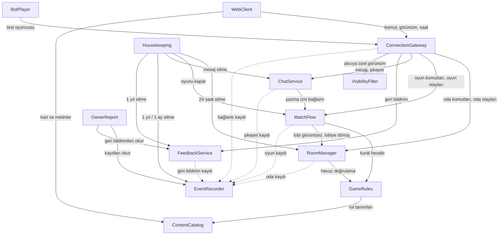

# Yapı Taşları (Bileşen Kataloğu) — Gulyabani–Köylü (çalışma adı)

v1 için yazılacak yazılımın mantıksal yapı taşları. Bir yapı taşı, kendi iş kuralları ve verisi olan, kodunu bizim yazdığımız bir parçadır. Veritabanı, sunucu, ülke veritabanı gibi hazır şeyler yapı taşı değil, yapı taşlarının kullandığı **dış bağımlılıklardır**. Bu belge teknoloji (programlama dili, veritabanı ürünü) ve yapı taşlarının tek program mı ayrı programlar mı olacağını seçmez: bunlar NFR/altyapı aşamalarında ve Units Generation'da kararlaştırılır. Kod içi adlar İngilizce, açıklamalar Türkçedir (team-practices Code Style).

## Sources

- [desc] Initial description: "gulyabani-koylu-intent.md dosyasındaki oyunu sıfırdan geliştir. Sadece v1 kapsamı; v2 maddeleri kapsam dışı."
- [scope] Workflow-selected scope: `mvp`.
- Gereksinimler: `inception/requirements-analysis/requirements.md` (requirements; FR1–FR21, NFR1–NFR15; FR2.3 ve FR14.5 bu aşamada sahibin onayıyla güncellendi).
- Kullanıcı hikâyeleri: `inception/user-stories/stories.md` (stories; US1.1–US13.5, [İskelet] etiketleri).
- Ekip çalışma biçimi: `inception/practices-discovery/team-practices.md` (team-practices; yürüyen iskelet, test sırası ve kapsam sınırları, tek ücretsiz sunucu, kod adları İngilizce).
- Ayrıntılı Taslaklar: `inception/refined-mockups/interaction-spec.md` ("Yeniden Katılma Kuralı", "Bekleyenler ve Odayı Kapatma", "Moderatör Kaybolursa").
- [Q1]: `domain-design-questions.md` — moderatörlük teklifi 3 dakika açık kalır (özet onayı: Looks correct). Diğer ayrıntılar sahibin kuralı gereği (project.md Corrections) benim seçtiğim varsayılanlardır ve aynı özetle onaylandı.

## Bileşen Kataloğu

```yaml
components:
  - name: ContentCatalog
    summary: Rollerin, kart metinlerinin ve görsellerinin, Rehber içeriğinin ve oyuncuya görünen metinlerin tek veri kaynağı.
    behaviour: >
      v1'in 9 rolünü veri olarak tanımlar (ad, taraf, taraf simgesi, yetenek metni, ne zaman uyandığı,
      kazanma koşulu, strateji ipucu, atmosfer sözü, ön yüz görsel yolu, varsayılan ve zorunlu olma,
      ön ayarlara üyelik). Yeni rol kod değil veri olarak eklenir (NFR12). Rehber'in Kartlar sekmesi
      bu kaynaktan üretilir; ayrı kopya tutulmaz (FR18.5). Kutu oyununun isim, metin ve görselleri
      bulunmaz (FR19.4). Boşboğaz için "her gün yeni kelime" listesini (en az 30 Türkçe kelime) ve
      oyuncuya görünen tüm Türkçe metinleri (NFR11) tutar. Hiçbir zaman kimin hangi rolde olduğunu
      bilmez (FR18.6). Değişmez, salt okunur veridir.
    responsibilities:
      - Rol tanımları ve ön ayarlar (Acemi, Klasik, Dolu Köy)
      - Kart ön ve arka yüz görsellerinin yolları
      - Rehber içeriği (Kartlar, Nasıl Oynanır, Moderatör Rehberi)
      - Gizli kelime listesi
      - Oyuncuya görünen Türkçe metin dosyası
    depends_on: []
    dependents:
      - component: GameRules
        interaction: rol tanımlarını, taraflarını ve gizli kelime listesini okur
      - component: WebClient
        interaction: kart metinlerini, görselleri, Rehber içeriğini ve Türkçe metinleri gösterir
    external_dependencies: []
    entities:
      - name: RoleDefinition
        identifier: roleId
        attributes: [name, side, sideIcon, abilityText, wakeTiming, winCondition, strategyTip, flavorText, frontImagePath, mandatory, presets]
      - name: GuideArticle
        identifier: articleId
        attributes: [tab, title, body, illustrationPaths, order]
      - name: SecretWordList
        identifier: listId
        attributes: [words]
      - name: TextBundle
        identifier: textKey
        attributes: [text]

  - name: GameRules
    summary: Oyunun bütün kurallarını işleten, internet, ekran ve veritabanı bilmeyen saf kural modülü.
    behaviour: >
      Verilen oyun durumu ve bir komut (ör. oy, gece seçimi, sonraki adım, oyuncu çıkarma) için yeni
      durumu ve ortaya çıkan olayları hesaplar; yan etkisi yoktur, saati ve rastgeleliği dışarıdan alır
      (NFR12, NFR15). Rol havuzu doğrulaması (FR3.2–FR3.5), kriptografik rastgele kaynakla rol dağıtımı
      (FR4.1), ilk gece ve standart gece adım sırası ile kapalı/ölü rol adımlarının atlanması (FR5),
      gulyabani ortak kararı ve eşitlik kuralları (FR6), ölüm sonrası etki zinciri — Celalli Damat →
      sevdalı → Dertli → kazanma kontrolü (FR7.2), oylama, yeniden oylama, köyün en genci, son söz ve
      onay oylaması (FR9), dokuz rolün yetenekleri (FR10) ve kazanma kontrolü sırası (FR11.1) burada
      tanımlıdır. Her komutu sırasına, oyuncunun rolüne ve durumuna göre doğrular; geçersiz komut
      durumu değiştirmez (NFR7, AC13.5.1). Kuralların testleri koddan önce yazılır ve satır kapsamı en
      az %90'dır (team-practices Testing Posture).
    responsibilities:
      - Rol havuzu doğrulaması ve önerilen gulyabani sayısı
      - Rol dağıtımı
      - Gece, sabah, gündüz ve oylama kurallarının hesaplanması
      - Ölüm zinciri ve kazanma kontrolü
      - Her komut için "şu an kim neyi yapabilir" kararı (yasal eylemler)
    depends_on:
      - component: ContentCatalog
        interaction: rol tanımlarını, taraflarını ve gizli kelime listesini okumak
        style: sync
    dependents:
      - component: RoomManager
        interaction: lobide rol havuzunun ve oyuncu sayısının oyunu başlatmaya uygunluğunu sorar
      - component: MatchFlow
        interaction: her komutta yeni oyun durumunu ve olayları hesaplatır
    external_dependencies: []
    entities:
      - name: GameState
        identifier: gameId
        attributes: [phase, nightNumber, dayNumber, stepCursor, settingsSnapshot, rolePoolSnapshot, secretWord, voteRound, revoteCount, accusedSeatId, winners, endedAt]
        references:
          - entity: RoleDefinition
            owned_by: ContentCatalog
            relationship: oyunun rol havuzu, katalogdaki rol tanımlarından oluşur
      - name: Seat
        identifier: seatId
        attributes: [gameId, participantId, nick, roleId, alive, deathCause, loverOf, buddyOf, isYoungest, revealed]
        references:
          - entity: Participant
            owned_by: RoomManager
            relationship: her koltuk odadaki bir katılımcıya aittir
          - entity: RoleDefinition
            owned_by: ContentCatalog
            relationship: her koltuğun bir rolü vardır
      - name: NightAction
        identifier: actionId
        attributes: [gameId, nightNumber, step, actorSeatId, targetSeatIds, result, timedOut]
      - name: Vote
        identifier: voteId
        attributes: [gameId, dayNumber, round, voterSeatId, targetSeatId, abstained]
      - name: DeathRecord
        identifier: deathId
        attributes: [gameId, seatId, cause, phase, chainOrder, revealedRoleId]

  - name: RoomManager
    summary: Odaların yaşam döngüsünü, katılımı, lobiyi, bekleyenleri ve çıkarma kurallarını yönetir.
    behaviour: >
      6 haneli, o an kullanımda olmayan oda kodu ve link üretir; kuran kişi varsayılan moderatördür
      (FR1.2). Nick kurallarını uygular — 2–16 karakter, baş/son boşluk atılır, oda içinde Türkçe
      büyük/küçük harf duyarsız benzersiz, filtre listesindeki kelime içermez (FR1.3–FR1.4). Giriş
      kararını interaction-spec'teki 9 satırlık "Yeniden Katılma Kuralı" sırasıyla verir: oyunda
      çıkarılmış tarayıcı, art arda 2 çıkarmada 30 dakika yasak, nick kuralı, nick kullanımda, oda
      yeni isteklere kapalı, lobi, bekleme ekranı ya da oda dolu, oyuncu zaten bağlı, yeniden katılma
      isteği. Bekleme bir istektir; "Yeni oyun"da bekleyenler lobiye alınır (FR1.6, FR17.2). Odada
      en fazla 26 oyuncu (bekleyenler dahil) olur (FR2.4). Lobide ve bekleyenlerde çıkarma, art arda
      2 çıkarmada 30 dakika yasak ve "Yeni isteklere kapat" anahtarı (FR2.3), lobide moderatörlük
      devri (FR2.2), rol havuzu ve ayarların izinli aralıkta tutulması (FR2.6, FR3), köyün en genci
      işareti (FR2.7) ve oda kurulduktan 22 saat sonra yeni oyun başlatılamaması (FR17.2) burada
      işler. Yeniden katılma isteğini moderatöre iletir; onay iki adımlıdır, onaydan önce isteyene
      oyun bilgisi gitmez (AC9.6.3). Tarayıcı tanıması oturum bilgisiyle yapılır, IP kullanılmaz (C-14).
    responsibilities:
      - Oda kodu üretimi, odaya giriş kararı ve 24 saatlik oda ömrü
      - Lobi, bekleyenler ve katılımcı listesi
      - Oda ayarları ve rol havuzu (izinli aralıklar)
      - Lobide ve bekleyenlerde çıkarma, 30 dakikalık istek yasağı, "Yeni isteklere kapat"
      - Moderatörün kim olduğu (lobide devir; oyunda MatchFlow'un bildirdiği değişiklik)
      - Yeniden katılma isteği ve onayı
    depends_on:
      - component: GameRules
        interaction: rol havuzunun ve oyuncu sayısının oyunu başlatmaya uygun olup olmadığını sormak
        style: sync
      - component: EventRecorder
        interaction: oda kurma, giriş/çıkış ve çıkarma olaylarını kaydettirmek
        style: async
    dependents:
      - component: MatchFlow
        interaction: oyun başında lobi görüntüsünü alır, oyun sonunda odayı lobiye döndürür, oyunda çıkarma ve moderatör değişikliğini bildirir
      - component: ConnectionGateway
        interaction: giriş, nick, lobi komutlarını ve bağlantı durumunu iletir; oda olaylarını dinler
      - component: Housekeeping
        interaction: 24 saati dolan odaları sildirir
    external_dependencies:
      - name: Kalıcı veri deposu
        kind: database
        purpose: odaların, katılımcıların ve çıkarma kayıtlarının sunucu yeniden başlasa da korunması (FR14.6)
    entities:
      - name: Room
        identifier: roomCode
        attributes: [createdAt, expiresAt, status, moderatorParticipantId, closedToNewRequests, youngestParticipantId]
      - name: Participant
        identifier: participantId
        attributes: [roomCode, nick, normalizedNick, status, connected, browserRef, joinedAt]
        references:
          - entity: Room
            owned_by: RoomManager
            relationship: her katılımcı tek bir odadadır
      - name: RoomSettings
        identifier: roomCode
        attributes: [daySeconds, lastWordsSeconds, confirmVoteSeconds, ghulDecisionSeconds, otherNightSeconds, groomSeconds, noKillFirstNight, ghulTieRule, voteTieRule, liveVotes, abstainAllowed, ghostMode, dailySecretWord, timidNoticeChance, timidNoticeShowsName, troubledDeadline, earlyEnd]
      - name: RolePool
        identifier: roomCode
        attributes: [enabledRoleIds, ghulCount, preset]
        references:
          - entity: RoleDefinition
            owned_by: ContentCatalog
            relationship: havuzdaki her rol katalogdaki bir rol tanımıdır
      - name: KickRecord
        identifier: kickId
        attributes: [roomCode, browserRef, context, kickedAt, consecutiveCount, bannedUntil]
        references:
          - entity: Room
            owned_by: RoomManager
            relationship: her çıkarma kaydı bir odaya aittir
      - name: RejoinRequest
        identifier: requestId
        attributes: [roomCode, nick, requesterBrowserRef, status, createdAt]
        references:
          - entity: Participant
            owned_by: RoomManager
            relationship: istek, oyunda olup bağlantısı kopuk bir katılımcının yerini almak içindir

  - name: MatchFlow
    summary: Süren oyunu yürütür — fazlar, moderatör adımları, sayaçlar, kopan oyuncu ve moderatör kaybolursa kuralı, oyunun kalıcılığı.
    behaviour: >
      Moderatör "Oyunu Başlat" dediğinde RoomManager'dan lobi görüntüsünü alıp GameRules ile rolleri
      dağıtır ve oyunu açar. Her gelen komutu sıraya koyar, GameRules'a hesaplatır, sonucu kalıcı
      depoya yazdıktan sonra kabul eder ve olay yayınlar; böylece aynı anda gelen oy ve seçimlerden
      hiçbiri kaybolmaz (NFR7) ve sunucu yeniden başlasa da kabul edilmiş işlem korunur, oyun kalan
      süreyle devam eder (FR14.6, NFR5). Bütün süreler sunucuda bitiş zamanı olarak tutulur (FR14.8);
      süre dolunca ilgili komutu kendisi üretir (FR5.7, FR6.4). Ölü rolün adımını 8–15 saniyelik
      rastgele beklemeyle atlar (FR5.3). Gündüz süresi bitince oylamaya kendiliğinden geçmez,
      moderatöre hatırlatır; uzatma ve duraklatma burada işler (FR8.1). Kopan oyuncunun sırası olan
      adımı en fazla 5 dakikaya uzatır ve sonraki fazda "hâlâ kopuk" uyarısı üretir (FR14.4). Oyun
      sırasında çıkarmayı ölüm olarak işletir (FR15.2). Moderatör koparsa oyunu duraklatır; 3 dakika
      sonra ölülere moderatörlük teklifi gönderir, düğmeler 10 saniye sonra açılır, ilk kabul eden
      moderatör olur; teklif 3 dakikada kabul edilmezse, herkes reddederse ya da ölü yoksa "Moderatör
      yok" durumuna geçer; oyun sırasında ölüler arasında devri yönetir (FR14.5, [Q1]). Moderatör olan
      ölü oyuncu Mezarlık Sohbeti'ne yazamaz. Yürüyen iskelette bu kural kapalıdır, moderatör beklenir.
      "Yeni oyun"da oyunu kapatır ve odayı lobiye döndürür (FR17.2).
    responsibilities:
      - Süren oyunun tek sahibi; komutların sırayla işlenmesi
      - Faz ve moderatör adımı ilerletme, anons metinleri için adım bilgisi
      - Sayaçlar, uzatma, duraklatma, süre dolunca otomatik işlem
      - Kopan oyuncu süre uzatması ve "hâlâ kopuk" uyarısı
      - Moderatör kaybolursa kuralı ve oyunda moderatörlük devri
      - Kabul edilen her işlemin kalıcı kaydı ve yeniden başlatmada oyunu geri yükleme
      - Sohbet izinleri için güncel bağlam (kim yaşıyor, hangi faz, sanık kim, kim gulyabani)
    depends_on:
      - component: GameRules
        interaction: komutları doğrulatmak, yeni durumu ve olayları hesaplatmak, rol dağıtmak
        style: sync
      - component: RoomManager
        interaction: lobi görüntüsünü almak, odayı oyunda/lobide işaretlemek, oyunda çıkarmayı ve moderatör değişikliğini bildirmek
        style: sync
      - component: EventRecorder
        interaction: oyun başlangıcı, faz geçişleri, oylar, seçimler, ölümler, oyun sonu ve moderatör işlemlerini kaydettirmek
        style: async
    dependents:
      - component: ConnectionGateway
        interaction: oyun komutlarını ve bağlantı kopma/dönme bilgisini iletir; oyun olaylarını dinler
      - component: ChatService
        interaction: kimin hangi kanala yazabileceği için güncel oyun bağlamını sorar
      - component: Housekeeping
        interaction: süresi dolan odanın oyununu kapattırır
    external_dependencies:
      - name: Kalıcı veri deposu
        kind: database
        purpose: kabul edilen her işlemin ve süren oyun durumunun sunucu yeniden başlasa da korunması (FR14.6, NFR5)
      - name: İşletim sisteminin kriptografik rastgele sayı kaynağı
        kind: other
        purpose: rol dağıtımı, Ürkek uyarı olasılığı, eşitlik ve gizli kelime için GameRules'a verilen rastgelelik (NFR15)
    entities:
      - name: Match
        identifier: matchId
        attributes: [roomCode, gameId, status, paused, pauseReason, moderatorParticipantId, deadlines, disconnectExtensions, persistedVersion, startedAt]
        references:
          - entity: Room
            owned_by: RoomManager
            relationship: her oyun bir odada oynanır
          - entity: GameState
            owned_by: GameRules
            relationship: her oyunun tek bir kural durumu vardır
      - name: ModeratorOffer
        identifier: offerId
        attributes: [matchId, offeredSeatIds, opensAt, expiresAt, acceptedSeatId, declinedSeatIds, kind]
        references:
          - entity: Match
            owned_by: MatchFlow
            relationship: teklif süren bir oyuna aittir
          - entity: Seat
            owned_by: GameRules
            relationship: teklif yalnızca ölü koltuklara gider

  - name: VisibilityFilter
    summary: Her alıcı için, yalnızca görmeye hakkı olan bilgiyi içeren görünümü üreten saf süzgeç.
    behaviour: >
      Oyun durumunu, oda durumunu ve sohbet mesajlarını alıp her alıcı (oyuncu, ölü oyuncu, moderatör,
      bekleyen, izleyici eski moderatör) için ayrı bir görünüm hazırlar. NFR8'deki görünürlük
      tablosunun tek uygulama yeridir: başkalarının rolü, rozetler, Bekçi sonucu, gizli kelime, Ürkek
      uyarısı, gulyabani işaretleri ve sohbeti, Mezarlık Sohbeti, gece günlüğü, canlı değilse oylar
      yalnızca hakkı olana gider; hayalet modu kapalıyken ölülere açılmamış roller gitmez (FR12.3);
      bekleyene ve onay bekleyen yeniden katılma isteğine hiçbir oyun bilgisi gitmez (FR1.6, AC9.6.3);
      kopuk durumu yalnızca moderatöre gider. Gece herkesin görünümü, sırası gelen dışında, birebir
      aynıdır (FR5.5). Yan etkisi yoktur; gizli bilgi testleri bu süzgecin her alıcı türü için
      çıktısını sınar (US13.1).
    responsibilities:
      - Alıcıya göre görünüm üretimi (NFR8 tablosu)
      - Gece ekranlarının birbirinden ayırt edilemez olması
      - Bekleyen ve onay bekleyen kişiye oyun bilgisi gitmemesi
    depends_on: []
    dependents:
      - component: ConnectionGateway
        interaction: her olay sonrası her bağlı kişiye gidecek görünümü üretir
    external_dependencies: []
    entities: []

  - name: ConnectionGateway
    summary: Tarayıcılarla canlı bağlantıyı, oturumları, yeniden bağlanmayı ve gelen isteklerin yönlendirilmesini yönetir.
    behaviour: >
      Yalnızca şifreli bağlantı kabul eder (NFR7). Tahmin edilemez oturum belirteci verir; oturum
      tarayıcıda saklanır ve sayfa yenilense de aynı rol ve ekranla dönülür (FR14.1). Bağlantı kopunca
      ve dönünce RoomManager ile MatchFlow'a bildirir; geri gelen oyuncuya güncel görünümü gönderir
      (NFR4). İkinci sekme ya da cihaz açılınca son bağlantı devralır, eskisine "Oyun başka bir
      pencerede açıldı" gider ve eski sekmenin komutları kabul edilmez (FR14.7). Moderatör onayıyla
      yeniden katılmada eski oturumu geçersiz kılar (AC9.6.2); oyunda çıkarılanın oturumunu geçersiz
      kılar (FR15.3). Gelen komutları ilgili yapı taşına yönlendirir; oda, oyun ve sohbet olaylarını
      dinler ve her bağlı kişiye VisibilityFilter'ın ürettiği görünümü gönderir. Mesajda 10 saniyede
      5, oda kodu denemesinde dakikada 10 sınırını uygular (NFR7). Ülke bilgisini bağlantı anında
      belirler ve IP'yi saklamadan atar (FR20.2, C-14); cihaz türü ve tarayıcıyı kayıtlara ekler.
      İstemcilere sunucu saatini bildirir ki geri sayım 1 saniye içinde doğru çizilsin (NFR14).
    responsibilities:
      - Canlı bağlantı, oturum belirteci ve oturum geçersiz kılma
      - Kopma/dönme algılama ve bildirme
      - İkinci sekme devri
      - Komut yönlendirme ve alıcıya özel görünüm gönderimi
      - Hız sınırları
      - Ülke, cihaz türü ve tarayıcı bilgisinin IP saklamadan çıkarılması
      - Sunucu saati eşitlemesi
    depends_on:
      - component: RoomManager
        interaction: oda kurma, giriş, lobi ve yeniden katılma komutlarını iletmek; bağlantı durumunu bildirmek; oda olaylarını dinlemek
        style: sync
      - component: MatchFlow
        interaction: oyun komutlarını iletmek; kopma/dönme bildirmek; oyun olaylarını dinlemek
        style: sync
      - component: ChatService
        interaction: mesaj ve şikayet komutlarını iletmek; yeni mesaj olaylarını dinlemek
        style: sync
      - component: FeedbackService
        interaction: memnuniyet, öneri/şikayet ve "Sorun bildir" gönderimlerini iletmek
        style: sync
      - component: VisibilityFilter
        interaction: her alıcıya gidecek görünümü ürettirmek
        style: sync
      - component: EventRecorder
        interaction: kopma, geri gelme ve bağlantı olaylarını kaydettirmek
        style: async
    dependents:
      - component: WebClient
        interaction: bütün oyun etkileşimini bu bağlantı üzerinden yapar
      - component: BotPlayer
        interaction: uçtan uca testte gerçek oyuncu gibi bağlanır
    external_dependencies:
      - name: Çevrimdışı ülke veritabanı dosyası (ücretsiz)
        kind: other
        purpose: bağlantı anında IP'den ülkeyi bulmak; IP hemen atılır (FR20.2, C-14)
    entities:
      - name: Session
        identifier: sessionId
        attributes: [tokenHash, roomCode, participantId, role, activeConnectionId, connected, lastSeenAt, deviceType, browser, country, revoked]
        references:
          - entity: Participant
            owned_by: RoomManager
            relationship: her oturum bir katılımcıyı temsil eder

  - name: ChatService
    summary: Üç sohbet kanalını, yazma izinlerini, kelime filtresini ve mesaj şikayetini yönetir.
    behaviour: >
      Kanallar: gündüz sohbeti (gündüz yaşayanlar ve moderatör yazar, ölüler okur, gece kapalı; son
      sözde yalnızca sanık yazar), gulyabani sohbeti (yaşayan gulyabaniler yazar, moderatör okur) ve
      Mezarlık Sohbeti (ölüler yazar, moderatör ve moderatör olan ölü oyuncu yalnızca okur) (FR16.1,
      FR8.2, FR9.3, FR12.2, FR14.5). Kimin yazabileceğini MatchFlow'dan aldığı güncel bağlama göre
      karar verir. Mesaj en fazla 300 karakter, boş değil, düz metin (FR16.2). Kelime filtresi her
      kanalda ilk ve son harf dışını "*" yapar, Türkçe harf duyarsızdır (FR16.3); aynı liste nick
      kontrolünde de kullanılır. Boşboğaz'ın gizli kelimesi gündüz sohbetinde ayrı sözcük olarak
      geçince MatchFlow'a bildirir (FR10.1). Şikayet: kendi mesajı şikayet edilemez, aynı kişinin
      ikinci şikayeti yeni kayıt açmaz; şikayet odada moderatörün Sohbet sekmesinde işaretlenir ve
      kalıcı kayıt için EventRecorder'a gönderilir (FR16.4–FR16.5). Mesaj içerikleri kayıtlara yazılmaz
      (FR20.2). Mesajlar oda ile birlikte 24 saatte silinir (FR20.4).
    responsibilities:
      - Sohbet kanalları ve yazma izinleri
      - Mesaj kuralları ve kelime filtresi
      - Gizli kelime eşleşmesini algılama
      - Mesaj şikayeti (odadaki işaret ve kalıcı kayıt)
    depends_on:
      - component: MatchFlow
        interaction: yazma izni için güncel oyun bağlamını sormak; gizli kelime eşleşmesini bildirmek
        style: sync
      - component: EventRecorder
        interaction: mesaj şikayetini kalıcı kayda yazdırmak
        style: async
    dependents:
      - component: ConnectionGateway
        interaction: mesaj ve şikayet komutlarını iletir; yeni mesaj olaylarını dinler
      - component: Housekeeping
        interaction: silinen odanın mesajlarını sildirir
    external_dependencies:
      - name: Kalıcı veri deposu
        kind: database
        purpose: oda süresince mesajların ve şikayet işaretlerinin korunması
      - name: Türkçe küfür/hakaret listesi (kaynağı açık soru, DEP-04)
        kind: other
        purpose: kelime filtresinin kelime listesi
    entities:
      - name: ChatMessage
        identifier: messageId
        attributes: [roomCode, channel, authorParticipantId, authorNick, text, sentAt]
        references:
          - entity: Room
            owned_by: RoomManager
            relationship: her mesaj bir odanın sohbetindedir
          - entity: Participant
            owned_by: RoomManager
            relationship: her mesajı bir katılımcı yazar
      - name: MessageFlag
        identifier: flagId
        attributes: [messageId, reporterParticipantId, flaggedAt]
        references:
          - entity: ChatMessage
            owned_by: ChatService
            relationship: her işaret şikayet edilen bir mesaja aittir
      - name: FilterWordList
        identifier: listId
        attributes: [words]

  - name: EventRecorder
    summary: Oyun olaylarını kişisel veriyi gereğinden fazla tutmadan kaydeden ve saklama sürelerini uygulayan kayıt defteri.
    behaviour: >
      FR20.1'deki olayları zaman, oda kodu, nick, cihaz türü, tarayıcı ve ülkeyle kaydeder (FR20.2).
      IP adresi hiçbir kayıtta ve sunucu günlüğünde bulunmaz; kayıt girişinde IP biçimine benzeyen
      alan reddedilir (C-14). Sohbet içeriği kaydedilmez; tek istisna mesaj şikayeti kaydıdır, onun
      mesaj metni ve notu 1 ay sonra silinir, kalan alanları 1 yıl kalır (FR16.5). Kayıtlar 1 yıl sonra
      silinir (FR20.3). Oda kodu kayıtta yalnızca bir değerdir; oda silinse de kayıt durur. Kayıt
      yazımı oyunu yavaşlatmaz ve kayıt hatası oyunu durdurmaz; hata sayısı ölçülür (NFR13).
    responsibilities:
      - Olay kaydı ve mesaj şikayeti kaydı
      - IP'siz kayıt güvencesi
      - 1 yıl ve 1 ay saklama süreleri için silme işlemleri
      - Rapor için sorgulanabilir kayıtlar
    depends_on: []
    dependents:
      - component: RoomManager
        interaction: oda ve katılım olaylarını yazar
      - component: MatchFlow
        interaction: oyun olaylarını yazar
      - component: ConnectionGateway
        interaction: kopma ve geri gelme olaylarını yazar
      - component: ChatService
        interaction: mesaj şikayeti kaydını yazar
      - component: FeedbackService
        interaction: geri bildirim olaylarını yazar
      - component: OwnerReport
        interaction: rapor için kayıtları okur
      - component: Housekeeping
        interaction: süresi dolan kayıtları ve şikayet metinlerini sildirir
    external_dependencies:
      - name: Kalıcı veri deposu
        kind: database
        purpose: 1 yıl saklanan kayıtlar
    entities:
      - name: LogEvent
        identifier: eventId
        attributes: [type, occurredAt, roomCode, nick, deviceType, browser, country, payload]
      - name: MessageReportLog
        identifier: reportLogId
        attributes: [roomCode, channel, messageText, authorNick, messageSentAt, reporterNick, reportedAt, note, textPurgeAt]

  - name: FeedbackService
    summary: Oyun sonu memnuniyetini, öneri/şikayet metnini ve "Sorun bildir" gönderimlerini alır ve saklar.
    behaviour: >
      Kötü / orta / iyi seçimi ve en fazla 1.000 karakterlik isteğe bağlı açıklama (FR17.3), en fazla
      1.000 karakterlik öneri/şikayet metni (FR17.4) ve bağlantı şeridindeki "Sorun bildir" ile kısa
      açıklama (FR17.5) kabul eder. Aynı gönderim tekrar gelirse ikinci kayıt açmaz (istemcinin "Tekrar
      dene" düğmesi güvenle kullanılsın diye). Geri bildirimler 1 yıl saklanır (FR20.3).
    responsibilities:
      - Memnuniyet, öneri/şikayet ve sorun bildirimi gönderimleri
      - Geri bildirimlerin 1 yıl saklanması
    depends_on:
      - component: EventRecorder
        interaction: geri bildirim olayını kayda düşürmek
        style: async
    dependents:
      - component: ConnectionGateway
        interaction: oyuncunun gönderimlerini iletir
      - component: OwnerReport
        interaction: memnuniyet ortalaması ve sayılar için geri bildirimleri okur
      - component: Housekeeping
        interaction: 1 yılı dolan geri bildirimleri sildirir
    external_dependencies:
      - name: Kalıcı veri deposu
        kind: database
        purpose: 1 yıl saklanan geri bildirimler
    entities:
      - name: Feedback
        identifier: feedbackId
        attributes: [kind, roomCode, nick, rating, text, submittedAt, submissionKey]

  - name: OwnerReport
    summary: Sahibin sunucuda tek komutla, verdiği tarih aralığı için Türkçe rapor dosyası üretmesini sağlar.
    behaviour: >
      Ekranı yoktur (FR21.1). Sayılan oyun sayısı (en az 3 oyuncu + moderatör, kazanan ilan edilene kadar
      oynanmış), en az 6 oyunculu sorunsuz oyun sayısı (kopma kaydı yok, yeniden başlatma yok, "Sorun
      bildir" yok), oyun süreleri (en kısa, ortalama, en uzun), kopma sayısı, memnuniyet ortalaması ve
      geri bildirim sayısı, öneri/şikayet sayısı ve mesaj şikayeti sayısını hesaplar (FR21.2). Veri
      yoksa "veri yok" yazar, 0 yazmaz. Oyunculara istatistik göstermez (FR20.5). Kayıtları yalnızca okur.
    responsibilities:
      - Rapor komutu ve rapor dosyası
      - Başarı ölçütlerinin hesaplanması
    depends_on:
      - component: EventRecorder
        interaction: dönemin oyun, kopma ve şikayet kayıtlarını okumak
        style: sync
      - component: FeedbackService
        interaction: dönemin geri bildirimlerini okumak
        style: sync
    dependents: []
    external_dependencies: []
    entities: []

  - name: Housekeeping
    summary: Süresi dolan verileri zamanında silen zamanlanmış temizlik işi.
    behaviour: >
      Düzenli aralıklarla çalışır. Kurulduktan 24 saat geçen odaları, oyunlarını ve sohbetlerini sildirir
      (FR20.4, project.md Mandated); 1 ayı dolan şikayet metinlerini ve notlarını, 1 yılı dolan kayıtları
      ve geri bildirimleri sildirir (FR16.5, FR20.3). Silme işini her verinin sahibi olan yapı taşına
      yaptırır; kendisi veri tutmaz. Sunucu kapalıyken kaçırılan silmeleri açılışta yapar. Yaptığı
      silmeleri sayı olarak ölçer (NFR13).
    responsibilities:
      - 24 saat, 1 ay ve 1 yıl silme sürelerini zamanında tetiklemek
    depends_on:
      - component: RoomManager
        interaction: 24 saati dolan odaları silmek
        style: sync
      - component: MatchFlow
        interaction: silinen odanın oyununu kapatmak
        style: sync
      - component: ChatService
        interaction: silinen odanın mesajlarını silmek
        style: sync
      - component: EventRecorder
        interaction: 1 yılı dolan kayıtları ve 1 ayı dolan şikayet metinlerini silmek
        style: sync
      - component: FeedbackService
        interaction: 1 yılı dolan geri bildirimleri silmek
        style: sync
    dependents: []
    external_dependencies: []
    entities: []

  - name: WebClient
    summary: Oyuncunun, moderatörün ve ölü oyuncunun tarayıcıda kullandığı tek web uygulaması; Rehber dahil.
    behaviour: >
      Ayrıntılı Taslaklar'daki ekranları (M-01 … M-18) ve parçaları (Button, RoleCard, ChatPanel,
      StatusBanner, PhaseTransition, ConfirmDialog, RejoinRequest, ModeratorOffer …) gösterir. Hiçbir
      oyun kuralını kendisi işletmez ve gizli bilgiyi gizlemeye güvenmez: yalnızca sunucudan gelen
      görünümü çizer (C-07). Mobil önceliklidir, 320 pikselde yatay kaydırma olmaz; moderatör ekranı
      telefonda sekmeli, bilgisayarda sütunludur (FR13.2, NFR10). WCAG 2.1 AA'ya uyar; gece sırası için
      titreşim, ses ve ekran okuyucu duyurusu yapmaz, odak taşımaz ve sayfa başlığı herkeste aynıdır
      (FR5.5, NFR9). Geri sayımı sunucu saatine göre çizer (NFR14). Gönderilemeyen girdiyi korur ve
      "Tekrar dene" sunar. Oturum belirtecini, "Nasıl oynanır?" kartının gösterildiğini ve moderatörün son
      rol havuzu ve ayarlarını tarayıcıda saklar (FR14.1, FR2.5, FR2.8). Tüm metinler ContentCatalog'daki
      Türkçe metin dosyasından gelir (NFR11). Desteklenmeyen tarayıcıda kısa uyarı gösterir.
    responsibilities:
      - Ana sayfa, giriş, lobi, bekleme, oyun, mezarlık, oyun sonu ve hata ekranları
      - Moderatör ekranı (Akış, Oyuncular, Günlük, Sohbet)
      - Rehber (Kartlar, Nasıl Oynanır, Moderatör Rehberi)
      - Bağlantı şeridi ve yeniden bağlanma deneyimi
      - Tarayıcıda saklanan küçük tercihler
    depends_on:
      - component: ConnectionGateway
        interaction: komut göndermek, kendine özel görünümü ve sunucu saatini almak
        style: sync
      - component: ContentCatalog
        interaction: kart metinlerini, görselleri, Rehber içeriğini ve Türkçe metinleri göstermek
        style: sync
    dependents: []
    external_dependencies:
      - name: Kullanıcının tarayıcısı (yerel depolama)
        kind: other
        purpose: oturum belirteci ve küçük tercihlerin aynı tarayıcıda saklanması
    entities:
      - name: LocalPreferences
        identifier: browserStorageKey
        attributes: [sessionToken, roomCode, howToPlaySeen, lastRolePool, lastSettings]

  - name: BotPlayer
    summary: Uçtan uca testte tam bir oyunu baştan sona oynayan otomatik oyuncular ve bot moderatör sürücüsü.
    behaviour: >
      Yalnızca testte kullanılır; oyuncuya sunulan bir özellik değildir (v2'deki "bot moderatör" ile
      ilgisi yoktur, C-05). Gerçek bir tarayıcı gibi ConnectionGateway'e bağlanır; aldığı görünüme göre
      yasal bir eylem seçer (oy, gece seçimi, sonraki adım). Farklı rol havuzu kombinasyonlarında oyunun
      kazananla bittiğini doğrular (NFR12, team-practices Walking Skeleton doğrulaması). Kopma,
      yeniden bağlanma, ikinci sekme ve moderatör kaybolursa senaryolarını da oynatabilir. Gizli bilgi
      testinde her botun aldığı mesajları kaydeder (US13.1).
    responsibilities:
      - Uçtan uca bot oyunculu test
      - Bağlantı ve gizli bilgi senaryolarının otomatik denenmesi
    depends_on:
      - component: ConnectionGateway
        interaction: gerçek oyuncu gibi bağlanıp oynamak
        style: sync
    dependents: []
    external_dependencies: []
    entities: []
```

## Bileşen Diyagramı



<!-- Text fallback: WebClient ve BotPlayer, ConnectionGateway'e bağlanır; WebClient ayrıca ContentCatalog'dan kart ve metinleri alır. ConnectionGateway komutları RoomManager, MatchFlow, ChatService ve FeedbackService'e iletir, onların olaylarını dinler, her alıcıya gidecek görünümü VisibilityFilter'a ürettirir ve bağlantı olaylarını EventRecorder'a yazdırır. MatchFlow kuralları GameRules'a hesaplatır, lobi görüntüsü ve lobiye dönüş için RoomManager'ı çağırır, oyun olaylarını EventRecorder'a yazdırır. RoomManager rol havuzunu GameRules'a doğrulatır ve oda olaylarını EventRecorder'a yazdırır. ChatService yazma izni için MatchFlow'a sorar ve şikayetleri EventRecorder'a yazdırır. FeedbackService geri bildirimleri EventRecorder'a da kaydettirir. GameRules rol tanımlarını ContentCatalog'dan okur. OwnerReport EventRecorder ve FeedbackService'i okur. Housekeeping silme işlerini RoomManager, MatchFlow, ChatService, EventRecorder ve FeedbackService'e yaptırır. Kesikli oklar kayıt yazımının oyunu bekletmeyen (async) olduğunu gösterir. Döngü yoktur. -->

## Bileşen Özeti

| Bileşen | Amaç | Bağımlı olduğu | Ona bağımlı olanlar | Sahip olduğu varlıklar |
|---|---|---|---|---|
| ContentCatalog | Roller, kartlar, Rehber, Türkçe metinler | — | GameRules, WebClient | RoleDefinition, GuideArticle, SecretWordList, TextBundle |
| GameRules | Saf oyun kuralları | ContentCatalog | RoomManager, MatchFlow | GameState, Seat, NightAction, Vote, DeathRecord |
| RoomManager | Oda, giriş, lobi, bekleyenler, çıkarma | GameRules, EventRecorder | MatchFlow, ConnectionGateway, Housekeeping | Room, Participant, RoomSettings, RolePool, KickRecord, RejoinRequest |
| MatchFlow | Süren oyunu yürütme ve kalıcılık | GameRules, RoomManager, EventRecorder | ConnectionGateway, ChatService, Housekeeping | Match, ModeratorOffer |
| VisibilityFilter | Alıcıya özel görünüm (gizli bilgi) | — | ConnectionGateway | — |
| ConnectionGateway | Bağlantı, oturum, yönlendirme | RoomManager, MatchFlow, ChatService, FeedbackService, VisibilityFilter, EventRecorder | WebClient, BotPlayer | Session |
| ChatService | Sohbet kanalları, filtre, şikayet | MatchFlow, EventRecorder | ConnectionGateway, Housekeeping | ChatMessage, MessageFlag, FilterWordList |
| EventRecorder | IP'siz olay kaydı | — | RoomManager, MatchFlow, ConnectionGateway, ChatService, FeedbackService, OwnerReport, Housekeeping | LogEvent, MessageReportLog |
| FeedbackService | Memnuniyet, öneri/şikayet, sorun bildirimi | EventRecorder | ConnectionGateway, OwnerReport, Housekeeping | Feedback |
| OwnerReport | Sahibe rapor komutu | EventRecorder, FeedbackService | — | — |
| Housekeeping | Zamanlanmış silmeler | RoomManager, MatchFlow, ChatService, EventRecorder, FeedbackService | — | — |
| WebClient | Tek web uygulaması (oyuncu, moderatör, Rehber) | ConnectionGateway, ContentCatalog | — | LocalPreferences |
| BotPlayer | Uçtan uca test oyuncuları | ConnectionGateway | — | — |

## Varlık Sahipliği

| Varlık | Sahip bileşen | Kimlik | Öznitelikler | Başvurular |
|---|---|---|---|---|
| RoleDefinition | ContentCatalog | roleId | name, side, sideIcon, abilityText, wakeTiming, winCondition, strategyTip, flavorText, frontImagePath, mandatory, presets | — |
| GuideArticle | ContentCatalog | articleId | tab, title, body, illustrationPaths, order | — |
| SecretWordList | ContentCatalog | listId | words | — |
| TextBundle | ContentCatalog | textKey | text | — |
| GameState | GameRules | gameId | phase, nightNumber, dayNumber, stepCursor, settingsSnapshot, rolePoolSnapshot, secretWord, voteRound, revoteCount, accusedSeatId, winners, endedAt | RoleDefinition (ContentCatalog) |
| Seat | GameRules | seatId | gameId, participantId, nick, roleId, alive, deathCause, loverOf, buddyOf, isYoungest, revealed | Participant (RoomManager), RoleDefinition (ContentCatalog) |
| NightAction | GameRules | actionId | gameId, nightNumber, step, actorSeatId, targetSeatIds, result, timedOut | — |
| Vote | GameRules | voteId | gameId, dayNumber, round, voterSeatId, targetSeatId, abstained | — |
| DeathRecord | GameRules | deathId | gameId, seatId, cause, phase, chainOrder, revealedRoleId | — |
| Room | RoomManager | roomCode | createdAt, expiresAt, status, moderatorParticipantId, closedToNewRequests, youngestParticipantId | — |
| Participant | RoomManager | participantId | roomCode, nick, normalizedNick, status, connected, browserRef, joinedAt | Room (RoomManager) |
| RoomSettings | RoomManager | roomCode | FR2.6'daki 17 ayar | — |
| RolePool | RoomManager | roomCode | enabledRoleIds, ghulCount, preset | RoleDefinition (ContentCatalog) |
| KickRecord | RoomManager | kickId | roomCode, browserRef, context, kickedAt, consecutiveCount, bannedUntil | Room (RoomManager) |
| RejoinRequest | RoomManager | requestId | roomCode, nick, requesterBrowserRef, status, createdAt | Participant (RoomManager) |
| Match | MatchFlow | matchId | roomCode, gameId, status, paused, pauseReason, moderatorParticipantId, deadlines, disconnectExtensions, persistedVersion, startedAt | Room (RoomManager), GameState (GameRules) |
| ModeratorOffer | MatchFlow | offerId | matchId, offeredSeatIds, opensAt, expiresAt, acceptedSeatId, declinedSeatIds, kind | Match (MatchFlow), Seat (GameRules) |
| Session | ConnectionGateway | sessionId | tokenHash, roomCode, participantId, role, activeConnectionId, connected, lastSeenAt, deviceType, browser, country, revoked | Participant (RoomManager) |
| ChatMessage | ChatService | messageId | roomCode, channel, authorParticipantId, authorNick, text, sentAt | Room, Participant (RoomManager) |
| MessageFlag | ChatService | flagId | messageId, reporterParticipantId, flaggedAt | ChatMessage (ChatService) |
| FilterWordList | ChatService | listId | words | — |
| LogEvent | EventRecorder | eventId | type, occurredAt, roomCode, nick, deviceType, browser, country, payload | — |
| MessageReportLog | EventRecorder | reportLogId | roomCode, channel, messageText, authorNick, messageSentAt, reporterNick, reportedAt, note, textPurgeAt | — |
| Feedback | FeedbackService | feedbackId | kind, roomCode, nick, rating, text, submittedAt, submissionKey | — |
| LocalPreferences | WebClient | browserStorageKey | sessionToken, roomCode, howToPlaySeen, lastRolePool, lastSettings | — |

Not: Kayıtlardaki (`LogEvent`, `MessageReportLog`, `Feedback`) oda kodu ve nick birer düz değerdir, `Room` ya da `Participant`'a başvuru değildir; oda 24 saatte silinse de kayıt 1 yıl durur. Veri türleri, izinli değerler ve ilişki sayıları Fonksiyonel Tasarım'da (`entities.md`) belirlenir.

## Dış Bağımlılıklar

| Bileşen | Bağımlılık | Tür | Amaç |
|---|---|---|---|
| RoomManager | Kalıcı veri deposu | database | Oda, katılımcı ve çıkarma kayıtlarının yeniden başlatmada korunması |
| MatchFlow | Kalıcı veri deposu | database | Kabul edilen her işlemin ve süren oyunun korunması (FR14.6, NFR5) |
| MatchFlow | İşletim sisteminin kriptografik rastgele sayı kaynağı | other | Rol dağıtımı, Ürkek olasılığı, eşitlik, gizli kelime (NFR15) |
| ConnectionGateway | Çevrimdışı ücretsiz ülke veritabanı dosyası | other | IP'den ülke; IP saklanmaz (FR20.2, C-14) |
| ChatService | Kalıcı veri deposu | database | Oda süresince mesajlar ve şikayet işaretleri |
| ChatService | Türkçe küfür/hakaret listesi | other | Kelime filtresi (kaynağı açık soru, DEP-04) |
| EventRecorder | Kalıcı veri deposu | database | 1 yıl saklanan kayıtlar |
| FeedbackService | Kalıcı veri deposu | database | 1 yıl saklanan geri bildirimler |
| WebClient | Kullanıcının tarayıcısı (yerel depolama) | other | Oturum belirteci ve küçük tercihler |

Hepsi ücretsiz olmalıdır (project.md Mandated, NFR3); veri deposu ürününün seçimi ve tek depo mu ayrı depolar mı olacağı NFR/altyapı aşamalarında yapılır.

## Gerekçe

| Bileşen | Neden ayrı bir yapı taşı |
|---|---|
| ContentCatalog | Ayrı veri sahipliği ve ayrı değişim hızı: rol metinleri ve görselleri koddan bağımsız değişir; Rehber ile oyunun aynı kaynağı kullanması gerekir (FR18.5, NFR12). |
| GameRules | Ayrı ilgi alanı ve test biçimi: kurallar önce test yazılarak geliştirilir ve %90 kapsam ister; internet ve ekrandan bağımsız olması bunu mümkün kılar (NFR12, team-practices). ADR-001. |
| RoomManager | Ayrı yaşam döngüsü: oda oyundan önce vardır, birden çok oyunu kapsar ve 24 saat yaşar; giriş ve çıkarma kuralları oyunun kurallarından farklı hızda değişir. ADR-003. |
| MatchFlow | Ayrı sorumluluk: zaman, sıra, kalıcılık ve moderatör adımları gibi "kural dışı" yürütme işleri; GameRules'u saf tutmak için kural hesabından ayrıldı. ADR-001, ADR-004, ADR-007. |
| VisibilityFilter | Ayrı güvenlik sınırı: gizli bilgi kuralının tek yerde uygulanması ve tek yerden test edilmesi (NFR8, C-07). ADR-002. |
| ConnectionGateway | Ayrı ilgi alanı: ağ, oturum, hız sınırı ve IP'den ülke çıkarma; kişisel verinin (IP) dokunduğu tek yer burasıdır. ADR-005. |
| ChatService | Ayrı veri sahipliği: mesajlar ve şikayet işaretleri; filtre ve şikayet kuralları oyun kurallarından bağımsız değişir. |
| EventRecorder | Ayrı saklama süresi: kayıtlar 1 yıl, oda verisi 24 saat yaşar; IP'siz kayıt güvencesi tek yerde. ADR-006. |
| FeedbackService | Ayrı veri sahipliği ve saklama: geri bildirimler oyuncunun isteğe bağlı gönderimidir, 1 yıl saklanır. |
| OwnerReport | Ayrı kullanıcı ve çalışma biçimi: yalnızca sahip, sunucuda komutla çalıştırır; oyun sırasında hiç çalışmaz. |
| Housekeeping | Ayrı tetikleyici: zamanlanmış çalışır, kullanıcı isteğiyle değil; silme sürelerinin kaçırılmaması tek yerde izlenir. |
| WebClient | Ayrı çalışma yeri: kullanıcının tarayıcısında çalışır; kural işletmez. ADR-008. |
| BotPlayer | Ayrı amaç: yalnızca test; iskeletin doğrulama komutu bunu çalıştırır (team-practices Walking Skeleton). ADR-009. |

### Yürüyen iskelette kullanılan yapı taşları

İskelet (yalnızca Gulyabani ve Köylü; team-practices Walking Skeleton) şu yapı taşlarının en sade hâlini birbirine bağlar: ContentCatalog (2 rol), GameRules (gece kararı, oylama, kazanma), RoomManager (oda kurma, katılma, lobi), MatchFlow (fazlar, sayaçlar, kalıcılık; moderatör kaybolursa kuralı yok), VisibilityFilter, ConnectionGateway (yeniden bağlanma dahil), ChatService (gündüz ve gulyabani sohbeti), WebClient ve BotPlayer. EventRecorder, FeedbackService, OwnerReport ve Housekeeping iskelete gerekmez; hangi parçada ekleneceğine Units Generation ve Teslimat Planlaması karar verir.

### Alternatives Rejected

Ana ayrıştırma kararlarının reddedilen seçenekleri `decisions.md`'deki ADR'lerde yazılıdır: kuralları akış koduna gömmek (ADR-001), gizli bilgiyi her yapı taşında ayrı süzmek ya da istemcide gizlemek (ADR-002), oda ile oyunu tek yapı taşında toplamak (ADR-003), oyunu yalnızca bellekte tutmak (ADR-004), yapı taşlarının bağlantı katmanını doğrudan çağırması (ADR-005), kayıtları oda verisiyle birlikte tutmak (ADR-006), moderatör kaybolursa kuralını oda yönetimine koymak ya da teklifi süresiz bırakmak (ADR-007), ayrı bir moderatör uygulaması (ADR-008), botları yalnızca kural modülü üzerinde oynatmak (ADR-009).

## Assumptions & Open Questions

- [assumption] Kalıcı veri deposu için tek bir ücretsiz depo yeterli olabilir; tek depo mu ayrı depolar mı olacağı NFR/altyapı aşamalarında karar verilir.
- [assumption] IP'den ülkeyi bulmak için sunucuda çalışan ücretsiz, çevrimdışı bir ülke veritabanı dosyası kullanılır (dış servise IP gönderilmez); ürünü altyapı aşamasında seçilir.
- Açık sorular gereksinim belgesindeki gibi duruyor: oyunun nihai adı (ISS-01), teknoloji seçimi (ISS-02), yayın aşamaları (ISS-03), küfür listesinin kaynağı (DEP-04), "her gün yeni kelime" listesinin içeriği (A19).
- Ayrıntılı Taslaklar'dan devreden küçük notlar R-08 (M-13 örneği) ve R-10 (M-02 son satır ifadesi) Fonksiyonel Tasarım'da düzeltilir.
