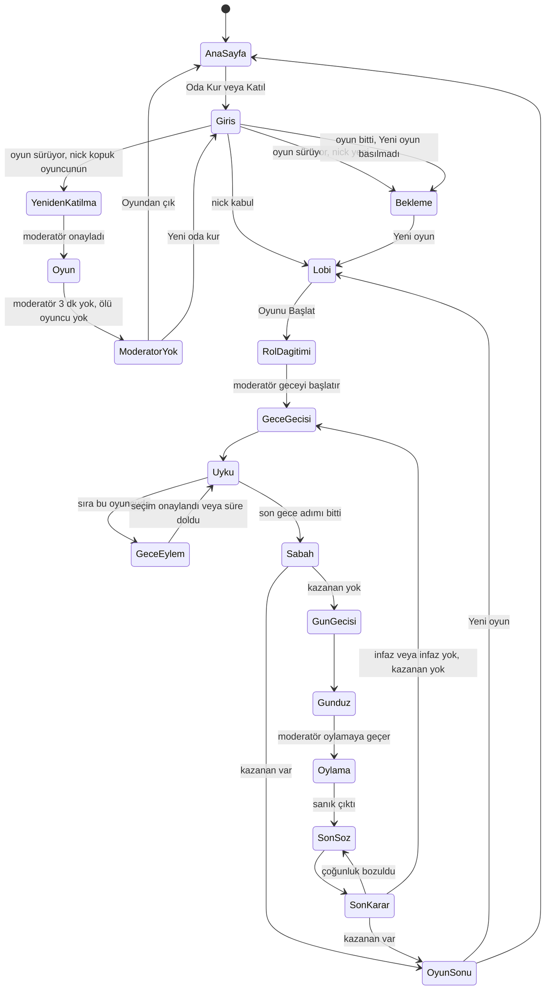

# Etkileşim Şartnamesi — Gulyabani–Köylü (çalışma adı)

Ekranların nasıl davrandığı: dokunma ve klavye karşılıkları, ekranlar arası geçişler, süreler, her parçanın durumları ve ekran okuyucunun ne söylediği. Ekranlar `mockups.md` (M-01…M-18), renk ve parça adları `design-system-mapping.md`, erişilebilirlik denetimi `accessibility-checklist.md` dosyasındadır. Parça şartnameleri `.claude/knowledge/aidlc-design-agent/component-spec-template.md` biçimindedir.

## Sources

- [desc] Initial description: "gulyabani-koylu-intent.md dosyasındaki oyunu sıfırdan geliştir. Sadece v1 kapsamı; v2 maddeleri kapsam dışı."
- [scope] Workflow-selected scope: `mvp`.
- Kaba taslaklar ve akışlar: `ideation/rough-mockups/wireframes.md` (wireframes) ve `ideation/rough-mockups/user-flow.md` (user-flow, F-01…F-12).
- Gereksinimler: `inception/requirements-analysis/requirements.md` (requirements; FR1–FR18, NFR7–NFR10, NFR14).
- Kullanıcı hikâyeleri: `inception/user-stories/stories.md` (stories) ve inceleme notu user-stories R-01.
- Ekip çalışma biçimi: `inception/practices-discovery/team-practices.md` (team-practices; yürüyen iskelet, test sırası).
- [Q1]–[Q4]: `refined-mockups-questions.md` (özet onayı: Looks correct).
- Sahibin onay kapısındaki düzeltmeleri (2026-10-31): moderatör kaybolursa ne olacağı, bekleyenler ve art arda çıkarma, odayı yeni isteklere kapatma, yeniden katılma onayına "Emin misin?" adımı.

## Etkileşim İlkeleri

- **Her ekranda tek ana eylem.** Ana düğme her zaman ekranın altında, başparmağın ulaştığı yerdedir; moderatörün "Sonraki Adım" düğmesi her fazda aynı yerdedir (W-09).
- **Hatayı önle, sonra açıkla.** Yapılamayan işlem düğmesi pasif olur ve hemen altında nedeni yazar ("En az 3 oyuncu gerekli"); hata sonradan çıkan bir uyarıyla bildirilmez (FR2.4, FR3.5, FR6.3).
- **Geri alınamayan işlemler onay ister:** oyuncu çıkarma, moderatörlük devri, yeniden katılma onayı (iki adım: "Onayla..." ve "Emin misin?"), Görücü ve gulyabani seçiminin onayı ("Seçimi Onayla"). Yeniden katılma reddi tek adımdır, çünkü kişi yeniden istek gönderebilir. Oy verme onay istemez; oy, süre bitene kadar değiştirilebilir.
- **Yazılan hiçbir şey kaybolmaz.** Gönderilemeyen mesaj, seçim, nick ve geri bildirim alanda kalır; "Tekrar dene" ile yeniden gönderilir (FR1.4, FR17.3).
- **Gizli bilgi ekranın görünüşünden de sızmaz.** Gece herkesin ekranı aynı anda ve aynı biçimde değişir; sırası gelen oyuncunun ekranı sessizce değişir (titreşim, ses, ekran okuyucu duyurusu yok; FR5.5). Faz geçiş kartı herkeste aynıdır. Kopuk durumu yalnızca moderatöre görünür.
- **Sayaçlar sunucunun saatine göredir.** Ekrandaki süre sunucudaki bitiş zamanından en fazla 1 saniye sapar; telefonun saati yanlış olsa da sayım doğrudur (FR14.8, NFR14).

## Ortak Ekran Durumları

Her ekran aşağıdaki durumları aynı biçimde gösterir (wireframes Ekran durumları):

| Durum | Görünüş | Ekran okuyucu |
|---|---|---|
| Yükleniyor (ilk açılış) | İçeriğin biçiminde soluk kutular; 5 saniyeyi geçerse "Biraz uzun sürdü, bekliyoruz..." | "Yükleniyor" |
| Yükleniyor (düğme) | Düğme pasif, yazısı "...iyor" olur ("Oda kuruluyor...", "Gönderiliyor...") | Düğmenin yeni adı |
| Boş | Küçük linol baskı çizim + açıklama + varsa eylem ("Meydan sessiz. İlk sözü sen söyle.") | Açıklama metni |
| Hata (işlem) | Alanın ya da düğmenin altında hata simgesi + "Gönderilemedi, tekrar dene."; girilen veri korunur | Hata metni hemen okunur |
| Hata (sayfa) | Tam ekran mesaj + sonraki adım düğmeleri (M-16) | Mesaj başlık olarak okunur |
| Kısmi / uç | Uzun nick ve mesajlar satıra kırılır; tek parça uzun kelime de kırılır; 26 oyunculu liste kaydırılır, başlık sabit kalır | — |
| Bağlantı yok | Üstte bağlantı şeridi (M-15); düğmeler pasif, son görünüm yerinde kalır | "Bağlantı koptu" uyarısı |

## Ekranlar Arası Geçişler



<!-- Text fallback: Ana sayfadan giriş ekranına geçilir. Nick kabul edilirse lobiye; oyun sürüyorsa ve nick yeniyse bekleme ekranına; nick kopuk bir oyuncununsa yeniden katılma ekranına geçilir, moderatör onaylarsa oyuna dönülür. Oyun bittikten sonra, "Yeni oyun" basılmadan gelen yeni kişi de bekleme ekranına geçer. Bekleme ekranındaki kişi "Yeni oyun" ile lobiye geçer. Oyun sırasında moderatör 3 dakika gelmez ve ölü oyuncu yoksa herkes "Moderatör yok" ekranına geçer; oradan ana sayfaya ya da yeni oda kurmak için giriş ekranına gidilir. Lobiden rol dağıtımına, oradan gece geçiş kartına ve uyku ekranına gidilir. Sırası gelen oyuncu gece eylem paneline geçer ve seçimden ya da süre bitiminden sonra uykuya döner. Son gece adımından sonra sabah gelir; kazanan yoksa gün geçiş kartı ve gündüz, varsa oyun sonu gelir. Gündüzden oylamaya, sanık çıkarsa son söze ve son karara geçilir; çoğunluk bozulursa son söze dönülür, değilse gece geçişine ya da kazanan varsa oyun sonuna gidilir. Oyun sonundan yeni oyunla lobiye ya da ana sayfaya dönülür. -->

- Ölen oyuncu, öldüğü an hangi durumdaysa oradan mezarlığa (M-12) geçer; oyun sonunda herkesle birlikte oyun sonu ekranına gelir.
- Moderatör bu durumların hiçbirine "geçmez": kendi ekranında (M-11) hep Akış görünür, faz adı ve tema değişir.
- Oylama sonucunda hiç oy yoksa ya da yeniden oylama sınırı dolduysa son söz atlanır, doğrudan gece geçişine gidilir (FR9.2, FR9.4).

## Faz Geçişi

[Q2] — `PhaseTransition` (aşağıda şartnamesi var).

| Ne zaman | Kart | Sonra |
|---|---|---|
| Moderatör geceyi başlatır (rol dağıtımından ya da gün sonundan sonra) | "Gece çöktü" + gece sayısı | Gece teması, Uyku ekranı |
| Sabah sonucu açıklandı, kazanan yok | "Gün ağardı" + gündüz sayısı | Gündüz teması, meydan |

- Kart 2 saniye görünür; bu sırada dokunma ve tuşlar etkisizdir, sonra kendiliğinden kaybolur. Sayaçlar kart kaybolunca başlar (kart, gündüz süresinden yemez).
- Bağlantı kart sırasında koparsa oyuncu döndüğünde kart gösterilmez; doğrudan güncel ekrana gelir.

## Gece Sırası

- Sırası gelmeyen herkes Uyku ekranında kalır. Sırası gelen oyuncunun ekranı Uyku ekranından eylem paneline **sessizce** geçer: titreşim, ses ve ekran okuyucu duyurusu yoktur (FR5.5, AC3.2.2, NFR9 istisnası).
- **Gece odak taşınmaz.** Odağı panele taşımak ekran okuyucunun yeni başlığı sesli okumasına yol açar; bu da sıranın geldiğini toplantıda duyurur. Bu yüzden gece panel, Uyku ekranının ana bölgesinin içeriği olarak yerine geçer ama odak kodla hareket ettirilmez ve sayfa başlığı değişmez (aşağıda). Ekran okuyucu kullanan oyuncu ekranı kendisi gezerek panelin açıldığını fark eder; bu, sahibin onayladığı bilinçli sapmadır (NFR9, requirements [Q17]). Klavye kullanan oyuncu Tab'a basınca ilk seçeneğe gelir.
- **Sayfa başlığı gece herkeste aynıdır:** "Gece · Oda 482913". Rolün adı ya da "sıra sende" sayfa başlığında hiçbir zaman yazmaz (tarayıcı sekmesinde görünmesin diye).
- Bu yüzden oyuncuların gece ekranlarına bakması gerekir; ilk gece anonsu bunu hatırlatır (FR13.4) ve Rehber'in sık sorulanlarında yazar (FR18.3).
- Seçim yapılıp "Seçimi Onayla"ya basılınca (ya da gulyabanilerde karar onaylanınca) panel 2 saniye "Seçimin alındı." der ve Uyku ekranına döner.
- Süre dolarsa panel "Süre doldu." der ve 2 saniye sonra Uyku ekranına döner; seçim boş geçer (FR5.7). Kopan oyuncu için süre en fazla 5 dakikaya uzar (FR14.4).
- Ölü rolün adımı moderatöre normal okunur ve 8–15 saniye sonra kendiliğinden geçer; oyuncuların ekranı bu sırada değişmez (FR5.3).

## Gündüz Oylaması

- Moderatör "Oylamaya geç" deyince herkesin ekranında oylama paneli alttan açılır; sohbet arkada görünür kalır (bilgisayarda yan sütunda).
- Oy bir dokunuşla seçilir, "Oyumu Ver" ile gönderilir. Süre bitene kadar değiştirilebilir. Süresi içinde oy vermeyenin oyu sayılmaz (FR9.1).
- Oylar canlıysa sayılar her oyda güncellenir; ekran okuyucu sayı değişimlerini **duyurmaz** (sürekli konuşmasın diye), yalnızca oylama sonucunu duyurur.
- Son söz ve son karar ekranları aynı paneli kullanır; başlık ve süre değişir (FR9.3, FR9.4).

## Yeniden Katılma Kuralı

[Q3] — user-stories R-01 çözümü. Giriş ekranında (M-02) nick yazılınca sunucu şu sırayla karar verir:

| Sıra | Koşul | Sonuç |
|---|---|---|
| 1 | Bu tarayıcı bu odadan oyun sırasında çıkarılmış | "Moderatör seni odadan çıkardı." (FR15.3) |
| 2 | Bu tarayıcı art arda 2 kez lobiden ya da bekleyenlerden çıkarılmış, 30 dakika dolmamış | "Bu odaya bir süre istek gönderemezsin. 30 dakika sonra tekrar dene." |
| 3 | Nick kuralları bozuk (uzunluk, filtre) | Alanın altında neden (FR1.4) |
| 4 | Oyun başlamadı ya da oyun bitti ("Yeni oyun" basılmadı), nick odada var | "Bu nick odada kullanılıyor, başka bir nick seç." (AC1.2.2) |
| 5 | Oda yeni isteklere kapalı, nick odada değil ya da kopuk bir oyuncunun | "Bu oda şu an yeni oyunculara kapalı." |
| 6 | Oyun başlamadı, nick yeni | Lobi |
| 7 | Oyun sürüyor ya da oyun bitti ("Yeni oyun" basılmadı), nick oyunda değil | Bekleme ekranı (M-02b) ya da oda doluysa "Bu oda dolu." (review R-03) |
| 8 | Oyun sürüyor, nick oyunda ve bağlantısı açık | "Bu oyuncu şu an oyunda. Sen o oyuncuysan, önce eski pencereyi kapat." İstek gönderilmez. |
| 9 | Oyun sürüyor, nick oyunda ve bağlantısı kopuk | "Yeniden katılma isteği gönderilsin mi?" → M-02c; moderatöre `RejoinRequest` kartı |

- Aynı anda bir oyuncu için tek istek olur; ikinci istek gelirse ilki düşer. İsteklerin kötüye kullanımı ayrıca sınırlanmaz: oda kurularak oynandığı için sorun çıkaranı moderatör çıkarır ya da odayı yeni isteklere kapatır (sahip kararı, review R-02).
- Moderatör onaylarsa (iki adım: "Onayla..." → "Emin misin?" → "Evet, onayla") eski oturum geçersiz olur, yeni tarayıcı oyuncunun yerini alır (AC9.6.2). Reddederse istek gönderen M-16 mesajını görür. Onaydan önce isteyen tarayıcıya hiçbir oyun bilgisi gitmez (AC9.6.3).
- İstek beklerken eski bağlantı geri gelirse istek kendiliğinden düşer ve istek gönderen "Bu oyuncu oyuna döndü." mesajını görür.
- Moderatör kartı, isteği gönderenin gerçekten o oyuncu olup olmadığını toplantıda sormayı hatırlatır; sistemin bunu kendi başına bilmesi mümkün değildir (hesap yok, A8).

## Bekleyenler ve Odayı Kapatma

Sahip düzeltmesi (M-02, M-02b, M-11).

- **Bekleme bir istektir.** Oyun sürerken ya da oyun bittikten sonra ("Yeni oyun" basılmadan) gelen yeni kişi bekleme ekranına geçer. Moderatör "Yeni oyun" deyince bekleyenlerin hepsi kendiliğinden lobiye alınır (FR1.6, FR17.2). Bekleyenler oda sınırına (26) sayılır (FR2.4).
- **Moderatör bekleyeni ya da lobideki kişiyi çıkarabilir** (M-11 Oyuncular > Bekleyenler, M-04 Oyuncular). Çıkarılan kişi "Moderatör seni odadan çıkardı." görür ve aynı tarayıcıyla yeniden istek gönderebilir.
- **Art arda iki çıkarma = 30 dakika.** Aynı tarayıcı aynı odadan, arada bir oyunda oynamadan, art arda 2 kez çıkarılırsa 30 dakika boyunca o odaya istek gönderemez. Sayaç kişi bir oyunda oynayınca sıfırlanır. Tarayıcıda saklanan oturum bilgisiyle tanınır; IP kullanılmaz (C-14).
- **Oyun sırasında çıkarma** (FR15) değişmez: çıkarılan kişi ölmüş sayılır ve o odaya bir daha giremez (FR15.3).
- **Yeni isteklere kapat** anahtarı (lobide ve oyun sırasında): açıkken yeni gelen kimse bekleme ekranına geçemez ve yeniden katılma isteği gönderilemez; gelen kişi "Bu oda şu an yeni oyunculara kapalı." görür. Bekleyenler ve odadakiler etkilenmez. Anahtar yeni oyunda da açık kalır; moderatör istediği an kapatır. Oyunculara anahtarın durumu gösterilmez.

## Moderatör Kaybolursa

Sahip düzeltmesi; FR14.5'teki "oda silinene kadar beklenir" kuralının yerine geçer (M-18, review R-01).

| Sıra | Ne zaman | Ne olur |
|---|---|---|
| 1 | Moderatörün bağlantısı koptu | Oyun ve bütün sayaçlar durur; herkes "Moderatör bekleniyor. Oyun duraklatıldı." ve 3 dakikalık geri sayımı görür. Moderatör dönerse oyun kaldığı yerden sürer. |
| 2 | 3 dakika doldu, en az bir ölü oyuncu var | Bütün ölülere `ModeratorOffer` kartı gider. Yaşayanlar "Moderatör yok. Ölü oyunculara moderatörlük teklif edildi." şeridini görür. |
| 3 | Bir ölü "Moderatör ol" dedi | İlk kabul eden moderatör olur; diğer kartlar kapanır. Herkes "Ali artık moderatör." görür. Yeni moderatörün ekranı M-11'e döner, oyun duraklamış açılır; "Devam et" ile sürer. |
| 4 | 3 dakika doldu, ölü yok; ya da bütün ölüler "Hayır" dedi | Herkes "Moderatör yok" ekranını görür: [Yeni oda kur] [Oyundan çık]. Roller açılmaz. |
| 5 | Eski moderatör 2. ya da 4. adımda döndü | Teklif kapanır ya da "Moderatör yok" ekranı kalkar; oyun eski moderatörle sürer: "Moderatör döndü. Oyun sürüyor." |
| 6 | Eski moderatör yeni moderatör seçildikten sonra döndü | "Moderatörlük Ali'ye geçti. Ali isterse sana geri devredebilir." Eski moderatör oyunu izleyici olarak görür, hiçbir yere yazamaz. |

- **Devretme (oyun sırasında):** yeni moderatör Akış'taki [Moderatörlüğü devret...] ile başka bir ölü oyuncuya ya da dönen eski moderatöre devreder. Seçilen kişiye `ModeratorOffer` kartı (aynı 10 saniye kuralıyla) gider; "Hayır" derse moderatörlük devredende kalır. Devretme ConfirmDialog ile onaylanır.
- **Gizlilik:** teklif yalnızca ölülere gider; ölü olmak herkesin bildiği bir bilgidir. Şeritler ve ekranlar her oyuncuda aynıdır; gece sırası belli olmaz. Yeni moderatör herkesin rolünü görür; ölü olduğu için bu bilgiyle oyunu etkileyemez.
- **İskelet:** bu kural iskelette yoktur; iskelette moderatör koparsa oyun duraklar ve moderatör dönene kadar beklenir.

## Zamanlayıcılar ve Süre Kontrolü

| Süre | Varsayılan | Kim görür | Son 10 saniye |
|---|---|---|---|
| Gündüz (meydan) | 4 dk | Herkes (faz şeridinde) | Sayı `color.warning` olur |
| Oylama / son karar | 20 sn | Herkes | Aynı |
| Son söz | 30 sn | Herkes | Aynı |
| Gulyabani kararı | 90 sn | Yaşayan gulyabaniler, moderatör | Aynı |
| Diğer gece seçimleri | 60 sn | Yalnızca sırası gelen, moderatör | Aynı |
| Celalli Damat | 30 sn | Celalli Damat, moderatör | Aynı |
| Moderatör beklemesi | 3 dk (sabit) | Herkes (şeritte) | Aynı |
| Moderatörlük teklifinde düğmelerin açılması | 10 sn (sabit) | Teklif alan ölü oyuncu | — |
| Art arda iki çıkarmadan sonra istek yasağı | 30 dk (sabit) | Gösterilmez; yalnızca mesajda yazar | — |

- Moderatör "Süre +30 sn" ve "Duraklat / Devam et" düğmeleriyle süreyi değiştirir; değişiklik herkeste aynı anda görünür ve "Moderatör süreyi uzattı (+30 sn)." kısa mesajı çıkar (FR8.1, AC5.1.3).
- Gündüz meydan süresi için ek olarak "+2 dk" düğmesi vardır (sürenin dolduğu anda çıkan hatırlatmada).
- Ekran okuyucu kalan süreyi gece panellerinde ve oylamada her 30 saniyede bir, son 10 saniyede bir kez okur (wireframes W-07).

## Parça Şartnameleri

### Button

| Field | Value |
|---|---|
| Component | `Button` |
| Description | Eylem düğmesi; ana, ikincil, tehlikeli ve sade türleri vardır |
| Category | input |

#### States

| State | Description | Trigger |
|---|---|---|
| default | Ana: `color.accent` zemin, `color.on-accent` yazı; ikincil: kenar çizgili | page load |
| hover | Zemin biraz koyulaşır (yalnızca fareyle) | mouseover |
| focus | 3 piksel odak halkası | Tab key / click |
| pressed | 100 ms küçülme (hareket azaltmada yok) | basma |
| disabled | `color.disabled-text`; hemen altında neden metni | `disabled=true` |
| loading | Yazı "...iyor" olur, yanında küçük dönen işaret; basılamaz | async op in progress |
| error | Altında hata simgesi + metin; düğme yeniden etkin | validation failure / ağ hatası |

#### Props / Inputs

| Prop | Type | Required | Default | Description |
|---|---|---|---|---|
| `variant` | `primary \| secondary \| danger \| quiet` | no | `primary` | Görünüş türü |
| `label` | string | yes | — | Metin dosyasındaki anahtar |
| `disabled` | boolean | no | `false` | Pasif mi |
| `disabledReason` | string | no | — | Pasifken altında yazan neden |
| `loadingLabel` | string | no | — | Yüklenirken yazı |
| `onPress` | function | yes | — | Basınca çalışan işlem |

#### Responsive Behaviour

| Breakpoint | Behaviour |
|---|---|
| mobile (<768px) | Ana düğme tam genişlik, en az 48 piksel yükseklik |
| tablet (768–1024px) | Ana düğme en fazla 400 piksel |
| desktop (>1024px) | İçeriğe göre genişlik, en az 160 piksel |

#### Accessibility

| Requirement | Implementation |
|---|---|
| ARIA role | Yerel `button` öğesi |
| Keyboard interaction | Tab ile odak, Enter ya da Boşluk ile basma |
| Label / aria-label | Görünen metin; neden metni `aria-describedby` ile bağlı |
| Contrast ratio | WCAG AA (4.5:1 text, 3:1 UI components); değerler `design-system-mapping.md` |
| Screen reader | "Oyunu Başlat, düğme, devre dışı. En az 3 oyuncu gerekli." |
| Focus management | Basınca odak yerinde kalır; ekran değişirse yeni ekranın başlığına gider |

#### Usage Example

```
<Button variant="primary" label="lobby.start" disabled disabledReason="lobby.needThreePlayers" onPress={startGame} />
```

### Toggle ve Stepper

| Field | Value |
|---|---|
| Component | `Toggle` (anahtar), `Stepper` (adet seçici) |
| Description | Rol ve ayarları açıp kapatma; sayı ve süreleri izinli aralıkta artırıp azaltma |
| Category | input |

#### States

| State | Description | Trigger |
|---|---|---|
| default | Anahtarda "AÇIK"/"KAPALI" yazısı ve konum; seçicide değer ve birim | page load |
| focus | Odak halkası | Tab key / click |
| disabled | Kilitli (Gulyabani, Köylü) ya da oyun başladı; yanında kilit simgesi | `locked=true` |
| error | Elle yazılan aralık dışı değer: "1–15 dk arasında olmalı" | validation failure |
| limit | Seçici en alt/üst değerde: o yöndeki düğme pasif | değer = sınır |

#### Props / Inputs

| Prop | Type | Required | Default | Description |
|---|---|---|---|---|
| `value` | boolean \| number | yes | — | Mevcut değer |
| `min`, `max`, `step` | number | Stepper için yes | — | İzinli aralık (FR2.6) |
| `unit` | string | no | — | "dk", "sn", "%" |
| `locked` | boolean | no | `false` | Kilitli mi |
| `onChange` | function | yes | — | Değişince |

#### Responsive Behaviour

| Breakpoint | Behaviour |
|---|---|
| mobile (<768px) | Etiket solda, kontrol sağda, tek satır; etiket uzunsa iki satıra kırılır |
| tablet (768–1024px) | Aynı |
| desktop (>1024px) | Aynı, ayarlar iki sütunda |

#### Accessibility

| Requirement | Implementation |
|---|---|
| ARIA role | Anahtar: `switch`; seçici: `spinbutton` |
| Keyboard interaction | Anahtar: Boşluk ile değiştir; seçici: Yukarı/Aşağı ok ile artır/azalt, Home/End ile sınır |
| Label / aria-label | Görünen etiket bağlı ("Bekçi") |
| Contrast ratio | WCAG AA; anahtarın açık/kapalı hali yazıyla da belli |
| Screen reader | "Bekçi, anahtar, açık"; "Gulyabani sayısı, 2, en az 1, en fazla 5" |
| Focus management | Değişince odak yerinde kalır |

#### Usage Example

```
<Stepper label="roles.gulyabaniCount" value={2} min={1} max={5} step={1} onChange={setCount} />
```

### ActionSheet ve ChoiceList

| Field | Value |
|---|---|
| Component | `ActionSheet` (eylem paneli), `ChoiceList` (hedef listesi) |
| Description | Gece seçimi ve oylama için alttan (gece tam ekran) açılan panel ve içindeki tek seçimli liste |
| Category | input |

#### States

| State | Description | Trigger |
|---|---|---|
| default | Başlık, kalan süre, liste, onay düğmesi | sıra geldi / oylama başladı |
| focus | Seçili satırda odak halkası | ok tuşları |
| selected | Satırda dolu daire + "seçtin" yazısı | dokunma / Boşluk |
| disabled | Onay düğmesi pasif + neden ("Herkes aynı kişiyi seçmeli.") | kural sağlanmadı |
| loading | "Gönderiliyor..." | gönderim |
| error | "Gönderilemedi, tekrar dene."; seçim korunur | ağ hatası |
| empty | "Seçilecek kimse yok." (ör. tek yaşayan kalmışsa) | liste boş |
| timeout | "Süre doldu." ve panel kapanır | süre bitti |

#### Props / Inputs

| Prop | Type | Required | Default | Description |
|---|---|---|---|---|
| `title` | string | yes | — | "Bir evi yokla" |
| `options` | list (oyuncu) | yes | — | Yalnızca yaşayan ve kurala uygun oyuncular (FR5.6) |
| `multi` | number | no | 1 | Görücü için 2 |
| `annotations` | map | no | — | Gulyabani işaretleri, oy sayıları |
| `deadline` | time | yes | — | Sunucudaki bitiş zamanı |
| `onConfirm` | function | yes | — | Onaylanınca |

#### Responsive Behaviour

| Breakpoint | Behaviour |
|---|---|
| mobile (<768px) | Gece: tam ekran; gündüz: alttan, ekranın en fazla %80'i, kendi içinde kayar |
| tablet (768–1024px) | Gündüz: ekranın ortasında 560 piksel genişlikte |
| desktop (>1024px) | Gündüz: sağ sütunun üstünde; sohbet görünür kalır [Q4] |

#### Accessibility

| Requirement | Implementation |
|---|---|
| ARIA role | Panel: `dialog` (gündüz) / sayfanın ana bölgesi (gece); liste: `radiogroup` |
| Keyboard interaction | Tab ile listeye gir, ok tuşlarıyla gez, Boşluk ile seç, Tab ile onay düğmesine geç; gündüz panelinde Esc paneli küçültür ama oylamayı iptal etmez |
| Label / aria-label | Başlık `aria-labelledby` |
| Contrast ratio | WCAG AA |
| Screen reader | "Bir evi yokla, 8 seçenek. Ali, 1/8." Seçimde "Can seçildi." Kalan süre her 30 sn'de; gece sıranın gelmesi duyurulmaz (NFR9 istisnası) |
| Focus management | Gündüz: açılınca odak başlığa, kapanınca açılmadan önceki öğeye. Gece: odak kodla taşınmaz (bkz. Gece Sırası); kapanınca odak Uyku ekranının ana bölgesine |

#### Usage Example

```
<ActionSheet title="night.watchman.title" deadline={endsAt}><ChoiceList options={alivePlayersExceptSelf} onConfirm={submit} /></ActionSheet>
```

### RoleCard

| Field | Value |
|---|---|
| Component | `RoleCard` |
| Description | Rol kartı; kapalı (arka yüz) ve açık (ön yüz) hali, çevirme |
| Category | display |

#### States

| State | Description | Trigger |
|---|---|---|
| default | Arka yüz (herkeste aynı) + "Açmak için dokun" | page load |
| focus | Kartın çevresinde odak halkası | Tab key |
| open | Ön yüz: ad, çizim, taraf simgesi + yazısı, yetenek, atmosfer sözü | dokunma / Enter / Boşluk |
| loading | Arka yüz + "Kartın hazırlanıyor..." | kart bilgisi gelmedi |
| revealed | Ölünce herkese açılan kart: altında oyuncunun adı, üstünde ölüm nedeni | ölüm |
| soluk | Rehber'de bu odada olmayan rol: soluk + "bu odada yok" | oda filtresi |

#### Props / Inputs

| Prop | Type | Required | Default | Description |
|---|---|---|---|---|
| `role` | rol kimliği | yes | — | Kart veri kaynağından (FR18.5) |
| `faceUp` | boolean | no | `false` | Açık mı |
| `owner` | string | no | — | Açılmış kartta oyuncu adı |
| `size` | `small \| medium \| large` | no | `medium` | Lobi listesi / oyun / Rehber ayrıntısı |

#### Responsive Behaviour

| Breakpoint | Behaviour |
|---|---|
| mobile (<768px) | Oran 5:7, ekran genişliğinin en fazla %80'i |
| tablet (768–1024px) | En fazla 320 piksel genişlik |
| desktop (>1024px) | En fazla 360 piksel genişlik |

#### Accessibility

| Requirement | Implementation |
|---|---|
| ARIA role | `button` (`aria-pressed` açık/kapalı) |
| Keyboard interaction | Enter ya da Boşluk ile çevir |
| Label / aria-label | Kapalıyken "Rol kartın, kapalı"; açıkken rol adı |
| Contrast ratio | Kart metinleri kart yüzeyinde, 4.5:1 üstü (AC11.3.3) |
| Screen reader | Açılınca: "Bekçi. Köylüler tarafı. Her gece bir evi yoklar." Atmosfer sözü okunur, çizimin kısa açıklaması vardır |
| Focus management | Çevirince odak kartta kalır |

#### Usage Example

```
<RoleCard role="watchman" faceUp={isOpen} onToggle={toggle} />
```

### ChatPanel ve MessageMenu

| Field | Value |
|---|---|
| Component | `ChatPanel`, `MessageMenu` |
| Description | Mesaj listesi, yazma alanı, salt okunur hali ve mesajın şikayet menüsü |
| Category | input / display |

#### States

| State | Description | Trigger |
|---|---|---|
| default | Mesajlar eskiden yeniye; en altta yazma alanı + "Gönder" | page load |
| empty | "Meydan sessiz. İlk sözü sen söyle." / "Burada henüz yalnızsın." | mesaj yok |
| readonly | Yazma alanı yok; yerinde neden ("Bu sohbeti yalnızca okuyabilirsin.", "Son söz sırasında yalnızca sanık yazabilir.") | kanal kuralı (FR16.1) |
| closed | Gece gündüz sohbeti: "Gece sohbet kapalı." | gece |
| sending | Mesaj soluk görünür, "gönderiliyor" | gönderim |
| error | Mesajın yanında "Gönderilemedi, tekrar dene." ve metin silinmez | ağ hatası |
| limit | 300 karakter aşıldı: "Gönder" pasif, "En fazla 300 karakter" | uzunluk (FR16.2) |
| rate-limited | "Biraz yavaş: birkaç saniye bekle." | 10 sn'de 6. mesaj (NFR7) |
| reported | Moderatörde: bayrak + "Şikayet edildi (Can)" | şikayet (FR13.3) |

#### Props / Inputs

| Prop | Type | Required | Default | Description |
|---|---|---|---|---|
| `channel` | `day \| gulyabani \| graveyard` | yes | — | Kanal |
| `canWrite` | boolean | yes | — | Sunucunun izni |
| `readonlyReason` | string | no | — | Yazamama nedeni |
| `messages` | list | yes | — | Filtreden geçmiş düz metin mesajlar (FR16.3) |
| `onReport` | function | no | — | Şikayet; kendi mesajında görünmez |

#### Responsive Behaviour

| Breakpoint | Behaviour |
|---|---|
| mobile (<768px) | Sohbet sekmesinde tam yükseklik; klavye açılınca yazma alanı klavyenin üstünde kalır |
| tablet (768–1024px) | Aynı |
| desktop (>1024px) | Sol sütun [Q4]; Enter gönderir, Shift+Enter yeni satır |

#### Accessibility

| Requirement | Implementation |
|---|---|
| ARIA role | Mesaj listesi: `log` (`aria-live="polite"`) |
| Keyboard interaction | Yazma alanında Enter gönderir; her mesajın yanındaki menü düğmesi (Tab ile ulaşılır) "Şikayet et"i açar; menüde ok tuşları ve Esc |
| Label / aria-label | Yazma alanı: "Mesaj yaz, Meydan sohbeti" |
| Contrast ratio | WCAG AA |
| Screen reader | Yeni mesaj: "Can: Dün gece kim nerdeydi?" (NFR9). Kendi mesajı duyurulmaz |
| Focus management | Gönderince odak yazma alanında kalır; şikayet menüsü kapanınca odak menü düğmesine döner |

#### Usage Example

```
<ChatPanel channel="day" canWrite={isAlive && isDay} messages={dayMessages} onReport={report} />
```

### StatusBanner

| Field | Value |
|---|---|
| Component | `StatusBanner` |
| Description | Ekranın en üstünde bağlantı, moderatör bekleniyor ve duraklatma şeritleri (M-15) |
| Category | feedback |

#### States

| State | Description | Trigger |
|---|---|---|
| reconnecting | "Bağlantı koptu. Yeniden bağlanılıyor..." + [Sorun bildir] | bağlantı koptu |
| restored | "Tekrar oyundasın." 3 sn sonra kaybolur | bağlantı geldi |
| failed | "Bağlanamadık. İnternetini kontrol edip sayfayı yenile." + [Sayfayı yenile] | 60 sn |
| paused | "Moderatör bekleniyor. Oyun duraklatıldı." + "2:41 sonra yeni moderatör aranacak." | moderatör koptu (FR14.5, sahip düzeltmesi) |
| offer-sent | "Moderatör yok. Ölü oyunculara moderatörlük teklif edildi." | 3 dk doldu, ölü var |
| new-moderator | "Ali artık moderatör. Oyun Ali devam edince sürecek." | bir ölü teklifi kabul etti |
| info | "Moderatör oyunu duraklattı." | duraklatma |

#### Props / Inputs

| Prop | Type | Required | Default | Description |
|---|---|---|---|---|
| `kind` | yukarıdaki durumlar | yes | — | Şerit türü |
| `onReport` | function | no | — | "Sorun bildir" (FR17.5) |

#### Responsive Behaviour

| Breakpoint | Behaviour |
|---|---|
| mobile (<768px) | Tam genişlik, faz şeridinin üstünde; içerik aşağı kayar, üstüne binmez |
| tablet (768–1024px) | Aynı |
| desktop (>1024px) | Aynı |

#### Accessibility

| Requirement | Implementation |
|---|---|
| ARIA role | Kopma ve başarısızlık: `alert`; geri gelme ve bilgi: `status` |
| Keyboard interaction | "Sorun bildir" ve "Sayfayı yenile" Tab ile ulaşılır |
| Label / aria-label | Görünen metin |
| Contrast ratio | `color.warning` / `color.success` + simge |
| Screen reader | Kopma ve geri gelme duyurulur (W-13) |
| Focus management | Odağı çalmaz; kullanıcı neredeyse orada kalır |

#### Usage Example

```
<StatusBanner kind="reconnecting" onReport={openReport} />
```

### PhaseTransition

| Field | Value |
|---|---|
| Component | `PhaseTransition` |
| Description | 2 saniyelik "Gece çöktü" / "Gün ağardı" kartı [Q2] |
| Category | feedback |

#### States

| State | Description | Trigger |
|---|---|---|
| default | Tam ekran kart, SVG başlık, faz sayısı | faz değişimi |
| reduced-motion | Aynı kart, hareketsiz belirir ve kaybolur | hareket azaltma tercihi |
| skipped | Gösterilmez | oyuncu kart sırasında koptu ve sonra döndü; moderatör ekranı |

#### Props / Inputs

| Prop | Type | Required | Default | Description |
|---|---|---|---|---|
| `phase` | `night \| day` | yes | — | Hangi kart |
| `number` | number | yes | — | Gece/gündüz sayısı |
| `durationMs` | number | no | 2000 | Görünme süresi |

#### Responsive Behaviour

| Breakpoint | Behaviour |
|---|---|
| mobile (<768px) | Tam ekran |
| tablet (768–1024px) | Tam ekran |
| desktop (>1024px) | Tam ekran (bilgi sızmasın diye düzen değişmez) |

#### Accessibility

| Requirement | Implementation |
|---|---|
| ARIA role | `status` |
| Keyboard interaction | Yok; 2 saniye içinde tuşlar etkisiz |
| Label / aria-label | Başlık gerçek metindir (resim değil): "Gece çöktü. Gece 2." |
| Contrast ratio | Metin `color.transition-bg` üstünde 13:1'in üstü |
| Screen reader | "Gece 2 başladı." (faz değişimi duyurusu) |
| Focus management | Kart kaybolunca odak yeni ekranın başlığına |

#### Usage Example

```
<PhaseTransition phase="night" number={2} />
```

### ConfirmDialog ve RejoinRequest

| Field | Value |
|---|---|
| Component | `ConfirmDialog`, `RejoinRequest` |
| Description | Geri alınamayan işlem onayı; moderatöre gelen yeniden katılma onay kartı [Q3] ve onun "Emin misin?" adımı |
| Category | feedback |

#### States

| State | Description | Trigger |
|---|---|---|
| default | Soru + iki düğme (tehlikeli işlem solda değil sağda; "Vazgeç" her zaman var). `RejoinRequest` kartında [Onayla...] [Reddet] | işlem istendi |
| confirm-step | `RejoinRequest` için ikinci adım: "Emin misin? Bu tarayıcı Fırat'ın yerine geçecek ve Fırat'ın rolünü görecek. Yanlış kişiyse gizli bilgi ona gider." [Vazgeç] [Evet, onayla] (sahip düzeltmesi, review R-05) | [Onayla...] basıldı |
| focus | Onay penceresinde ve "Emin misin?" adımında ilk odak "Vazgeç"tedir; `RejoinRequest` kartı gelince odak kartın başlığına gitmez, moderatör karta kendisi geçer (yanlışlıkla onayı önler) | açılış |
| loading | "İşleniyor..." | onay gönderildi |
| error | "Yapılamadı. Tekrar dene." | ağ hatası |
| expired | `RejoinRequest`: "İstek düştü (oyuncu döndü / süre doldu)." | eski bağlantı geldi ya da 5 dk |

#### Props / Inputs

| Prop | Type | Required | Default | Description |
|---|---|---|---|---|
| `message` | string | yes | — | "Ali odadan çıkarılsın mı? Bu geri alınamaz." |
| `confirmLabel` | string | yes | — | "Çıkar", "Devret", "Onayla" |
| `danger` | boolean | no | `true` | Tehlikeli işlem mi |
| `disconnectedFor` | süre | RejoinRequest için yes | — | "3 dakikadır kopuk" |

#### Responsive Behaviour

| Breakpoint | Behaviour |
|---|---|
| mobile (<768px) | Alttan açılan panel; düğmeler alt alta |
| tablet (768–1024px) | Ortada kutu, 420 piksel |
| desktop (>1024px) | Ortada kutu; `RejoinRequest` Akış sütununun üstünde kart |

#### Accessibility

| Requirement | Implementation |
|---|---|
| ARIA role | `alertdialog` |
| Keyboard interaction | Odak kutunun içinde kalır; Esc = Vazgeç; Tab ile düğmeler arasında |
| Label / aria-label | Soru metni `aria-labelledby` |
| Contrast ratio | WCAG AA |
| Screen reader | Soru açılınca okunur; `RejoinRequest` gelince moderatöre "Ali yeniden katılmak istiyor." duyurulur |
| Focus management | Kapanınca odak açan düğmeye döner |

#### Usage Example

```
<ConfirmDialog message="lobby.kickConfirm" confirmLabel="lobby.kick" danger onConfirm={kick} />
```

### ModeratorOffer

| Field | Value |
|---|---|
| Component | `ModeratorOffer` |
| Description | Moderatör 3 dakikadır yokken ölü oyunculara (ya da devretmede seçilen kişiye) giden "Moderatör olur musun?" kartı (M-18) |
| Category | feedback |

#### States

| State | Description | Trigger |
|---|---|---|
| default | Başlık, açıklama, [Moderatör ol] ve [Hayır] pasif; düğmenin üstünde 10 saniyelik geri sayım | teklif geldi |
| ready | 10 saniye doldu; iki düğme etkin | 10 sn |
| loading | "İşleniyor..." | basıldı |
| taken | "Ali moderatör oldu." Kart kapanır | başka biri önce kabul etti |
| cancelled | "Moderatör döndü." Kart kapanır | eski moderatör döndü |
| error | "Yapılamadı. Tekrar dene." | ağ hatası |

#### Props / Inputs

| Prop | Type | Required | Default | Description |
|---|---|---|---|---|
| `reason` | `moderator-gone \| handover` | yes | — | 3 dakikalık yokluk mu, devretme mi |
| `fromName` | string | no | — | Devretmede devredenin adı ("Ali sana moderatörlüğü devretmek istiyor.") |
| `unlockAfterMs` | number | no | 10000 | Düğmelerin açılma süresi |
| `onAccept`, `onDecline` | function | yes | — | Yanıt |

#### Responsive Behaviour

| Breakpoint | Behaviour |
|---|---|
| mobile (<768px) | Mezarlık ekranının üstünde tam genişlik panel; düğmeler alt alta, tam genişlik |
| tablet (768–1024px) | Ortada kutu, 420 piksel |
| desktop (>1024px) | Ortada kutu, 420 piksel |

#### Accessibility

| Requirement | Implementation |
|---|---|
| ARIA role | `alertdialog` |
| Keyboard interaction | Odak kutunun içinde kalır; Tab ile düğmeler arasında; Esc kartı kapatmaz (yanıt beklenir) |
| Label / aria-label | Başlık `aria-labelledby`, açıklama `aria-describedby` |
| Contrast ratio | WCAG AA; pasif düğme `color.disabled-text` |
| Screen reader | Gelince başlık ve açıklama okunur; düğmeler açılınca bir kez "Artık seçebilirsin." denir |
| Focus management | Açılınca odak başlığa; kapanınca mezarlık ekranının başlığına ya da (kabul edince) moderatör ekranının başlığına |

#### Usage Example

```
<ModeratorOffer reason="moderator-gone" unlockAfterMs={10000} onAccept={becomeModerator} onDecline={decline} />
```

### Diğer Parçalar (kısa)

| Parça | Davranış | Klavye | Ekran okuyucu |
|---|---|---|---|
| `BottomTabBar` | 4 sekme, seçili sekme simge + kalın yazı + üst çizgi; yeni sohbet mesajında Sohbet sekmesinde sayı rozeti | Sol/sağ ok ile gez, Enter ile aç | `tablist`; "Sohbet, sekme, 3 yeni mesaj" |
| `TopTabs` | Moderatör ve Rehber sekmeleri | Sol/sağ ok, Tab ile panele | `tablist` |
| `PhaseBar` | Faz adı, sayı, `Countdown`, [?] | [?] Tab ile ulaşılır | Faz adı başlık (h1) olarak; faz değişimi duyurulur |
| `Countdown` | Sunucu bitiş zamanına göre dk:sn; son 10 sn `color.warning`; duraklayınca yanında duraklama simgesi | — | Her 30 sn'de bir okunur (yalnızca seçim panellerinde) |
| `PlayerRow` | Ad, durum yazısı, rozet, açılmış rol; ölü soluk + "(öldü)" | Satır odaklanabilir (moderatörde ayrıntı açar) | "Ali, öldü, Ürkek" |
| `Badge` | Simge + yazı ("Ahbap", "Sevdalı", "kopuk", "Gördüm") | — | Yazısı okunur |
| `GuideOverlay` | Katman; arkada oyun sürer; faz değişince üstte şerit | Esc kapatır, odak içinde kalır | `dialog`; kapanınca odak açan düğmeye |
| `FeedbackFaces` | Üç seçenek, simge + yazı | Ok tuşlarıyla gez, Boşluk seç | `radiogroup`, "Oyun nasıldı?" |
| `PrivacyNotice` | Kısa metin + [Ayrıntı] aynı sayfada açılır | Enter ile aç/kapa | `aria-expanded` |
| `Toast` | 4 sn görünür, kendiliğinden kaybolur; önemli bilgi taşımaz | — | `status` |
| `EmptyState` | Çizim + açıklama + eylem | Eylem düğmesi Tab ile | Açıklama okunur, çizim gizli |
| `MessageScreen` | Tam ekran mesaj + düğmeler (M-16, M-18 "Moderatör yok") | İlk düğme odakta | Mesaj h1 olarak |
| `WaitingList` | Moderatörde bekleyenlerin adları ve [Çıkar]; bekleyen yoksa görünmez | Satırlar ve düğmeler Tab ile | "Bekleyenler, 1 kişi. Selin" |

## Assumptions & Open Questions

- [assumption] Oylarda canlı sayı değişimleri ekran okuyucuya duyurulmaz, yalnızca sonuç duyurulur; sürekli konuşma oyunu takip etmeyi zorlaştırır.
- [assumption] Onay pencerelerinde ve yeniden katılmanın "Emin misin?" adımında ilk odak "Vazgeç" düğmesindedir; yanlışlıkla geri alınamaz işlem yapılmasını önler.
- [assumption] Moderatörlük teklifi kartında Esc kartı kapatmaz; ölü oyuncunun açık bir yanıt vermesi beklenir. Teklifi kimse yanıtlamazsa kart açık kalır.
- [assumption] Art arda iki çıkarma sayacı kişi bir oyunda oynayınca sıfırlanır; "aynı kişi" aynı tarayıcı demektir.
- Sahip düzeltmesi FR14.5'i (moderatör beklemesi) değiştirir ve FR2.3'e art arda iki çıkarma kuralı ile "Yeni isteklere kapat" anahtarını ekler; requirements.md Fonksiyonel Tasarım'dan önce güncellenmeli.
- [assumption] Faz geçiş kartı gündüz süresinden yemez; sayaç kart kaybolunca başlar.
- Teknoloji henüz seçilmedi (requirements ISS-02); "Usage Example" satırları yalnızca parçanın nasıl çağrılacağını gösteren örnektir, gerçek sözdizimi seçilen teknolojiye göre değişir.
