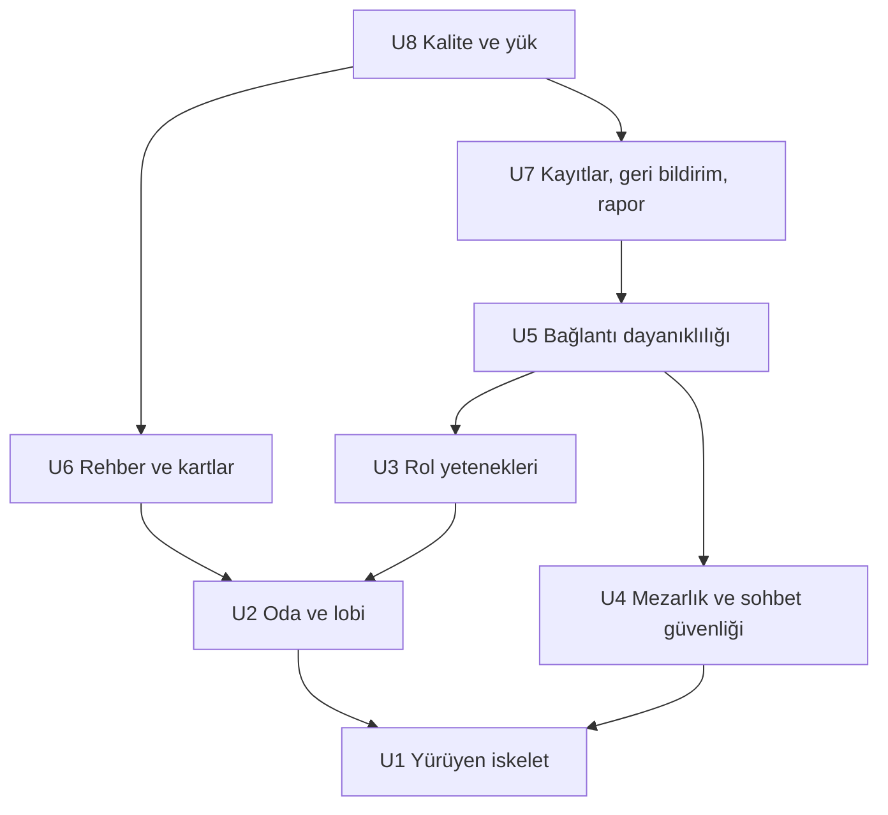

# Parçalar Arası Bağımlılıklar — Gulyabani–Köylü (çalışma adı)

Bu belge yalnızca yapıyı (hangi parça hangisine dayanır) gösterir. Hangi parçanın önce yapılacağına ve önceliğe Teslimat Planlaması karar verir; burada bir yapım sırası ya da kritik yol önerilmez.

## Sources

- Parçalar: `unit-of-work.md` (U1–U8).
- Yapı taşları ve bağımlılık yönleri: `inception/domain-design/components.md` (components).
- Mimari kararlar: `inception/domain-design/decisions.md` (decisions; ADR-003, ADR-005, ADR-006).
- Gereksinimler: `inception/requirements-analysis/requirements.md` (requirements).
- Kullanıcı hikâyeleri: `inception/user-stories/stories.md` (stories).
- Ekip çalışma biçimi: `inception/practices-discovery/team-practices.md` (yürüyen iskelet AÇIK).
- [Q1]: `units-generation-questions.md` — 8 parça (A), özet onayı: Looks correct.

## Bağımlılık Kuralı

Bir parça, kodu ya da testleri derlenmek veya geçmek için kodu gereken her parçaya dayanır. Aralarında ok olmayan parçalar aynı anda, her biri projenin kendi kopyasında yazılabilir; bu yüzden her parçanın kodu ve testleri, yalnızca kendi kodu, dayandığı parçalar ve projenin o anki hâliyle geçmelidir.

## Bağımlılık Tablosu

| Parça | Doğrudan dayandığı | Neden |
|---|---|---|
| U1 u1-walking-skeleton | — | İlk ve kendi başına çalışan tam oyun |
| U2 u2-room-and-lobby | U1 | İskeletin oda, lobi ve giriş kodunu genişletir |
| U3 u3-role-abilities | U2 | Rolleri oyuna sokmak için rol havuzu ve 9 rolün tanımları gerekir; oyunda çıkarma, U2'nin çıkarma kaydını kullanır |
| U4 u4-graveyard-and-chat-safety | U1 | İskeletin ölüm, sohbet ve görünüm koduna mezarlık ve filtre ekler |
| U5 u5-connection-resilience | U3, U4 | Kopan oyuncu uzatması rol adımlarını (U3), moderatörlük teklifi ölüler ve Mezarlık Sohbeti kuralını (U4), yeniden katılma isteği giriş kuralını (U2, U3 üzerinden) kullanır |
| U6 u6-guide-and-cards | U2 | Rehber 9 rolün katalog tanımlarını ve odanın rol havuzunu ("Bu odada aktif roller") kullanır |
| U7 u7-records-feedback-report | U5 | Kayda bağlanacak olayların hepsi (oda, çıkarma, roller, mezarlık şikayeti, kopma, moderatör işlemleri) U1–U5'te üretilir; 24 saat silme bütün oda ve oyun verisini kapsar |
| U8 u8-quality-and-load | U6, U7 | Gizli bilgi, erişilebilirlik ve yük denetimi bütün özellikler ve ekranlar yerindeyken yapılır |

## Bağımlılık Diyagramı



<!-- Text fallback: Oklar "dayanır" yönündedir. U2 ve U4, U1'e dayanır. U3 ve U6, U2'ye dayanır. U5, U3 ve U4'e dayanır. U7, U5'e dayanır. U8, U6 ve U7'ye dayanır. Döngü yoktur. -->

## Makine Okunur Bağımlılık Bloğu

```yaml
units:
  - name: u1-walking-skeleton
    kind: service
    depends_on: []
  - name: u2-room-and-lobby
    kind: service
    depends_on: [u1-walking-skeleton]
  - name: u3-role-abilities
    kind: service
    depends_on: [u2-room-and-lobby]
  - name: u4-graveyard-and-chat-safety
    kind: service
    depends_on: [u1-walking-skeleton]
  - name: u5-connection-resilience
    kind: service
    depends_on: [u3-role-abilities, u4-graveyard-and-chat-safety]
  - name: u6-guide-and-cards
    kind: ui
    depends_on: [u2-room-and-lobby]
  - name: u7-records-feedback-report
    kind: service
    depends_on: [u5-connection-resilience]
  - name: u8-quality-and-load
    kind: service
    depends_on: [u6-guide-and-cards, u7-records-feedback-report]
```

## Yürüyen İskelet

Bağımlılık sırasındaki ilk parça U1'dir ve hiçbir parçaya dayanmaz. Kendi başına, yalnızca Gulyabani ve Köylü ile oda kurmadan oyun sonuna kadar tam bir oyun oynatır; ContentCatalog, GameRules, RoomManager, MatchFlow, VisibilityFilter, ConnectionGateway, ChatService, WebClient ve BotPlayer'ın en sade hâlini gerçek bağlantı üzerinden birbirine bağlar (`components.md` "Yürüyen iskelette kullanılan yapı taşları"). Bot oyunculu uçtan uca testle ve gerçek telefonlarda yeniden bağlanma denemesiyle doğrulanır; sahibin iskelet onayı olmadan sonraki parçalara geçilmez (team-practices Walking Skeleton). EventRecorder, FeedbackService, OwnerReport ve Housekeeping iskelette yoktur (U7).

## Parçalar Arası Bağlantı Noktaları

Bütün parçalar aynı programdadır; bağlantı, Alan Tasarımı'ndaki yapı taşı arayüzleri üzerinden doğrudan çağrı ve olaylarla yapılır (ADR-005). Ayrı ağ arayüzü yoktur. Biçimler Sözleşme Tasarımı'nda yazılır.

| Bağlantı | Parçalar | Biçim | Not |
|---|---|---|---|
| Komut → yeni durum ve olaylar (GameRules arayüzü) | U1 tanımlar; U2, U3, U5 genişletir | Doğrudan çağrı | Yeni rol ve kural aynı arayüze eklenir; arayüz U1'de sabitlenir |
| Rol tanımları (ContentCatalog verisi) | U1 yapıyı kurar; U2 9 rolü, U3 kelime listesini, U6 görsel ve Rehber içeriğini ekler | Paylaşılan salt okunur veri | Rehber ve oyun aynı kaynağı kullanır (FR18.5) |
| Alıcıya özel görünüm (VisibilityFilter) | U1 kurar; U3, U4, U5 yeni bilgi türleri ekler; U8 tamamını sınar | Doğrudan çağrı | Her yeni bilgi türü buradan geçer (ADR-002) |
| Oda ve oyun olayları (ConnectionGateway dinler) | U1 kurar; bütün parçalar olay ekler | Olay | Yapı taşları bağlantı katmanını çağırmaz (ADR-005) |
| Kayıt olayları (EventRecorder dinler) | U7 kurar ve U1–U5'in olaylarını bağlar | Olay, oyunu bekletmeyen | Kayıt hatası oyunu durdurmaz (NFR13) |
| Mesaj şikayeti | U4 odada işaretler ve olay yayınlar; U7 kalıcı kaydı yazar | Olay | ADR-006 |
| Silme tetikleri (Housekeeping) | U7 kurar; RoomManager, MatchFlow, ChatService, ConnectionGateway, EventRecorder, FeedbackService silme işlemi sunar | Doğrudan çağrı | Her veriyi sahibi siler (Alan Tasarımı R-01) |
| Ortak kalıcı veri deposu | U1 kurar; bütün parçalar kullanır | Paylaşılan depo, her yapı taşı kendi verisine yazar | Ürün NFR/altyapı aşamasında seçilir |

## Paralel Yazılabilecek Parçalar

Aralarında doğrudan ya da dolaylı bağımlılık olmayan parça çiftleri aynı anda yazılabilir:

- U2 ile U4
- U3 ile U4
- U3 ile U6
- U4 ile U6
- U5 ile U6
- U6 ile U7

Birden çok geçerli sıralama vardır (ör. U1, U2, U4, U3, U6, U5, U7, U8 ya da U1, U4, U2, U6, U3, U5, U7, U8); seçim Teslimat Planlaması'nındır.
